<a href="https://fonoster.com"></a>

> [!WARNING]
> **Major upgrades underway.** We're moving fast, so expect breaking changes and some instability for a while. We're pausing contributions for now, but bug reports are welcome: [report a bug](https://github.com/fonoster/fonoster/issues/new?template=bug_report.yaml).

# The AI that answers the phone.

[Fonoster](https://fonoster.com) is an open-source platform for building, testing, and running voice agents on real phone lines. Use Fonoster Cloud, or run it on your own servers.

 [](https://github.com/fonoster/fonoster/actions/workflows/release.yaml) [](https://discord.gg/4QWgSz4hTC) <a href="https://github.com/fonoster/fonoster/blob/main/CODE_OF_CONDUCT.md"></a>  

## Features 

The most notable features of Fonoster are:

- [x] Multitenancy
- [x] Easy deployment of PBX functionalities
- [x] Programmable Voice Applications
- [x] NodeJS SDK
- [x] Support for Amazon Simple Storage Service (S3)
- [x] Secure API endpoints with Let's Encrypt
- [x] Authentication with OAuth2
- [X] Authentication with JWT 
- [x] Role-Based Access Control (RBAC)
- [x] Plugins-based Command-line Tool
- [x] Support for Google Speech APIs

## Code Examples

### Autopilot

With Autopilot, your agent is a YAML file. Pick the speech-to-text, the voice, and the language model, then write the prompt:

```yaml
# agent.yaml
name: front-desk
type: AUTOPILOT
speechToText:
  productRef: stt.deepgram
  config:
    model: nova-3
    languageCode: multi
textToSpeech:
  productRef: tts.deepgram
  config:
    voice: aura-asteria-en
intelligence:
  productRef: llm.openai
  config:
    conversationSettings:
      firstMessage: Hi! Thanks for calling. How can I help?
      systemPrompt: You book appointments for a dental clinic. Keep your answers short.
      goodbyeMessage: Thanks for calling. Goodbye!
      systemErrorMessage: Sorry, I'm having trouble right now. Please call again later.
      idleOptions:
        message: Are you still there?
    languageModel:
      provider: openai
      model: gpt-4o
      temperature: 0.7
      maxTokens: 250
```

Deploy it with the command-line tool:

```sh
# Log in once with an API key from your workspace
npx @fonoster/ctl workspaces:login

# Create the agent
npx @fonoster/ctl applications:create -f agent.yaml
```

Then point a phone number at the new application (in the dashboard, or with `npx @fonoster/ctl sipnet:numbers:create`) and give it a call. Autopilot also supports tools, a knowledge base, and call transfers. See the [Autopilot docs](https://docs.fonoster.com/concepts/autopilot).

### Voice Applications

For full control over the call, write a Voice Application instead. Fonoster opens one signed WebSocket **session** to your app for every call ([session protocol](docs/session-protocol.md)); the SDKs for TypeScript (`@fonoster/voice`) and Python (`fonoster-voice`) wrap it. A session can:

- `say` - Speak text (or a stream of model tokens) and report what the caller heard
- `gather` - Wait for speech or keypresses
- `play` / `playDtmf` - Play a media file or DTMF tones
- `transfer` - Cold, warm or SIP REFER transfer to a number or SIP URI
- `hold` / `resume`, `handoff`, `hangup`
- `audio` - Raw call audio in and out, for your own speech stack
- Events: turns, partial transcripts, keypresses

Voice Application Example:

```typescript
const { VoiceServer } = require("@fonoster/voice");

// The gateway signs every connection; set APP_SIGNING_SECRET to the app's signing secret.
new VoiceServer({ port: 3000 }).listen(async (session) => {
  await session.say("Hi there! What's your name?");

  const { speech: name } = await session.gather();

  await session.say("Nice to meet you " + name + "!");

  await session.say("Please enter your 4 digit pin.");

  const { digits } = await session.gather({
    maxDigits: 4,
    finishOnKey: "#"
  });

  await session.say("Your pin is " + digits);

  await session.hangup();
});

// Your app lives at ws://127.0.0.1:3000
// and you can publish it to the Internet with:
// ngrok http 3000
```

Coming from the gRPC SDK? See [What changed](docs/migrating-to-sessions.md).

### Making calls

Everything in Fonoster is an API first, and initiating a call is no exception. You can use the SDK to start a call with a few lines of code.

Example of originating a call with the SDK:

```typescript
const SDK = require("@fonoster/sdk");

async function main(request) {
  const apiKey = "your-api-key";
  const apiSecret = "your-api-secret"
  const accessKeyId = "WO00000000000000000000000000000000";

  const client = new SDK.Client({ accessKeyId });
  await client.loginWithApiKey(apiKey, apiSecret);

  const calls = new SDK.Calls(client);
  const response = await calls.createCall(request);

  console.log(response); // successful response
}

const request = {
  from: "+18287854037",
  to: "+17853178070",
  appRef: "3e61ecb7-a1b6-4a93-84c3-4f1979165bca",
  // Optional metadata to be sent to the Voice Application
  metadata: {
    name: "John Doe",
    message: "Please call me back."
  }
};

main(request).catch(console.error);
```

## Getting Started

To get started with Fonoster, use the following resources:

- [Deploying Fonoster with Docker](https://docs.fonoster.com/self-hosting)
- [Guide for Early Access User](https://docs.fonoster.com/quickstart)
- [Getting started with Fonoster](https://docs.fonoster.com/quickstart)
- [How we created an open-source alternative to Twilio and why it matters](https://dev.to/fonoster/how-we-created-an-open-source-alternative-to-twilio-and-why-it-matters-434g)

### Guides in this repository

- [Try the new platform on your machine](docs/try-the-new-platform.md)
- [Session protocol](docs/session-protocol.md) and [What changed](docs/migrating-to-sessions.md)
- [Workspace webhooks](docs/webhooks.md): events, signatures, retries, migrating from `eventsHook`
- [Call records](docs/call-records.md): contents, retention and erasure, redaction, verification
- [Providers](docs/providers.md): catalog ids, your own keys, deprecation warnings
- Operators: [deployment](docs/operators/rebuild.md), [regions](docs/operators/regions.md), [provider registry](docs/operators/registry.md)

## Give a Star! ⭐

Please give it a star if you like this project or plan to use it. Thanks 🙏

## Bugs and Feedback

For bugs, questions, and discussions, please use the [Github Issues](https://github.com/fonoster/fonoster/issues)

## Contributing

For contributing, please see the following links:

 - [Contribution Documents](https://github.com/fonoster/fonoster/blob/main/CONTRIBUTING.md)
 - [Contributors](https://github.com/fonoster/fonoster/contributors)

<a href="https://github.com/fonoster/fonoster/graphs/contributors">
  
</a>

## Sponsors

We're glad to be supported by respected companies and individuals from several industries.

Find all our supporters [here](https://github.com/sponsors/fonoster)

> [Become a Github Sponsor](https://github.com/sponsors/fonoster)

## Authors

 - [Pedro Sanders](https://github.com/psanders)

## License

Copyright (C) 2026 by [Fonoster Inc](https://fonoster.com). MIT License (see [LICENSE](https://github.com/fonoster/fonoster/blob/main/LICENSE) for details).
