# QA test catalog

Generated by `node mods/conformance/catalog/build.cjs` from `mods/conformance/catalog/areas/*.cjs`. Edit the area files, not this file.

**230 test cases in 15 areas.** Every case is automated. 26 spec capabilities, all covered. 167 of 648 spec scenarios have a test (26%); the rest are listed in `uncovered-scenarios.txt` and can only shrink. 174 conformance scenario files belong to cases. Tiers: pr 91, nightly 89, release 44, production 6. 6 of 230 cases declare a proof (how the test is shown red); a test without one cannot merge.

## How the catalog is organized

- **Area:** one part of the system, with one diagram that shows the **tester** (what drives and judges the test) and the **unit under test** (what is being judged). Anything else in the path is **support**.
- **Test case:** ID, name, objective, preconditions, numbered steps, pass criteria, fail criteria, priority, type, traceability.
- **Level:** L1 component, L2 integration, L3 system, L4 acceptance (manual).
- **Priority:** P0 blocks release; P1 must pass or have a waiver; P2 tracked.
- **Automation:** every case is automated. There is no manual test. A feature is either covered by a case that a machine runs, or it is not in the catalog and the build fails (see Coverage).
- **Result:** recorded per run by the test runner in `test-cases.csv`: Not run, Pass, Fail, Blocked, Waived.
- **Proven:** a case counts only once its test has been seen red against a seeded fault (`proof`). The report counts Proven separately from Pass.
- **Tier:** pr (under 15 minutes, fakes and mocks only), nightly, release, production. Set per area, overridable per case.
- **Trials:** a stochastic case declares `trials: { k, rate }` and is judged over all k runs; passing some runs is a Fail, not a flake.
- **Flakes:** marked by data only, rerun once, quarantined for at most 14 days as Blocked.
- **Known gaps:** a case that is expected to fail today says so in its fail criteria, and stays in the catalog until fixed.

| Area | Level | Cases | P0 |
| --- | --- | --- | --- |
| [DSH Dashboard](#dsh) | L3 System (UI) | 15 | 6 |
| [API Control-plane API, SDK and CLI](#api) | L2 Integration (API) | 35 | 8 |
| [VSD Voice SDK and session protocol](#vsd) | L1 Component (SDK) | 15 | 9 |
| [CAL Call flows](#cal) | L3 System (end to end) | 18 | 8 |
| [XFR Transfers, DTMF and in-call control](#xfr) | L3 System (end to end) | 15 | 5 |
| [TRK Trunking provider](#trk) | L3/L4 System (trunk edge) | 14 | 5 |
| [ROM Roomr media node: function](#rom) | L2 Integration (node in isolation) | 15 | 11 |
| [MQ Media quality and packet loss](#mq) | L2 Integration (benchmark) | 20 | 7 |
| [LDS Load and soak](#lds) | L3 System (load) | 9 | 2 |
| [APB AppBridge](#apb) | L2 Integration (service) | 13 | 9 |
| [FLT Fault injection](#flt) | L2/L3 Integration (negative) | 12 | 8 |
| [SEC Security and isolation](#sec) | L3 System (negative) | 11 | 9 |
| [BRG Billing, metering and regions](#brg) | L3 System | 11 | 6 |
| [OPS Deployment, upgrade, Kubernetes and observability](#ops) | L3 System (operations) | 21 | 8 |
| [PRD Production synthetic checks](#prd) | L5 Production | 6 | 4 |

## Coverage by spec capability

| Capability | Cases |
| --- | --- |
| autopilot | APB-013, FLT-006, PRD-005 |
| call-record | API-023, CAL-001, CAL-007, TRK-009, ROM-009, MQ-019, APB-009, SEC-011, OPS-014 |
| capabilities | API-027, API-028, API-029 |
| conformance | VSD-014, TRK-011, TRK-012, APB-002, APB-012 |
| control-plane | DSH-015, API-001, API-002, API-003, API-004, API-005, API-006, API-007, API-008, API-009, API-010, API-011, API-012, API-013, API-014, API-015, API-016, API-019, API-021, API-022, API-023, API-024, API-026, CAL-002, CAL-006, CAL-009, CAL-010, CAL-011, CAL-012, CAL-013, CAL-014, CAL-018, XFR-015, TRK-001, TRK-002, TRK-003, TRK-004, TRK-008, TRK-009, TRK-013, TRK-014, LDS-003, OPS-004, PRD-001, PRD-002 |
| dashboard | DSH-001, DSH-002, DSH-003, DSH-004, DSH-005, DSH-006, DSH-007, DSH-009, DSH-010, DSH-011, DSH-014, PRD-006 |
| deployment | TRK-010, FLT-008, SEC-007, SEC-009, SEC-010, OPS-002, OPS-003, OPS-004, OPS-006, OPS-007, OPS-008, OPS-009, OPS-010, OPS-011 |
| developer-environment | OPS-015, OPS-016, OPS-017, OPS-018, OPS-019, OPS-020, OPS-021 |
| identity | DSH-009, API-017, API-018, API-019, API-020, CAL-017, SEC-001, SEC-004, SEC-005 |
| identity-client | DSH-008, PRD-006 |
| identity-service | API-030, API-031, API-032, API-033, API-034, API-035 |
| media-control | VSD-009, XFR-001, XFR-002, XFR-003, XFR-004, XFR-005, XFR-006, XFR-010, XFR-012, TRK-006, ROM-001, ROM-002, ROM-003, ROM-004, ROM-005, ROM-008, ROM-010, ROM-011, ROM-012, ROM-013, ROM-014, ROM-015, LDS-008, FLT-009, FLT-010, PRD-004 |
| observability | LDS-001, LDS-007, SEC-006, OPS-012, OPS-013 |
| private-regions | BRG-007, BRG-008, BRG-011 |
| provider-registry | APB-008, FLT-004, FLT-005, FLT-007 |
| regions | DSH-013, BRG-009, BRG-010, BRG-011 |
| roomr | CAL-002, CAL-003, CAL-004, CAL-005, CAL-008, CAL-015, CAL-016, CAL-017, XFR-007, XFR-013, XFR-014, TRK-001, TRK-002, TRK-003, TRK-004, TRK-005, TRK-006, TRK-007, TRK-010, TRK-013, ROM-006, ROM-007, ROM-009, ROM-015, MQ-001, MQ-002, MQ-003, MQ-004, MQ-005, MQ-006, MQ-007, MQ-008, MQ-009, MQ-010, MQ-011, MQ-012, MQ-013, MQ-014, MQ-015, MQ-016, MQ-017, MQ-018, MQ-019, MQ-020, LDS-002, LDS-004, LDS-005, LDS-008, LDS-009, SEC-002, PRD-002 |
| self-host-installer | OPS-001 |
| service-config | OPS-005 |
| talk-in-browser | DSH-012, SEC-003 |
| turn-taking | VSD-006, APB-004, APB-005, APB-013, PRD-005 |
| twilio-media-streams-flavor | VSD-012, VSD-013, VSD-015, APB-003, APB-011 |
| usage-metering | DSH-007, BRG-001, BRG-002, BRG-003, BRG-004, BRG-005, BRG-006 |
| voice-sdk | VSD-001, VSD-003, VSD-004, VSD-005, VSD-014 |
| voice-session | VSD-001, VSD-002, VSD-006, VSD-007, VSD-008, VSD-009, VSD-010, VSD-011, CAL-001, CAL-006, XFR-008, XFR-009, XFR-011, TRK-005, LDS-006, APB-001, APB-002, APB-006, APB-007, FLT-001, FLT-002, FLT-003, FLT-011, FLT-012, SEC-008, PRD-001, PRD-003 |
| workspace-webhooks | APB-010, SEC-008 |

## DSH

### Dashboard

What the user sees: every screen and state in designs/dashboard.pen, in community and cloud editions, light and dark, desktop and narrow.

| | |
| --- | --- |
| Level | L3 System (UI) |
| Unit under test | Dashboard SPA with the apiserver, identity and database behind it |
| Tester | Playwright (Chromium) in the pinned container, committed golden screenshots, axe-core, and a fake microphone fed from a WAV file |
| Environment | Compose stack, seeded workspace; community and cloud editions |
| Cadence | Every pull request. Golden files change only in a reviewed pull request. |

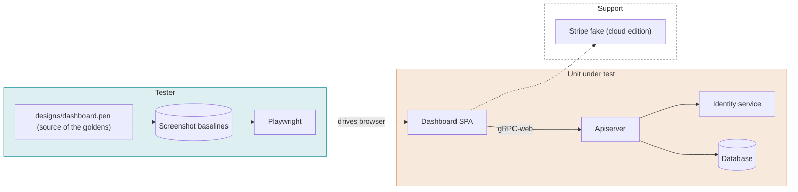

#### DSH-001 Screen matches accepted baseline

P1 · pr · Ref: dashboard

**Objective.** Each screen state in the design matches the locked Playwright baseline.

**Preconditions.** Dashboard running with seeded data. Golden screenshots committed to the repository, captured from the running dashboard inside the pinned Playwright container (never on a laptop), reviewed against the design frames once, and changed only through a reviewed pull request. Only the states that matter get a screenshot; structure checks carry the rest.

**Steps.**

1. For each frame in dashboard.pen, list its states (empty, loading, filled, error, edit dialog, delete dialog).
2. Open the screen in that state.
3. Capture a screenshot at 1440x900 and 390x844, in light and dark.
4. Compare each screenshot with its baseline.

**Pass.** Every screenshot is within the pixel tolerance set in the config for its baseline.

**Fail.** Any screenshot exceeds the tolerance, or a baseline is missing for a state in the design.

#### DSH-002 Screen structure follows the UI rules

P1 · pr · Ref: dashboard

**Objective.** Labels, order and copy follow the dashboard UI rules, independent of pixels.

**Preconditions.** Dashboard running with seeded data.

**Steps.**

1. Open each list and detail screen.
2. Read the page headings, column labels, button labels and empty-state text from the DOM.
3. Compare them with the copy table in the design.

**Pass.** All text and element order match the design. App protocol labels read Fonoster or Twilio. No row icons. Catalog labels are used instead of raw ids.

**Fail.** Any label, order or copy differs from the design.

#### DSH-003 Delete requires typing DELETE

P0 · pr · Ref: dashboard

**Objective.** A destructive action is blocked until the user confirms by typing.

**Preconditions.** A workspace with an application, a number and a SIP agent.

**Steps.**

1. Open Delete on the application.
2. Observe the confirm button.
3. Type 'delete' in lower case.
4. Type 'DELETE'.
5. Confirm.

**Pass.** The button is disabled until the input equals DELETE exactly. After confirmation the item is gone from the list and from the API.

**Fail.** The button is enabled earlier, or the item remains after confirmation.

#### DSH-004 Application STT and TTS are optional

P1 · pr · Ref: dashboard

**Objective.** An application can be saved with no STT and TTS selected.

**Preconditions.** Signed in as workspace owner.

**Steps.**

1. Open Create application.
2. Enter a name and a WebSocket URL.
3. Leave STT and TTS on None.
4. Save.
5. Reopen the application.

**Pass.** The application saves. STT and TTS show None. The API returns no STT or TTS provider for it.

**Fail.** Save is blocked, or a default provider is silently stored.

#### DSH-005 SIP agent names are split into pstn. and sip.

P2 · pr · Ref: dashboard

**Objective.** SIP agent addresses show the correct domain prefix for PSTN and SIP use.

**Preconditions.** A SIP agent with a number attached.

**Steps.**

1. Open the SIP agent detail.
2. Read the PSTN address and the SIP address.
3. Compare with the API values.

**Pass.** Each address uses its own prefix (pstn. or sip.) and equals the API value.

**Fail.** Prefixes are swapped, merged or missing.

#### DSH-006 Community edition hides SaaS-only UI

P0 · pr · Ref: dashboard

**Objective.** Billing, invoices and plan screens are absent in the self-hosted edition.

**Preconditions.** Dashboard started in community (OSS) mode.

**Steps.**

1. Sign in as owner.
2. Inspect the navigation.
3. Open the URLs of the billing routes directly.

**Pass.** No billing navigation entry. Direct URLs show not found, not a broken page.

**Fail.** Any billing, invoice or plan element appears.

#### DSH-007 Cloud edition shows Billing to owners only

P0 · pr · Ref: dashboard, usage-metering

**Objective.** The Billing tab is visible to workspace owners and hidden from other roles.

**Preconditions.** Cloud mode. One owner and one member in the same workspace.

**Steps.**

1. Sign in as the owner and open the navigation.
2. Sign out. Sign in as the member and open the navigation.
3. As the member, open the Billing URL directly.

**Pass.** Owner sees Billing. Member does not, and the direct URL is denied.

**Fail.** The member can see or open Billing.

#### DSH-008 Session lifecycle

P0 · pr · Ref: identity-client

**Objective.** Sign-in, token expiry and sign-out behave correctly.

**Preconditions.** A valid user.

**Steps.**

1. Sign in.
2. Reload the page.
3. Expire the access token (shorten its lifetime in the fixture).
4. Trigger any API call.
5. Sign out.

**Pass.** Reload keeps the session. An expired token refreshes, or sends the user to sign-in without a blank page. After sign-out, tokens are removed and protected routes redirect.

**Fail.** The session is lost on reload, the page goes blank on expiry, or tokens remain after sign-out.

#### DSH-009 Workspace switcher isolates data

P0 · pr · Ref: dashboard, identity

**Objective.** Switching workspace shows only that workspace's data.

**Preconditions.** A user in two workspaces with different applications.

**Steps.**

1. Open the list of applications in workspace A.
2. Switch to workspace B.
3. Open the same list.
4. Reload the page.

**Pass.** Each workspace lists only its own applications, before and after reload.

**Fail.** Any item from the other workspace appears, even briefly after the switch.

#### DSH-010 Theme setting persists

P2 · pr · Ref: dashboard

**Objective.** The theme chosen in Settings applies everywhere and survives reload.

**Preconditions.** Signed in.

**Steps.**

1. Open Settings.
2. Choose Dark, then reload.
3. Choose Light, then reload.
4. Choose System with the OS in dark.

**Pass.** The chosen theme is applied on every screen after each reload. System follows the OS.

**Fail.** The theme resets, or any screen ignores it.

#### DSH-011 API failure shows an error state

P1 · pr · Ref: dashboard

**Objective.** A failing API produces a readable error, not a blank screen.

**Preconditions.** Dashboard running. API reachable.

**Steps.**

1. Open a list screen.
2. Stop the apiserver, or make it return 500.
3. Reload the screen.
4. Restore the apiserver and retry.

**Pass.** The error state from the design is shown with a retry action. Retry loads the data.

**Fail.** A blank page, an endless spinner, or a raw error message.

#### DSH-012 Talk in browser

P0 · nightly · Ref: talk-in-browser

**Objective.** A user can test an application with a call from the browser.

**Preconditions.** An application backed by a fixture app that replies with a known phrase. Chromium started with --use-fake-device-for-media-stream and a WAV file as the microphone.

**Steps.**

1. Open the application and select Talk.
2. Let the fake microphone play the recorded phrase.
3. Capture the audio played by the page with a WebAudio analyser.
4. End the call.
5. Fetch the call record through the API.

**Pass.** The call connects. The reply audio contains the expected phrase (matched by the fake STT). The call record exists with the transcript.

**Fail.** No connection, silent reply, or no call record.

#### DSH-013 Regions screen

P2 · pr · Ref: regions

**Objective.** A user can list a region and see its status.

**Preconditions.** One cloud region and one enrolled private region.

**Steps.**

1. Open Regions.
2. Open each region.

**Pass.** Each region shows its name, status and node count that match the API.

**Fail.** Missing region, wrong status, or wrong node count.

#### DSH-014 Keyboard and focus

P2 · pr · Ref: dashboard

**Objective.** Core flows work by keyboard with visible focus and no accessibility violations.

**Preconditions.** Dashboard running with seeded data.

**Steps.**

1. With Playwright keyboard events only, sign in, create an application and open then cancel the delete dialog.
2. After each step assert document.activeElement and its computed focus outline.
3. Run axe-core on each screen reached.

**Pass.** Every control is reached in a logical order, focus is visible, Escape closes dialogs, and axe-core reports no serious or critical violations.

**Fail.** An unreachable control, invisible focus or a serious violation.

#### DSH-015 API and view parity

P1 · pr · Ref: control-plane

**Objective.** Every API operation has a UI decision, and the reverse.

**Preconditions.** The parity script and the RPC list generated from the proto files.

**Steps.**

1. Run the parity script.
2. Read the three groups: API only, UI only, both.
3. Check every row in the first two groups against test-plan-gaps.md.

**Pass.** Every row in API only and UI only is fixed or documented with a reason.

**Fail.** Any undocumented row.

## API

### Control-plane API, SDK and CLI

The API surface under the dashboard: input validation, output shape, auth, workspace isolation, and the same results from the SDK and the CLI.

| | |
| --- | --- |
| Level | L2 Integration (API) |
| Unit under test | Apiserver, identity service and database; the TypeScript SDK and CLI as clients |
| Tester | Mocha test runner with a shared case file (request, expected response or error), run through SDK, CLI and raw gRPC |
| Environment | Compose stack with throwaway database and NATS |
| Cadence | Every pull request |

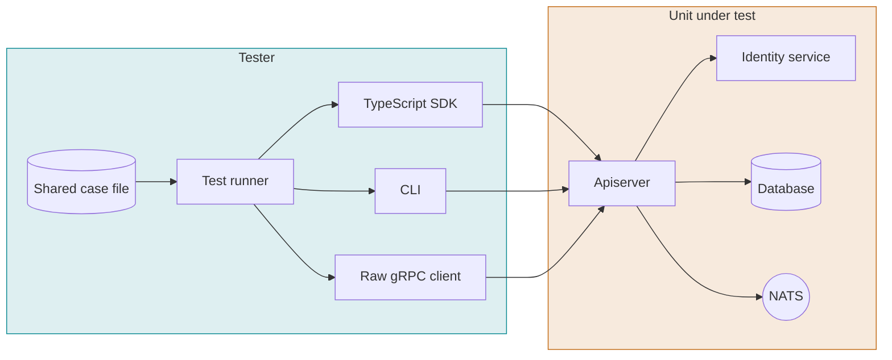

#### API-001 Applications: input validation

P1 · pr · Ref: control-plane

**Objective.** Every request field of Applications rejects invalid input with a clear error and no side effects.

**Preconditions.** API running. A valid API key for workspace A.

**Steps.**

1. List the request fields of every Applications operation from the proto/SDK types.
2. For each field send: missing, wrong type, empty, too long, invalid format, and an unknown extra field.
3. Record the response code and message.
4. List the resource afterwards.

**Pass.** Each invalid request returns the documented error code (INVALID_ARGUMENT or equivalent) with the field named in the message. Nothing is created or changed.

**Fail.** A request succeeds, returns a generic or 500 error, names no field, or leaves a partial record.

#### API-002 Numbers: input validation

P1 · pr · Ref: control-plane

**Objective.** Every request field of Numbers rejects invalid input with a clear error and no side effects.

**Preconditions.** API running. A valid API key for workspace A.

**Steps.**

1. List the request fields of every Numbers operation from the proto/SDK types.
2. For each field send: missing, wrong type, empty, too long, invalid format, and an unknown extra field.
3. Record the response code and message.
4. List the resource afterwards.

**Pass.** Each invalid request returns the documented error code (INVALID_ARGUMENT or equivalent) with the field named in the message. Nothing is created or changed.

**Fail.** A request succeeds, returns a generic or 500 error, names no field, or leaves a partial record.

#### API-003 Trunks: input validation

P1 · pr · Ref: control-plane

**Objective.** Every request field of Trunks rejects invalid input with a clear error and no side effects.

**Preconditions.** API running. A valid API key for workspace A.

**Steps.**

1. List the request fields of every Trunks operation from the proto/SDK types.
2. For each field send: missing, wrong type, empty, too long, invalid format, and an unknown extra field.
3. Record the response code and message.
4. List the resource afterwards.

**Pass.** Each invalid request returns the documented error code (INVALID_ARGUMENT or equivalent) with the field named in the message. Nothing is created or changed.

**Fail.** A request succeeds, returns a generic or 500 error, names no field, or leaves a partial record.

#### API-004 Agents (SIP): input validation

P1 · pr · Ref: control-plane

**Objective.** Every request field of Agents (SIP) rejects invalid input with a clear error and no side effects.

**Preconditions.** API running. A valid API key for workspace A.

**Steps.**

1. List the request fields of every Agents (SIP) operation from the proto/SDK types.
2. For each field send: missing, wrong type, empty, too long, invalid format, and an unknown extra field.
3. Record the response code and message.
4. List the resource afterwards.

**Pass.** Each invalid request returns the documented error code (INVALID_ARGUMENT or equivalent) with the field named in the message. Nothing is created or changed.

**Fail.** A request succeeds, returns a generic or 500 error, names no field, or leaves a partial record.

#### API-005 Credentials: input validation

P1 · pr · Ref: control-plane

**Objective.** Every request field of Credentials rejects invalid input with a clear error and no side effects.

**Preconditions.** API running. A valid API key for workspace A.

**Steps.**

1. List the request fields of every Credentials operation from the proto/SDK types.
2. For each field send: missing, wrong type, empty, too long, invalid format, and an unknown extra field.
3. Record the response code and message.
4. List the resource afterwards.

**Pass.** Each invalid request returns the documented error code (INVALID_ARGUMENT or equivalent) with the field named in the message. Nothing is created or changed.

**Fail.** A request succeeds, returns a generic or 500 error, names no field, or leaves a partial record.

#### API-006 ACLs: input validation

P1 · pr · Ref: control-plane

**Objective.** Every request field of ACLs rejects invalid input with a clear error and no side effects.

**Preconditions.** API running. A valid API key for workspace A.

**Steps.**

1. List the request fields of every ACLs operation from the proto/SDK types.
2. For each field send: missing, wrong type, empty, too long, invalid format, and an unknown extra field.
3. Record the response code and message.
4. List the resource afterwards.

**Pass.** Each invalid request returns the documented error code (INVALID_ARGUMENT or equivalent) with the field named in the message. Nothing is created or changed.

**Fail.** A request succeeds, returns a generic or 500 error, names no field, or leaves a partial record.

#### API-007 Domains: input validation

P1 · pr · Ref: control-plane

**Objective.** Every request field of Domains rejects invalid input with a clear error and no side effects.

**Preconditions.** API running. A valid API key for workspace A.

**Steps.**

1. List the request fields of every Domains operation from the proto/SDK types.
2. For each field send: missing, wrong type, empty, too long, invalid format, and an unknown extra field.
3. Record the response code and message.
4. List the resource afterwards.

**Pass.** Each invalid request returns the documented error code (INVALID_ARGUMENT or equivalent) with the field named in the message. Nothing is created or changed.

**Fail.** A request succeeds, returns a generic or 500 error, names no field, or leaves a partial record.

#### API-008 Secrets: input validation

P1 · pr · Ref: control-plane

**Objective.** Every request field of Secrets rejects invalid input with a clear error and no side effects.

**Preconditions.** API running. A valid API key for workspace A.

**Steps.**

1. List the request fields of every Secrets operation from the proto/SDK types.
2. For each field send: missing, wrong type, empty, too long, invalid format, and an unknown extra field.
3. Record the response code and message.
4. List the resource afterwards.

**Pass.** Each invalid request returns the documented error code (INVALID_ARGUMENT or equivalent) with the field named in the message. Nothing is created or changed.

**Fail.** A request succeeds, returns a generic or 500 error, names no field, or leaves a partial record.

#### API-009 API keys: input validation

P1 · pr · Ref: control-plane

**Objective.** Every request field of API keys rejects invalid input with a clear error and no side effects.

**Preconditions.** API running. A valid API key for workspace A.

**Steps.**

1. List the request fields of every API keys operation from the proto/SDK types.
2. For each field send: missing, wrong type, empty, too long, invalid format, and an unknown extra field.
3. Record the response code and message.
4. List the resource afterwards.

**Pass.** Each invalid request returns the documented error code (INVALID_ARGUMENT or equivalent) with the field named in the message. Nothing is created or changed.

**Fail.** A request succeeds, returns a generic or 500 error, names no field, or leaves a partial record.

#### API-010 Webhooks: input validation

P1 · pr · Ref: control-plane

**Objective.** Every request field of Webhooks rejects invalid input with a clear error and no side effects.

**Preconditions.** API running. A valid API key for workspace A.

**Steps.**

1. List the request fields of every Webhooks operation from the proto/SDK types.
2. For each field send: missing, wrong type, empty, too long, invalid format, and an unknown extra field.
3. Record the response code and message.
4. List the resource afterwards.

**Pass.** Each invalid request returns the documented error code (INVALID_ARGUMENT or equivalent) with the field named in the message. Nothing is created or changed.

**Fail.** A request succeeds, returns a generic or 500 error, names no field, or leaves a partial record.

#### API-011 Providers: input validation

P1 · pr · Ref: control-plane

**Objective.** Every request field of Providers rejects invalid input with a clear error and no side effects.

**Preconditions.** API running. A valid API key for workspace A.

**Steps.**

1. List the request fields of every Providers operation from the proto/SDK types.
2. For each field send: missing, wrong type, empty, too long, invalid format, and an unknown extra field.
3. Record the response code and message.
4. List the resource afterwards.

**Pass.** Each invalid request returns the documented error code (INVALID_ARGUMENT or equivalent) with the field named in the message. Nothing is created or changed.

**Fail.** A request succeeds, returns a generic or 500 error, names no field, or leaves a partial record.

#### API-012 Workspaces and users: input validation

P1 · pr · Ref: control-plane

**Objective.** Every request field of Workspaces and users rejects invalid input with a clear error and no side effects.

**Preconditions.** API running. A valid API key for workspace A.

**Steps.**

1. List the request fields of every Workspaces and users operation from the proto/SDK types.
2. For each field send: missing, wrong type, empty, too long, invalid format, and an unknown extra field.
3. Record the response code and message.
4. List the resource afterwards.

**Pass.** Each invalid request returns the documented error code (INVALID_ARGUMENT or equivalent) with the field named in the message. Nothing is created or changed.

**Fail.** A request succeeds, returns a generic or 500 error, names no field, or leaves a partial record.

#### API-013 Call records: input validation

P1 · pr · Ref: control-plane

**Objective.** Every request field of Call records rejects invalid input with a clear error and no side effects.

**Preconditions.** API running. A valid API key for workspace A.

**Steps.**

1. List the request fields of every Call records operation from the proto/SDK types.
2. For each field send: missing, wrong type, empty, too long, invalid format, and an unknown extra field.
3. Record the response code and message.
4. List the resource afterwards.

**Pass.** Each invalid request returns the documented error code (INVALID_ARGUMENT or equivalent) with the field named in the message. Nothing is created or changed.

**Fail.** A request succeeds, returns a generic or 500 error, names no field, or leaves a partial record.

#### API-014 Usage: input validation

P1 · pr · Ref: control-plane

**Objective.** Every request field of Usage rejects invalid input with a clear error and no side effects.

**Preconditions.** API running. A valid API key for workspace A.

**Steps.**

1. List the request fields of every Usage operation from the proto/SDK types.
2. For each field send: missing, wrong type, empty, too long, invalid format, and an unknown extra field.
3. Record the response code and message.
4. List the resource afterwards.

**Pass.** Each invalid request returns the documented error code (INVALID_ARGUMENT or equivalent) with the field named in the message. Nothing is created or changed.

**Fail.** A request succeeds, returns a generic or 500 error, names no field, or leaves a partial record.

#### API-015 Output shape matches the types

P1 · pr · Ref: control-plane

**Objective.** Every response matches the declared types, including optional fields.

**Preconditions.** Seeded workspace with one of each resource.

**Steps.**

1. Call Get and List for every resource.
2. Validate each response against the generated types and the JSON schema.
3. Compare fields set to their zero value with fields that are absent.

**Pass.** All responses validate. No undeclared fields. Timestamps are ISO-8601 UTC.

**Fail.** Any schema violation.

#### API-016 Pagination and ordering

P1 · pr · Ref: control-plane

**Objective.** Lists page correctly and in a stable order.

**Preconditions.** 125 applications in one workspace.

**Steps.**

1. List with page size 50 until the token is empty.
2. Collect all ids.
3. Repeat with page size 1 and 125.
4. Create an item between two page requests.

**Pass.** Every id is returned exactly once. Order is the same across runs. An empty list returns an empty array, not null.

**Fail.** Any duplicate or missing id, or unstable order.

#### API-017 No credentials

P0 · pr · Ref: identity

**Objective.** Calls without authentication are rejected.

**Preconditions.** API running.

**Steps.**

1. Call each RPC with no key and no token.

**Pass.** Every RPC returns UNAUTHENTICATED. No data is returned.

**Fail.** Any RPC returns data or a different error.

#### API-018 Wrong or expired credentials

P0 · pr · Ref: identity

**Objective.** Invalid keys and tokens are rejected.

**Preconditions.** A valid key; the same key revoked; a token past its expiry.

**Steps.**

1. Call each RPC with a random key.
2. Call each RPC with the revoked key.
3. Call each RPC with the expired token.

**Pass.** UNAUTHENTICATED for each.

**Fail.** Any call succeeds.

#### API-019 Cross-workspace access is denied

P0 · pr · Ref: identity, control-plane

**Objective.** A key from workspace A cannot read or change workspace B.

**Preconditions.** Resources with known ids in workspaces A and B. A key for A.

**Steps.**

1. With A's key, call Get, Update and Delete using ids that belong to B.
2. With A's key, call List.
3. Check B's data afterwards.

**Pass.** Get, Update and Delete return NOT_FOUND or PERMISSION_DENIED. List contains no B resources. B's data is unchanged.

**Fail.** Any B resource is returned or modified. Differences in error text that reveal that the id exists also fail.

#### API-020 Role enforcement

P0 · pr · Ref: identity

**Objective.** Each role can perform only its allowed operations.

**Preconditions.** Users with roles owner, admin and member in one workspace.

**Steps.**

1. For each operation, call it as each role.
2. Compare with the permission table.

**Pass.** Allowed operations succeed. All others return PERMISSION_DENIED.

**Fail.** Any difference from the table.

#### API-021 Duplicate and conflicting creates

P1 · pr · Ref: control-plane

**Objective.** Duplicate names and ids are handled as documented.

**Preconditions.** One application named 'sales'.

**Steps.**

1. Create another application named 'sales'.
2. Create two applications concurrently with the same new name.

**Pass.** The documented result (ALREADY_EXISTS or allowed) is returned. Exactly one record exists when uniqueness is required.

**Fail.** Two records where one is required, or a 500.

#### API-022 Delete cascade and references

P1 · pr · Ref: control-plane

**Objective.** Deleting a resource that others depend on follows the documented rule.

**Preconditions.** An application linked to a number; a trunk linked to a number.

**Steps.**

1. Delete the application.
2. Read the number.
3. Delete the trunk.
4. Read the number.

**Pass.** Either the delete is refused with FAILED_PRECONDITION and a clear message, or the reference is cleared. No dangling references.

**Fail.** A dangling reference, or an unclear error.

#### API-023 Outbound call via API

P0 · nightly · Ref: control-plane, call-record

**Objective.** Creating a call places a real call and returns a reference.

**Preconditions.** Trunk and number configured. A SIP bot registered as the callee.

**Steps.**

1. Call CreateCall to the bot.
2. The bot answers and plays a tone.
3. The bot hangs up.
4. Get the call record.

**Pass.** The bot receives the INVITE and the tone is detected end to end. The response contains a call reference. The call record shows start, answer and end times.

**Fail.** No ring, no reference, or an incomplete record.

#### API-024 TypeScript SDK and raw API give the same results

P1 · pr · Ref: control-plane

**Objective.** The SDK adds no behavior difference over the API.

**Preconditions.** The shared case file (request, expected response or error).

**Steps.**

1. Run every case through the SDK.
2. Run every case through raw gRPC.
3. Diff the results.

**Pass.** Responses and error codes are identical for all cases.

**Fail.** Any difference.

#### API-025 CLI smoke per command group

P2 · pr · Ref: ctl

**Objective.** Each CLI command group runs against a live API.

**Preconditions.** CLI configured with a valid key.

**Steps.**

1. For each command group run create, get, list, update and delete.
2. Check exit codes and output format (table and JSON).

**Pass.** Exit code 0 on success and non-zero on error. JSON output validates against the types.

**Fail.** Wrong exit code, or invalid JSON.

#### API-026 Rate limiting

P1 · pr · Ref: control-plane

**Objective.** Excess requests are limited without harming other workspaces.

**Preconditions.** Rate limit configured. Two workspaces.

**Steps.**

1. Send requests above the limit from workspace A.
2. Send normal requests from workspace B at the same time.

**Pass.** A receives RESOURCE_EXHAUSTED with retry information. B is unaffected.

**Fail.** No limit, or B is limited.

#### API-027 Capabilities: community defaults

P1 · pr · Ref: capabilities

**Objective.** GetCapabilities returns the community defaults.

**Preconditions.** Apiserver started with no features.auth configuration.

**Steps.**

1. Call Capabilities/GetCapabilities with no token.

**Pass.** The response lists methods [password] and signup invite, and has no GitHub block.

**Fail.** Any other methods, or a GitHub block.

#### API-028 Capabilities: cloud configuration

P0 · pr · Ref: capabilities

**Objective.** GetCapabilities reflects the cloud configuration and never returns secrets.

**Preconditions.** features.auth.methods [github, email_code] and identity.oauth2.github set, with a client secret.

**Steps.**

1. Call GetCapabilities.
2. Search the whole response for the client secret value.

**Pass.** Both methods and the GitHub client id and authorize URL are returned. The secret does not appear anywhere in the response.

**Fail.** A missing field, or the secret in the response.

#### API-029 Capabilities: public

P1 · pr · Ref: capabilities

**Objective.** GetCapabilities needs no credentials.

**Preconditions.** Apiserver running.

**Steps.**

1. Call GetCapabilities with no token and no key.

**Pass.** The call succeeds.

**Fail.** UNAUTHENTICATED.

#### API-030 Identity service: starts standalone

P0 · pr · Ref: identity-service

**Objective.** The Identity service runs alone on its configured port without telephony dependencies.

**Preconditions.** Identity configuration and an empty database. No NATS and no Asterisk running.

**Steps.**

1. Start the service.
2. Call GetPublicKey with no token.

**Pass.** The service binds the configured address and answers. It started no NATS or Asterisk/ARI connection.

**Fail.** It needs NATS or Asterisk, or does not bind.

#### API-031 Identity service: public and protected methods

P0 · pr · Ref: identity-service

**Objective.** Only allow-listed methods work without a token.

**Preconditions.** Service running.

**Steps.**

1. Call CreateUser, ExchangeCredentials and GetPublicKey with no token.
2. Call CreateWorkspace with no token.
3. Call CreateWorkspace with a valid access token.

**Pass.** The public methods are processed. CreateWorkspace with no token is rejected as unauthenticated before the handler runs. With a token the workspace owner is taken from the token.

**Fail.** A protected method runs without a token.

#### API-032 Identity service: fail fast on missing configuration

P1 · pr · Ref: identity-service

**Objective.** The service refuses to start with incomplete configuration.

**Preconditions.** Valid configuration.

**Steps.**

1. For each required value (database URL, signing keys) remove it and start the service.
2. Read the exit status and error.

**Pass.** The process exits with a non-zero status and an error naming the missing value.

**Fail.** The service starts, or the error does not name the value.

#### API-033 Identity service: database provisioning

P1 · pr · Ref: identity-service

**Objective.** The provisioning entrypoint creates the schema on an empty database.

**Preconditions.** An empty database.

**Steps.**

1. Run the provisioning entrypoint.
2. Inspect the schema.
3. Run it a second time.

**Pass.** The Identity schema exists. The second run changes nothing and does not fail.

**Fail.** Missing tables, or an error on re-run.

#### API-034 Identity service: published image

P1 · pr · Ref: identity-service

**Objective.** The published container image runs the service.

**Preconditions.** The image tag built by the release pipeline.

**Steps.**

1. Run the image with valid configuration.
2. Call GetPublicKey.

**Pass.** The gRPC service answers on the configured port.

**Fail.** The container exits or does not answer.

#### API-035 Identity service: library import is server-free

P2 · pr · Ref: identity-service

**Objective.** Importing the package as a library starts nothing.

**Preconditions.** The @fonoster/identity package.

**Steps.**

1. In a test process import buildIdentityService from the main entry.
2. List listening sockets and loaded server-only modules.

**Pass.** No gRPC server is started and the server-only modules are not loaded.

**Fail.** A listening socket or a loaded server module.

## VSD

### Voice SDK and session protocol

The WebSocket session between AppBridge and an app, in the native and Twilio flavors, through the TypeScript and Python voice SDKs.

| | |
| --- | --- |
| Level | L1 Component (SDK) |
| Unit under test | @fonoster/voice (TypeScript) and fonoster-voice (Python), each running a fixture app |
| Tester | Conformance runner that plays AppBridge and checks the scenario files |
| Environment | Local, no containers beyond NATS |
| Cadence | Every pull request that touches a contract; nightly |

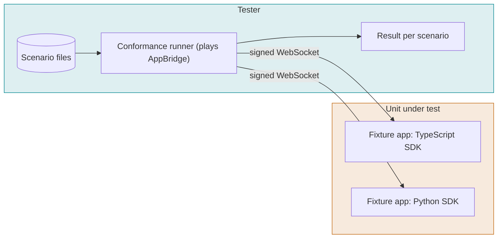

#### VSD-001 Signed connection accepted

P0 · pr · Ref: voice-session, voice-sdk

**Objective.** A correctly signed WebSocket upgrade is accepted.

**Preconditions.** Fixture app listening with a signing secret.

**Steps.**

1. Connect with X-Fonoster-Timestamp and a valid X-Fonoster-Signature.

**Pass.** The connection upgrades and the start message is processed.

**Fail.** Connection refused or closed.

#### VSD-002 Bad signature rejected

P0 · pr · Ref: voice-session

**Objective.** Unsigned, wrongly signed and replayed connections are refused.

**Preconditions.** Same as above.

**Steps.**

1. Connect with no signature.
2. Connect with a wrong signature.
3. Connect with a valid signature and a timestamp outside the allowed skew.
4. Replay a previously used signed request.

**Pass.** Each attempt is rejected before any message is processed.

**Fail.** Any attempt reaches the app handler.

#### VSD-003 Say, then hang up

P0 · pr · Ref: voice-sdk

**Objective.** An app can speak a phrase and end the call.

**Preconditions.** Fixture say-hello. Fake TTS.

**Steps.**

1. Run scenario say-hello.
2. Observe events and audio.

**Pass.** The expected speech events arrive in order, then a hangup. Scenario result is pass.

**Fail.** Missing or out-of-order events.

#### VSD-004 Gather speech and echo

P0 · pr · Ref: voice-sdk

**Objective.** An app receives a final transcript and replies.

**Preconditions.** Fixture gather-echo. Fake STT returns a fixed transcript.

**Steps.**

1. Run scenario gather-echo.

**Pass.** The app receives the transcript once and replies with the same text.

**Fail.** Transcript missing, duplicated, or reply differs.

#### VSD-005 Gather DTMF

P0 · pr · Ref: voice-sdk

**Objective.** An app receives DTMF digits.

**Preconditions.** Fixture for DTMF gather.

**Steps.**

1. Send DTMF 1, 2, 3, # from the runner.

**Pass.** The app receives 123 with the terminator, in order.

**Fail.** Digit lost, reordered, or duplicated.

#### VSD-006 Barge-in interrupts speech

P0 · pr · Ref: voice-session, turn-taking

**Objective.** Caller speech during TTS stops playback and reports what was spoken.

**Preconditions.** Fixture long-say. Turn-taking enabled.

**Steps.**

1. App starts a long say.
2. Runner sends caller speech after 1 s.

**Pass.** Playback stops within the stop budget. The interruption report states how much was played.

**Fail.** Playback continues, or the report is missing.

#### VSD-007 Raw audio frames in and out

P1 · pr · Ref: voice-session

**Objective.** Binary audio frames pass unchanged in both directions.

**Preconditions.** Audio-layer fixture.

**Steps.**

1. Send 100 frames of a known pattern.
2. App echoes them back.
3. Compare.

**Pass.** Frames return in order with identical content. Size and format match the declared audio format.

**Fail.** Loss, reorder or corruption.

#### VSD-008 mark and clear

P1 · pr · Ref: voice-session

**Objective.** Audio-layer mark and clear behave as specified.

**Preconditions.** Audio-layer fixture.

**Steps.**

1. App sends audio, then a mark.
2. Runner reports the mark after playout.
3. App sends audio, then clear.

**Pass.** The mark returns after the preceding audio plays. Clear drops queued audio.

**Fail.** Mark returns early, or queued audio plays after clear.

#### VSD-009 Transfer command

P0 · pr · Ref: voice-session, media-control

**Objective.** An app can ask for a transfer and get the result.

**Preconditions.** Fixture transfer. Fake node.

**Steps.**

1. App sends transfer to a number.
2. Node answers with transfer.result success.
3. Repeat with failure.

**Pass.** The app sees success and failure results with the documented reason.

**Fail.** No result, or the wrong reason.

#### VSD-010 Listener attach

P1 · pr · Ref: voice-session

**Objective.** A listen-only socket receives the requested tracks.

**Preconditions.** A live session.

**Steps.**

1. Attach a listener with tracks inbound.
2. Repeat with outbound and both.

**Pass.** The listener receives only the requested tracks and cannot send commands.

**Fail.** Wrong tracks, or the listener can control the call.

#### VSD-011 Unknown and malformed messages

P1 · pr · Ref: voice-session

**Objective.** The SDK handles bad input without crashing.

**Preconditions.** Fixture app.

**Steps.**

1. Send an unknown message type.
2. Send invalid JSON.
3. Send an oversized frame.
4. Send a binary frame before start.

**Pass.** Unknown types are ignored or reported per spec. Invalid input closes the session with the documented code. The process keeps running.

**Fail.** Process crash or hang.

#### VSD-012 Twilio flavor: start, media, stop

P0 · pr · Ref: twilio-media-streams-flavor

**Objective.** An unmodified Twilio Media Streams app works.

**Preconditions.** Twilio flavor enabled. A Twilio-style fixture app.

**Steps.**

1. Connect. Receive start with streamSid.
2. Receive media events with base64 mulaw.
3. Send media back.
4. Receive stop.

**Pass.** Message shapes, field names and encodings match the Twilio specification.

**Fail.** Any field or encoding differs.

#### VSD-013 Twilio flavor: mark and clear

P1 · pr · Ref: twilio-media-streams-flavor

**Objective.** Twilio mark and clear semantics hold.

**Preconditions.** Same as above.

**Steps.**

1. Send media then mark.
2. Observe the mark echo.
3. Send clear mid-playback.

**Pass.** Mark is echoed after playout. Clear stops playback and echoes pending marks.

**Fail.** Mark order or clear behavior differs.

#### VSD-014 TypeScript and Python SDKs agree

P0 · pr · Ref: voice-sdk, conformance · Runs: `scenarios/voice-sdk` (25 scenario files)

**Objective.** Both SDKs produce the same result for every shared scenario.

**Preconditions.** Scenario files from @fonoster/conformance. One fixture per name in both languages.

**Steps.**

1. Run every voice-sdk scenario against the TypeScript fixtures.
2. Run the same against the Python fixtures.
3. Diff the results.

**Pass.** Every scenario has the same result in both languages. No scenario is skipped silently.

**Fail.** Any difference, or a silent skip.

#### VSD-015 Pipecat bot works unchanged

P1 · pr · Ref: twilio-media-streams-flavor

**Objective.** An existing Pipecat bot talks to the platform without code changes.

**Preconditions.** The pipecat-golden project.

**Steps.**

1. Start the bot against the Twilio flavor.
2. Run the golden call script.

**Pass.** The golden transcript is reproduced.

**Fail.** Connection errors or a different transcript.

## CAL

### Call flows

Every call flow Fonoster uses, end to end through the SIP edge, the media node and AppBridge. This is not a Routr protocol compliance suite.

| | |
| --- | --- |
| Level | L3 System (end to end) |
| Unit under test | Routr, RTPEngine, Roomr node, AppBridge, apiserver and NATS together |
| Tester | Caller bot (sipcaller) and SIP bot endpoints acting as callers, callees and softphones, a trunk peer for the PSTN rows, an app fixture, and the API client for outbound |
| Environment | Real stack (ops/rebuild/stack) with a trunk simulator; a live trunking provider for the PSTN rows |
| Cadence | Smoke (10 calls) on every push to main; full set nightly and as a release gate |

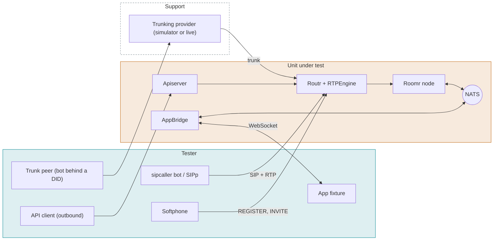

#### CAL-001 PSTN to application

P0 · nightly · Ref: voice-session, call-record

**Objective.** An inbound PSTN call reaches the app linked to the number.

**Preconditions.** Number linked to an application whose fixture replies with a known phrase. Trunk and trunk peer configured.

**Steps.**

1. The trunk peer originates a call to the number through the trunk.
2. The peer plays a recorded phrase.
3. The peer records the reply.
4. The peer hangs up.

**Pass.** The call answers within the documented time. The fixture receives the transcript of the phrase, the reply is recorded by the peer, and hangup ends the session. The call record has start, answer, end and the hangup side.

**Fail.** No answer, one-way audio, or an incomplete record.

#### CAL-002 PSTN to SIP agent

P0 · nightly · Ref: roomr, control-plane

**Objective.** An inbound PSTN call reaches a registered SIP bot.

**Preconditions.** SIP agent with a number. Bot registered as the agent. Trunk peer configured.

**Steps.**

1. The peer calls the number.
2. The agent bot answers and exchanges tones with the peer for 30 s.
3. The agent bot hangs up.
4. Repeat with the peer hanging up.

**Pass.** The bot receives the INVITE. Tones are detected in both directions. Each hangup ends the other leg within 2 s.

**Fail.** No INVITE, one-way audio, or a leg that stays up.

#### CAL-003 PSTN to SIP agent: busy, no answer, offline

P1 · nightly · Ref: roomr

**Objective.** Failure outcomes are reported to the caller and to the record.

**Preconditions.** Same as above.

**Steps.**

1. The peer calls while the agent bot is in another call.
2. The peer calls and the bot does not answer until the timeout.
3. Unregister the bot and call.

**Pass.** The peer sees the documented outcome (busy, timeout, unavailable). The call record shows the reason.

**Fail.** The call hangs, rings forever, or the record has no reason.

#### CAL-004 SIP agent to PSTN

P0 · nightly · Ref: roomr

**Objective.** A registered SIP bot can call out through a trunk.

**Preconditions.** Bot registered as the agent. Outbound trunk. Trunk peer as the destination.

**Steps.**

1. The agent bot dials the peer's number.
2. The peer answers and sends DTMF 1 2 3.
3. Exchange tones.
4. The bot hangs up.

**Pass.** The peer sees the configured caller ID. Tones are detected both ways. The peer decodes 123.

**Fail.** No ring, wrong caller ID, or lost digits.

#### CAL-005 SIP agent to SIP agent

P1 · nightly · Ref: roomr

**Objective.** Two registered agents in the same domain can call each other.

**Preconditions.** Bots A and B registered.

**Steps.**

1. A dials B.
2. B answers.
3. Exchange tones for 10 s.
4. B hangs up.

**Pass.** B receives the INVITE. Tones are detected both ways. Both legs end.

**Fail.** No INVITE, or a stuck leg.

#### CAL-006 Outbound call from API to an app

P0 · nightly · Ref: control-plane, voice-session

**Objective.** A call created through the API connects to the app on answer.

**Preconditions.** Trunk, number and application configured. Trunk peer as the callee.

**Steps.**

1. Create a call to the peer with the application.
2. The peer answers.
3. The peer speaks a phrase and records the reply.
4. The peer hangs up.

**Pass.** On answer the app session starts, the reply is recorded by the peer, and the record links the call to the application.

**Fail.** No session on answer, or no link in the record.

#### CAL-007 Outbound call: unanswered, busy, rejected

P1 · nightly · Ref: call-record

**Objective.** Outbound failure outcomes are reported to the API consumer.

**Preconditions.** Same as above.

**Steps.**

1. Create a call and let the peer ring out.
2. Create a call while the peer is busy.
3. Create a call and have the peer reject it.

**Pass.** Each call ends with the documented status (no-answer, busy, declined) and a record exists. No app session starts.

**Fail.** A wrong status, or an app session for an unanswered call.

#### CAL-008 Caller hangs up before answer

P1 · nightly · Ref: roomr

**Objective.** A CANCEL cleans up resources.

**Preconditions.** Inbound number linked to an application.

**Steps.**

1. Call the number and hang up while it is ringing.
2. Check the node's rooms, AppBridge sessions and the call record.

**Pass.** No room or session remains after 5 s. The record shows an abandoned call.

**Fail.** A leaked room or session.

#### CAL-009 ACL deny and allow

P0 · nightly · Ref: control-plane

**Objective.** Calls from addresses not allowed by the ACL are refused.

**Preconditions.** Trunk with an ACL that allows one test IP.

**Steps.**

1. Send an INVITE from the allowed IP.
2. Send an INVITE from another IP.

**Pass.** The allowed INVITE proceeds. The other is refused with 403 and creates no session.

**Fail.** The other IP reaches an application.

#### CAL-010 Inbound trunk authentication

P0 · nightly · Ref: control-plane

**Objective.** Inbound trunks authenticate by IP and by credentials as configured.

**Preconditions.** One trunk by IP, one by credentials.

**Steps.**

1. Call through each trunk with correct data.
2. Call with wrong credentials.
3. Call from the wrong IP.

**Pass.** Correct requests succeed. Wrong ones return 401/403 and create no session.

**Fail.** A wrong request succeeds.

#### CAL-011 Outbound trunk registration

P1 · nightly · Ref: control-plane

**Objective.** A trunk that needs registration registers and recovers.

**Preconditions.** A registering outbound trunk against a test registrar.

**Steps.**

1. Start the stack.
2. Check the registration.
3. Restart the registrar.
4. Place an outbound call.

**Pass.** The trunk registers, re-registers after the registrar restarts, and the call succeeds.

**Fail.** No re-registration, or an outbound failure.

#### CAL-012 Trunk failover

P1 · nightly · Ref: control-plane

**Objective.** When the first trunk fails, the next is used.

**Preconditions.** Two outbound trunks in priority order. First one blackholed.

**Steps.**

1. Place an outbound call.
2. Observe which trunk is used and the time to connect.

**Pass.** The call connects through the second trunk within the failover budget (set at baseline).

**Fail.** Call fails or the budget is exceeded.

#### CAL-013 Number formats

P1 · nightly · Ref: control-plane

**Objective.** Numbers are accepted and normalised in all supported formats.

**Preconditions.** Outbound trunk. Trunk peer or SIP bot as the destination.

**Steps.**

1. Dial the same destination as +E.164, E.164 without +, national and with spaces/dashes.
2. Inspect the number sent to the provider.

**Pass.** All formats connect to the same destination. The provider receives the format the trunk requires.

**Fail.** Any format fails or reaches another destination.

#### CAL-014 Softphone registration

P0 · nightly · Ref: control-plane

**Objective.** Registration works and fails correctly.

**Preconditions.** A SIP agent with credentials.

**Steps.**

1. Register with correct credentials.
2. Register with wrong credentials.
3. Let the registration expire.
4. Re-register.
5. Unregister.

**Pass.** Success returns 200 with the expected expiry. Wrong credentials return 401/403. Calls to an unregistered agent follow the offline outcome.

**Fail.** Any other result.

#### CAL-015 Node balancing

P1 · nightly · Ref: roomr

**Objective.** Routr chooses the node with the fewest sessions and avoids down nodes.

**Preconditions.** Three Roomr nodes with different X-Session-Count.

**Steps.**

1. Place 20 calls.
2. Stop one node.
3. Place 20 more calls.

**Pass.** Calls go to the lowest-count node. No calls go to the stopped node after it is marked down.

**Fail.** Calls reach a down node, or the count is ignored.

#### CAL-016 Full node is skipped

P1 · nightly · Ref: roomr

**Objective.** A node at capacity receives no new sessions.

**Preconditions.** A node configured with a low session cap.

**Steps.**

1. Fill the node.
2. Place another call.

**Pass.** The call goes to another node.

**Fail.** The call goes to the full node. This is a known gap; the test is expected to fail until fixed.

#### CAL-017 Cross-workspace X-App-Ref is refused

P0 · nightly · Ref: roomr, identity

**Objective.** A registered softphone cannot reach an application in another workspace.

**Preconditions.** Softphone registered in workspace A. An application in workspace B.

**Steps.**

1. From the softphone, send an INVITE to the media-node peer with the X-App-Ref of B's application.
2. Check for a session in B.

**Pass.** The INVITE is refused. No session starts in B.

**Fail.** A session starts. This is a known security gap; the test is expected to fail until fixed.

#### CAL-018 Concurrent call limit

P2 · nightly · Ref: control-plane

**Objective.** Per-workspace limits are enforced.

**Preconditions.** Workspace limit set to 5.

**Steps.**

1. Place 5 calls.
2. Place a 6th.

**Pass.** The 6th is refused with the documented response. The first 5 continue.

**Fail.** The 6th is accepted, or existing calls are dropped.

## XFR

### Transfers, DTMF and in-call control

The flows we run least often: every transfer type, DTMF in both directions and methods, hold, codec change, early media.

| | |
| --- | --- |
| Level | L3 System (end to end) |
| Unit under test | Roomr node, AppBridge and Routr during transfer, DTMF, hold and re-INVITE |
| Tester | sipcaller bot and SIP bot endpoints as caller and targets, a DTMF decoder, a trunk peer for the PSTN rows, an app fixture |
| Environment | Real stack; a trunk provider (or simulator) that supports REFER for the REFER rows |
| Cadence | Nightly; release gate |

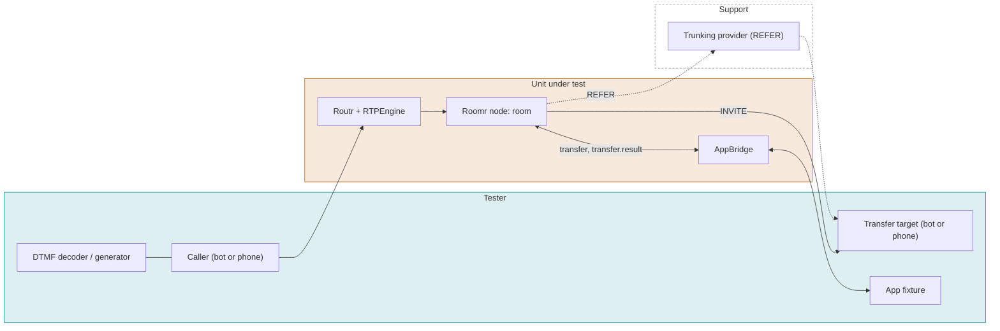

#### XFR-001 Cold transfer to PSTN

P0 · nightly · Ref: media-control

**Objective.** The app transfers the caller and drops out.

**Preconditions.** Active inbound call with an app. A target bot (or trunk peer) ready to answer.

**Steps.**

1. App sends transfer mode=cold to the target.
2. The target answers and exchanges tones with the caller.
3. Check the room and the app session.

**Pass.** Caller and target are connected (tones detected both ways). transfer.result is success. The app session ends and the room stays until the legs end.

**Fail.** No connection, no result event, or the app session remains.

#### XFR-002 Warm transfer to PSTN

P0 · nightly · Ref: media-control

**Objective.** The app speaks to the target first, then joins the caller.

**Preconditions.** Same as above.

**Steps.**

1. App sends transfer mode=warm.
2. The target answers. The app speaks to the target. The caller bot records its input.
3. App completes the transfer (transfer.complete).

**Pass.** During the consult the caller hears hold audio only, never the consult. After complete, caller and target exchange tones and the app leaves.

**Fail.** The caller hears the consult, the join fails, or the app stays in the call.

#### XFR-003 REFER transfer

P1 · nightly · Ref: media-control

**Objective.** A transfer is delegated to the trunking provider with SIP REFER.

**Preconditions.** Trunking provider or simulator that supports REFER. mode=refer.

**Steps.**

1. App sends transfer mode=refer.
2. Capture the NOTIFY progress.
3. The target answers.

**Pass.** Our legs are released after the provider accepts and connects. transfer.result reports success.

**Fail.** Our leg remains, or the result is wrong.

#### XFR-004 REFER not supported by the provider

P1 · nightly · Ref: media-control

**Objective.** A REFER rejected by the provider is reported and the call survives.

**Preconditions.** Provider or simulator that rejects REFER.

**Steps.**

1. App sends transfer mode=refer.
2. Provider answers 4xx/5xx.

**Pass.** transfer.result is failure with the reason. The caller is still connected to the app.

**Fail.** The call drops, or no result.

#### XFR-005 Transfer target busy, no answer, wrong number

P0 · nightly · Ref: media-control

**Objective.** Each failure leaves the caller connected and reports the reason.

**Preconditions.** Active call. Target bots that answer 486, never answer, and answer 404.

**Steps.**

1. Transfer to the busy target.
2. Transfer to the target that never answers until timeout.
3. Transfer to the invalid number.

**Pass.** Each yields transfer.result failure (busy, no-answer, invalid) and the caller stays with the app.

**Fail.** The caller is dropped or left in silence.

#### XFR-006 Caller hangs up during transfer

P1 · nightly · Ref: media-control

**Objective.** Resources are released if the caller leaves mid-transfer.

**Preconditions.** Active call.

**Steps.**

1. Start a transfer to a ringing target bot.
2. The caller bot sends BYE while the target rings.
3. Check the target and the room.

**Pass.** The target bot receives CANCEL within 2 s. No room or session remains.

**Fail.** The target keeps ringing, or resources leak.

#### XFR-007 Transfer from a SIP agent

P1 · nightly · Ref: roomr

**Objective.** A SIP agent can transfer a call (different path than an app).

**Preconditions.** PSTN caller (trunk peer or bot) connected to an agent bot.

**Steps.**

1. The agent bot sends REFER, blind then attended.
2. The target bot answers.

**Pass.** The caller is connected to the target (tones detected). The agent leg ends.

**Fail.** No transfer, or both legs stay.

#### XFR-008 DTMF from caller (RFC 2833)

P0 · nightly · Ref: voice-session

**Objective.** Digits sent as RTP events reach the app.

**Preconditions.** Inbound call to an app. Caller sends RFC 2833.

**Steps.**

1. Send 0-9, *, #, A-D.
2. Read events in the app.

**Pass.** Each digit arrives once, in order, with correct duration.

**Fail.** A missing, duplicated or wrong digit.

#### XFR-009 DTMF from caller (SIP INFO)

P1 · nightly · Ref: voice-session

**Objective.** Digits sent by SIP INFO reach the app.

**Preconditions.** Caller sends SIP INFO.

**Steps.**

1. Send the same digits by INFO.

**Pass.** Same result as the RFC 2833 test.

**Fail.** Any difference.

#### XFR-010 DTMF to caller

P0 · nightly · Ref: media-control

**Objective.** The app can send digits to the far end.

**Preconditions.** Outbound call to an IVR or a DTMF decoder.

**Steps.**

1. App sends dtmf.send 1234#.
2. Read the decoder output.

**Pass.** The decoder reads 1234# exactly.

**Fail.** Digits are lost, merged or wrong.

#### XFR-011 DTMF: long and fast digits

P1 · nightly · Ref: voice-session

**Objective.** Edge timing is handled.

**Preconditions.** Inbound call.

**Steps.**

1. Hold a digit for 3 s.
2. Send 10 digits at 50 ms spacing.
3. Send the same digit twice quickly.

**Pass.** A long press yields one digit with long duration. Fast digits are all received. Repeated digits are two events.

**Fail.** Long press repeats, or fast digits are lost.

#### XFR-012 Hold and resume

P1 · nightly · Ref: media-control

**Objective.** A re-INVITE hold mutes media and resume restores it.

**Preconditions.** Active call with a bot.

**Steps.**

1. The bot sends a re-INVITE with a=sendonly.
2. Check the media direction and the audio.
3. The bot sends a re-INVITE with a=sendrecv.

**Pass.** During hold no audio is sent from our side and the app is told. After resume, tones flow both ways.

**Fail.** Audio leaks while on hold, or one-way audio after resume.

#### XFR-013 Re-INVITE with codec change

P1 · nightly · Ref: roomr

**Objective.** Changing codec mid-call does not break audio.

**Preconditions.** Call established with PCMU.

**Steps.**

1. Send a re-INVITE offering PCMA only.
2. Check audio.

**Pass.** The call continues with PCMA, with no gap over 200 ms.

**Fail.** Audio stops or the call drops.

#### XFR-014 Early media and ringback

P2 · nightly · Ref: roomr

**Objective.** The caller hears ringback or announcements before answer as configured.

**Preconditions.** Outbound call to a bot that sends 183 with early media.

**Steps.**

1. Place the call.
2. The bot sends a tone in early media before answering.

**Pass.** The early-media tone is passed through to the caller with no clipping of its start. No audio is sent before the media path is ready.

**Fail.** Clipped start of early media or silence.

#### XFR-015 Caller ID and privacy

P2 · nightly · Ref: control-plane

**Objective.** Outbound caller ID and privacy headers are honored.

**Preconditions.** Number with caller ID set. A SIP bot receiving the call.

**Steps.**

1. Place an outbound call with the default caller ID.
2. Place a call with privacy enabled.
3. Read the From, P-Asserted-Identity and Privacy headers at the bot.

**Pass.** Default shows the configured number. Privacy sets the correct headers and hides the number.

**Fail.** Wrong number or a leaked identity.

## TRK

### Trunking provider

One generic suite for any SIP trunking provider, selected by a fixture file. It runs in reference mode against a local trunk simulator (free, every night) and in live mode against a real provider (release gate, plus a nightly canary). Provider differences are declared in the fixture's capability matrix, and the suite checks that observed behavior equals the declared one.

| | |
| --- | --- |
| Level | L3/L4 System (trunk edge) |
| Unit under test | The trunk configuration and the call path between the provider and the platform: Routr, RTPEngine, Roomr, AppBridge |
| Tester | Trunk suite with a provider fixture, a SIP peer bot behind number B, the provider's REST API where it has one (to originate calls), a DTMF decoder, a quality scorer, and the declared capability matrix |
| Environment | Reference mode: local stack and the trunk simulator. Live mode: production-like stack, a real provider account, test numbers and CI secrets |
| Cadence | Reference mode nightly and on changes to trunking code. Live mode as a release gate, with a nightly canary and a daily spend cap |

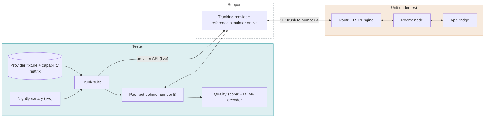

#### TRK-001 Inbound call to an application

P0 · release · Ref: control-plane, roomr

**Objective.** An inbound call arriving over the trunk reaches the linked application.

**Preconditions.** Fixture loaded. Number A linked to an application whose fixture replies with a known phrase. Peer bot registered behind number B.

**Steps.**

1. The peer bot calls number A through the provider (or the provider API originates the call).
2. The bot plays a recorded phrase.
3. The bot records the reply.
4. The bot hangs up.

**Pass.** The call answers, the app receives the transcript of the phrase, the reply is recorded two-way with a quality score at or above the floor, hangup ends the session, and the call record is complete.

**Fail.** No answer, one-way audio, a score below the floor, or an incomplete record.

#### TRK-002 Outbound call

P0 · release · Ref: control-plane, roomr

**Objective.** An outbound call through the trunk reaches the peer.

**Preconditions.** Outbound trunk with valid credentials. Peer bot behind number B.

**Steps.**

1. Create a call to number B through the API.
2. The peer bot answers and plays a tone for 60 s.
3. The bot hangs up.

**Pass.** The bot sees the expected caller ID. The tone is detected for the whole call with no gap over 200 ms.

**Fail.** Call rejected, wrong caller ID, or audio gaps.

#### TRK-003 Trunk authentication and recovery

P0 · release · Ref: control-plane, roomr

**Objective.** The trunk authenticates as configured (registration, credentials or IP) and recovers by itself.

**Preconditions.** Trunk configured with the auth method named in the fixture.

**Steps.**

1. Start the stack and read the trunk status through the API.
2. Restart Routr.
3. Read the status again and place an outbound call.

**Pass.** The trunk is up after start and after restart with no further action, and the call connects.

**Fail.** The trunk stays down or needs an extra action.

#### TRK-004 Wrong credentials are refused

P0 · release · Ref: control-plane, roomr

**Objective.** A trunk with wrong credentials or from a wrong address is refused and creates nothing.

**Preconditions.** Fixture with an alternate set of wrong credentials and a bot on a non-allowed address.

**Steps.**

1. Send an INVITE with wrong credentials.
2. Send an INVITE from the non-allowed address.
3. Check for sessions and rooms.

**Pass.** Both are refused with 401 or 403 and no session or room exists.

**Fail.** Either call reaches an application.

#### TRK-005 DTMF

P0 · release · Ref: voice-session, roomr

**Objective.** DTMF works in both directions over the trunk.

**Preconditions.** Active call with the peer bot.

**Steps.**

1. The bot sends 1 2 3 # (RFC 2833, and INFO where the matrix declares it). Read the events in the app.
2. The app sends 4 5 6 #. The bot decodes them.

**Pass.** All digits arrive once and in order, both ways, for every declared method.

**Fail.** Any lost, duplicated or wrong digit.

#### TRK-006 Transfers match the declared capabilities

P1 · release · Ref: media-control, roomr

**Objective.** Every transfer type the matrix declares works, and undeclared ones fail cleanly.

**Preconditions.** Active inbound call. A second peer bot as the target.

**Steps.**

1. Cold transfer.
2. Warm transfer.
3. REFER transfer.
4. Transfer to a busy target.

**Pass.** Each declared type connects the caller and the target and reports success. Each undeclared type reports failure and keeps the caller. Observed behavior equals the matrix.

**Fail.** A dropped caller, or a difference from the matrix (the matrix is then wrong or the provider changed).

#### TRK-007 Codec negotiation

P1 · release · Ref: roomr

**Objective.** A common codec is chosen and the audio is correct.

**Preconditions.** SDP capture enabled on the bot.

**Steps.**

1. Place an inbound and an outbound call.
2. Read the offered and answered codecs and the telephone-event payload type.
3. Score the audio.

**Pass.** A common codec is chosen by our priority. telephone-event is negotiated. The quality score is at or above the codec floor.

**Fail.** No common codec, a 488 response, or a score below the floor.

#### TRK-008 Number formats

P1 · release · Ref: control-plane

**Objective.** Numbers are accepted in the format the fixture declares.

**Preconditions.** Outbound trunk.

**Steps.**

1. Dial number B as +E.164, national and with leading zeros.
2. Read the number the bot receives.

**Pass.** All formats connect to B. The provider receives its required format.

**Fail.** A format fails or reaches another number.

#### TRK-009 Failure responses

P1 · release · Ref: call-record, control-plane

**Objective.** Busy, unavailable and declined calls are reported correctly.

**Preconditions.** Outbound trunk. The peer bot can answer busy, go offline, or decline.

**Steps.**

1. Call B while the bot answers busy.
2. Call B while the bot is unregistered.
3. Call B and have the bot decline.

**Pass.** Each ends with the documented status and a call record.

**Fail.** Wrong status, a hang, or no record.

#### TRK-010 TLS and SRTP when declared

P1 · release · Ref: deployment, roomr

**Objective.** Encrypted signaling and media work on providers that declare them.

**Preconditions.** Fixture declares tls and srtp. If it does not, the case reports the declared absence and passes only if plain transport is the only one offered.

**Steps.**

1. Place an inbound and an outbound call over TLS with SRTP.
2. Capture the traffic at the edge.

**Pass.** Calls connect and the capture shows no clear signaling or RTP.

**Fail.** A call fails, or clear traffic appears.

#### TRK-011 Reference provider behaves as declared

P1 · release · Ref: conformance

**Objective.** The trunk simulator itself is correct, so reference-mode results can be trusted.

**Preconditions.** The simulator and its own fixture.

**Steps.**

1. Run the simulator's self-test: registration, INVITE flows, REFER accept and reject, DTMF methods, codec offers, failure responses.
2. Compare each result with the simulator's declared matrix.

**Pass.** Every behavior equals the declared one.

**Fail.** Any difference.

#### TRK-012 Fixture validation

P2 · release · Ref: conformance

**Objective.** A malformed or incomplete provider fixture fails fast with a clear message.

**Preconditions.** Fixtures with a missing number, an unknown capability, and an empty spend limit.

**Steps.**

1. Load each fixture.

**Pass.** Each load fails before any call is placed, naming the problem.

**Fail.** The suite starts and fails later, or places calls.

#### TRK-013 Nightly canary

P1 · release · Ref: control-plane, roomr

**Objective.** Detect provider-side changes between releases.

**Preconditions.** A live fixture and a scheduled job.

**Steps.**

1. Each night place one outbound and one inbound call through the peer bot.
2. Check answer, tone presence and hangup.

**Pass.** Both calls complete. The job posts the result.

**Fail.** Any call fails. An issue is opened automatically.

#### TRK-014 Spend guard

P2 · release · Ref: control-plane

**Objective.** The live suite cannot run up an unbounded bill.

**Preconditions.** A daily spend limit in the live fixture.

**Steps.**

1. Run the suite with a limit set below its expected cost.
2. Check what runs after the limit is hit.

**Pass.** The suite stops before it exceeds the limit and reports the remaining cases as Blocked, not as Pass.

**Fail.** Spend above the limit, or unrun cases reported as Pass.

## ROM

### Roomr media node: function

The Go media node in isolation. Inputs are MediaControl commands over NATS and RTP; outputs are events and RTP.

| | |
| --- | --- |
| Level | L2 Integration (node in isolation) |
| Unit under test | go/roomr (the media node) |
| Tester | Go e2e tests and the conformance media-control scenarios, with the caller bot (sipcaller) as the SIP and RTP peer and a fake AppBridge issuing MediaControl |
| Environment | Local, NATS 2.11 container, Go 1.26, race detector on |
| Cadence | Every pull request; nightly with -race |

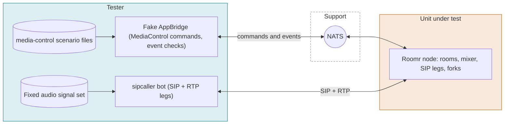

#### ROM-001 Command: answer

P0 · pr · Ref: media-control

**Objective.** The node answers an inbound leg on request.

**Preconditions.** Node up and heartbeating. Inbound INVITE pending.

**Steps.**

1. Bot sends INVITE.
2. Fake AppBridge receives the inbound event and sends answer.
3. Bot checks 200 OK and sends ACK.

**Pass.** 200 OK carries SDP with a negotiated codec. RTP flows after ACK.

**Fail.** No 200, no SDP, or no RTP.

#### ROM-002 Command: room.create and participant.add

P0 · pr · Ref: media-control

**Objective.** A room is created and a SIP leg joins it.

**Preconditions.** Node up.

**Steps.**

1. Send room.create.
2. Send participant.add for the inbound leg.
3. Read events.

**Pass.** Acks arrive with the command id. participant.joined is emitted. Node session count increases by one.

**Fail.** Missing ack, event or count.

#### ROM-003 Command: participant.dial

P0 · pr · Ref: media-control

**Objective.** The node dials out and reports progress.

**Preconditions.** A bot listening as the callee.

**Steps.**

1. Send participant.dial to the bot.
2. Bot rings, then answers.
3. Repeat with busy and no answer.

**Pass.** Progress events (ringing, answered) arrive in order. Busy and no-answer produce the documented failure event.

**Fail.** Missing or wrong events.

#### ROM-004 Command: participant.remove and hangup

P0 · pr · Ref: media-control

**Objective.** Removing a participant ends its leg only.

**Preconditions.** A room with three legs.

**Steps.**

1. Send participant.remove for leg 2.
2. Check legs 1 and 3.
3. Send hangup for leg 1.

**Pass.** Leg 2 gets BYE. Legs 1 and 3 keep audio until hangup. participant.left is emitted for each.

**Fail.** Another leg is affected.

#### ROM-005 Command: room.end

P0 · pr · Ref: media-control

**Objective.** Ending a room releases everything.

**Preconditions.** Room with two legs and a listener.

**Steps.**

1. Send room.end.
2. Check SIP, RTP ports, goroutines and room table.

**Pass.** All legs get BYE. room.ended is emitted. Ports and goroutines return to the pre-test level within 5 s.

**Fail.** Any leak.

#### ROM-006 Mixer: each participant hears everyone but themselves

P0 · nightly · Ref: roomr

**Objective.** Mix-minus is correct for 2, 3 and 10 participants.

**Preconditions.** Bots with distinct tones.

**Steps.**

1. Join N bots, each playing a different tone.
2. Record what each bot receives.
3. Analyse frequencies.

**Pass.** Each bot hears the other N-1 tones and not its own. Level is within the documented tolerance with no clipping.

**Fail.** Own audio returns (echo), a tone is missing, or clipping.

#### ROM-007 Codecs: PCMU, PCMA, Opus and mixed

P0 · nightly · Ref: roomr

**Objective.** Legs with different codecs mix correctly.

**Preconditions.** Bots offering PCMU, PCMA, Opus.

**Steps.**

1. Join one bot per codec to one room.
2. Play speech from each.
3. Record every output.

**Pass.** Each leg receives the others in its own codec. Audio quality score is at or above the codec-pair floor (set at baseline).

**Fail.** Negotiation failure, wrong pitch or speed, or a score below the floor.

#### ROM-008 Listener (fork) attach and detach

P1 · pr · Ref: media-control

**Objective.** A fork receives selected tracks and can be removed mid-call.

**Preconditions.** Room with two legs.

**Steps.**

1. listener.attach tracks=inbound.
2. Detach.
3. Attach tracks=both.
4. Detach.

**Pass.** The listener receives only the selected tracks. Detach stops the stream without affecting the call.

**Fail.** Wrong tracks, or audio glitch on the call.

#### ROM-009 Recording output

P0 · nightly · Ref: roomr, call-record

**Objective.** Recordings are complete and in sync.

**Preconditions.** Recording enabled.

**Steps.**

1. Run a 60 s two-party call with known audio.
2. End the call.
3. Fetch the recording.

**Pass.** File opens, length is 60 s within 100 ms, both parties are present, and sync between tracks is within 20 ms.

**Fail.** Truncated, silent or out-of-sync file.

#### ROM-010 DTMF events in and out

P0 · pr · Ref: media-control

**Objective.** The node reports and sends DTMF correctly.

**Preconditions.** Bot leg.

**Steps.**

1. Bot sends 2833 digits.
2. Send dtmf.send from the fake AppBridge.
3. Read events and bot receive log.

**Pass.** dtmf events match the digits sent. The bot receives the digits sent by the node.

**Fail.** Mismatch.

#### ROM-011 Hold and resume

P1 · pr · Ref: media-control

**Objective.** hold/resume change the media direction.

**Preconditions.** Active leg.

**Steps.**

1. Send hold.
2. Check SDP direction and RTP.
3. Send resume.

**Pass.** SDP uses sendonly/inactive during hold, RTP stops as specified, and resume restores sendrecv.

**Fail.** Media continues during hold or does not resume.

#### ROM-012 Heartbeat and node.down

P0 · pr · Ref: media-control

**Objective.** The node announces itself and its failure.

**Preconditions.** Node up.

**Steps.**

1. Observe node.heartbeat intervals.
2. Kill the node process (SIGKILL).
3. Observe node.down.

**Pass.** Heartbeats arrive at the configured interval with the session count. node.down arrives within the timeout.

**Fail.** No node.down, or wrong counts.

#### ROM-013 Invalid commands

P1 · pr · Ref: media-control

**Objective.** Bad commands are rejected with errors and do not disturb other rooms.

**Preconditions.** Two active rooms.

**Steps.**

1. Send commands with an unknown roomRef, duplicate ids, missing fields, and an unknown type.

**Pass.** Each gets an error ack with a code. The two rooms keep audio.

**Fail.** Panic, a hang, or audio disruption.

#### ROM-014 Node restart reconnect

P1 · nightly · Ref: media-control

**Objective.** The node reconnects to NATS and resumes heartbeats.

**Preconditions.** Node up.

**Steps.**

1. Restart NATS.
2. Observe the node.

**Pass.** The node reconnects without restarting. Calls on RTP continue. Heartbeats resume.

**Fail.** Node exit, or lost calls beyond the documented behavior.

#### ROM-015 Media-control scenario set

P0 · pr · Ref: media-control, roomr · Runs: `scenarios/media-control` (21 scenario files)

**Objective.** Every media-control scenario passes against the fake node and the Go node.

**Preconditions.** Fake node and the Go node, scenario files for media-control.

**Steps.**

1. Run all media-control scenarios against the fake node.
2. Run the same scenarios against the Go node.

**Pass.** Both nodes pass the same scenarios, with no skips.

**Fail.** A scenario passes on one node and fails on the other, or is skipped.

## MQ

### Media quality and packet loss

Objective measurements of what the media path does to audio, and how it behaves when the network misbehaves. Every score is reported relative to the committed baseline, never as an absolute quality claim. Pass bars apply only on the dedicated runner; on shared runners these cases report trends and do not gate.

| | |
| --- | --- |
| Level | L2 Integration (benchmark) |
| Unit under test | Roomr node, with RTPEngine in the path for the edge rows |
| Tester | Signal generator and recorder (bot legs), network impairment (tc netem or UDP proxy), quality scorer (ViSQOL), pprof |
| Environment | Dedicated runner with fixed hardware (shared CI reports trends only); results stored with git SHA, hardware and date |
| Cadence | Nightly on a dedicated runner; full set before release |

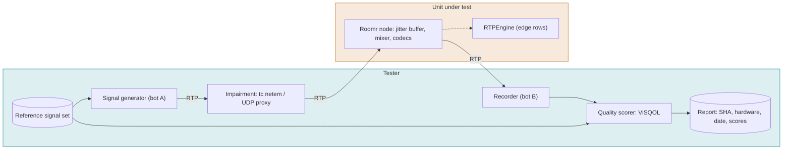

#### MQ-001 Baseline: clean network

P0 · nightly · trials 3×1 · Ref: roomr

**Objective.** Establish the reference score, latency and CPU with no impairment.

**Preconditions.** Reference signal set. No impairment.

**Steps.**

1. Run each reference file through a two-leg call, for each codec pair.
2. Score, and measure added latency and CPU.

**Pass.** Scores, latency and CPU are recorded and committed as the baseline. Added latency under 20 ms (value confirmed at baseline).

**Fail.** No baseline stored, or a score below the codec's published floor.

#### MQ-002 Packet loss 1% (random)

P0 · nightly · trials 3×1 · Ref: roomr

**Objective.** Audio stays intelligible and the node stays stable at 1% random loss on the RTP leg.

**Preconditions.** Node, a bot leg, and a second leg for recording. tc netem (or UDP proxy) between the bot and the node. Reference signal set.

**Steps.**

1. Establish a two-leg call.
2. Apply random loss of 1% on the inbound leg.
3. Send the reference speech file for 60 s.
4. Record the output of the other leg.
5. Score the output (ViSQOL) against the reference, and compute added latency, gaps and sample count.

**Pass.** Score drop against the committed baseline is within the floor for 1% random (floor recorded in the first baseline run). Added latency within budget. No crash, no duplicate audio, no SSRC change.

**Fail.** Score below the floor, a crash, duplicated or reordered audio, or latency over budget.

#### MQ-003 Packet loss 1% (bursty)

P0 · nightly · trials 3×1 · Ref: roomr

**Objective.** Audio stays intelligible and the node stays stable at 1% bursty loss on the RTP leg.

**Preconditions.** Node, a bot leg, and a second leg for recording. tc netem (or UDP proxy) between the bot and the node. Reference signal set.

**Steps.**

1. Establish a two-leg call.
2. Apply bursty loss of 1% on the inbound leg.
3. Send the reference speech file for 60 s.
4. Record the output of the other leg.
5. Score the output (ViSQOL) against the reference, and compute added latency, gaps and sample count.

**Pass.** Score drop against the committed baseline is within the floor for 1% bursty (floor recorded in the first baseline run). Added latency within budget. No crash, no duplicate audio, no SSRC change.

**Fail.** Score below the floor, a crash, duplicated or reordered audio, or latency over budget.

#### MQ-004 Packet loss 2% (random)

P0 · nightly · trials 3×1 · Ref: roomr

**Objective.** Audio stays intelligible and the node stays stable at 2% random loss on the RTP leg.

**Preconditions.** Node, a bot leg, and a second leg for recording. tc netem (or UDP proxy) between the bot and the node. Reference signal set.

**Steps.**

1. Establish a two-leg call.
2. Apply random loss of 2% on the inbound leg.
3. Send the reference speech file for 60 s.
4. Record the output of the other leg.
5. Score the output (ViSQOL) against the reference, and compute added latency, gaps and sample count.

**Pass.** Score drop against the committed baseline is within the floor for 2% random (floor recorded in the first baseline run). Added latency within budget. No crash, no duplicate audio, no SSRC change.

**Fail.** Score below the floor, a crash, duplicated or reordered audio, or latency over budget.

#### MQ-005 Packet loss 2% (bursty)

P0 · nightly · trials 3×1 · Ref: roomr

**Objective.** Audio stays intelligible and the node stays stable at 2% bursty loss on the RTP leg.

**Preconditions.** Node, a bot leg, and a second leg for recording. tc netem (or UDP proxy) between the bot and the node. Reference signal set.

**Steps.**

1. Establish a two-leg call.
2. Apply bursty loss of 2% on the inbound leg.
3. Send the reference speech file for 60 s.
4. Record the output of the other leg.
5. Score the output (ViSQOL) against the reference, and compute added latency, gaps and sample count.

**Pass.** Score drop against the committed baseline is within the floor for 2% bursty (floor recorded in the first baseline run). Added latency within budget. No crash, no duplicate audio, no SSRC change.

**Fail.** Score below the floor, a crash, duplicated or reordered audio, or latency over budget.

#### MQ-006 Packet loss 5% (random)

P0 · nightly · trials 3×1 · Ref: roomr

**Objective.** Audio stays intelligible and the node stays stable at 5% random loss on the RTP leg.

**Preconditions.** Node, a bot leg, and a second leg for recording. tc netem (or UDP proxy) between the bot and the node. Reference signal set.

**Steps.**

1. Establish a two-leg call.
2. Apply random loss of 5% on the inbound leg.
3. Send the reference speech file for 60 s.
4. Record the output of the other leg.
5. Score the output (ViSQOL) against the reference, and compute added latency, gaps and sample count.

**Pass.** Score drop against the committed baseline is within the floor for 5% random (floor recorded in the first baseline run). Added latency within budget. No crash, no duplicate audio, no SSRC change.

**Fail.** Score below the floor, a crash, duplicated or reordered audio, or latency over budget.

#### MQ-007 Packet loss 5% (bursty)

P0 · nightly · trials 3×1 · Ref: roomr

**Objective.** Audio stays intelligible and the node stays stable at 5% bursty loss on the RTP leg.

**Preconditions.** Node, a bot leg, and a second leg for recording. tc netem (or UDP proxy) between the bot and the node. Reference signal set.

**Steps.**

1. Establish a two-leg call.
2. Apply bursty loss of 5% on the inbound leg.
3. Send the reference speech file for 60 s.
4. Record the output of the other leg.
5. Score the output (ViSQOL) against the reference, and compute added latency, gaps and sample count.

**Pass.** Score drop against the committed baseline is within the floor for 5% bursty (floor recorded in the first baseline run). Added latency within budget. No crash, no duplicate audio, no SSRC change.

**Fail.** Score below the floor, a crash, duplicated or reordered audio, or latency over budget.

#### MQ-008 Packet loss 10% (random)

P1 · nightly · trials 3×1 · Ref: roomr

**Objective.** Audio stays intelligible and the node stays stable at 10% random loss on the RTP leg.

**Preconditions.** Node, a bot leg, and a second leg for recording. tc netem (or UDP proxy) between the bot and the node. Reference signal set.

**Steps.**

1. Establish a two-leg call.
2. Apply random loss of 10% on the inbound leg.
3. Send the reference speech file for 60 s.
4. Record the output of the other leg.
5. Score the output (ViSQOL) against the reference, and compute added latency, gaps and sample count.

**Pass.** Score drop against the committed baseline is within the floor for 10% random (floor recorded in the first baseline run). Added latency within budget. No crash, no duplicate audio, no SSRC change.

**Fail.** Score below the floor, a crash, duplicated or reordered audio, or latency over budget.

#### MQ-009 Packet loss 10% (bursty)

P1 · nightly · trials 3×1 · Ref: roomr

**Objective.** Audio stays intelligible and the node stays stable at 10% bursty loss on the RTP leg.

**Preconditions.** Node, a bot leg, and a second leg for recording. tc netem (or UDP proxy) between the bot and the node. Reference signal set.

**Steps.**

1. Establish a two-leg call.
2. Apply bursty loss of 10% on the inbound leg.
3. Send the reference speech file for 60 s.
4. Record the output of the other leg.
5. Score the output (ViSQOL) against the reference, and compute added latency, gaps and sample count.

**Pass.** Score drop against the committed baseline is within the floor for 10% bursty (floor recorded in the first baseline run). Added latency within budget. No crash, no duplicate audio, no SSRC change.

**Fail.** Score below the floor, a crash, duplicated or reordered audio, or latency over budget.

#### MQ-010 Packet loss 20% (random)

P1 · nightly · trials 3×1 · Ref: roomr

**Objective.** Audio stays intelligible and the node stays stable at 20% random loss on the RTP leg.

**Preconditions.** Node, a bot leg, and a second leg for recording. tc netem (or UDP proxy) between the bot and the node. Reference signal set.

**Steps.**

1. Establish a two-leg call.
2. Apply random loss of 20% on the inbound leg.
3. Send the reference speech file for 60 s.
4. Record the output of the other leg.
5. Score the output (ViSQOL) against the reference, and compute added latency, gaps and sample count.

**Pass.** Score drop against the committed baseline is within the floor for 20% random (floor recorded in the first baseline run). Added latency within budget. No crash, no duplicate audio, no SSRC change.

**Fail.** Score below the floor, a crash, duplicated or reordered audio, or latency over budget.

#### MQ-011 Packet loss 20% (bursty)

P1 · nightly · trials 3×1 · Ref: roomr

**Objective.** Audio stays intelligible and the node stays stable at 20% bursty loss on the RTP leg.

**Preconditions.** Node, a bot leg, and a second leg for recording. tc netem (or UDP proxy) between the bot and the node. Reference signal set.

**Steps.**

1. Establish a two-leg call.
2. Apply bursty loss of 20% on the inbound leg.
3. Send the reference speech file for 60 s.
4. Record the output of the other leg.
5. Score the output (ViSQOL) against the reference, and compute added latency, gaps and sample count.

**Pass.** Score drop against the committed baseline is within the floor for 20% bursty (floor recorded in the first baseline run). Added latency within budget. No crash, no duplicate audio, no SSRC change.

**Fail.** Score below the floor, a crash, duplicated or reordered audio, or latency over budget.

#### MQ-012 Jitter

P1 · nightly · trials 3×1 · Ref: roomr

**Objective.** Variable delay is absorbed by the jitter buffer.

**Preconditions.** Impairment tool.

**Steps.**

1. Apply jitter of 20, 50 and 100 ms.
2. Run the reference speech.
3. Score and read RTP stats.

**Pass.** Score at or above the floor for each level. Buffer growth stays bounded. Added latency returns to baseline when jitter stops.

**Fail.** Score below the floor, or latency does not recover.

#### MQ-013 Reordered packets

P1 · nightly · trials 3×1 · Ref: roomr

**Objective.** Out-of-order packets are put back in order.

**Preconditions.** Impairment tool.

**Steps.**

1. Reorder 5% and 20% of packets.
2. Run reference speech.
3. Compare.

**Pass.** Output has no audible reordering. Score at or above the floor.

**Fail.** Reordered audio in the output.

#### MQ-014 Duplicate packets

P1 · nightly · trials 3×1 · Ref: roomr

**Objective.** Duplicates are dropped.

**Preconditions.** Impairment tool.

**Steps.**

1. Duplicate 10% of packets.
2. Run reference speech.
3. Compare sample count.

**Pass.** Output length equals input length within one packet. No repeated audio.

**Fail.** Duplicated audio or a longer output.

#### MQ-015 One-way delay

P2 · nightly · trials 3×1 · Ref: roomr

**Objective.** A constant added delay does not break sync or the mix.

**Preconditions.** Impairment tool.

**Steps.**

1. Add 100, 250 and 500 ms to one leg in a three-leg room.
2. Record each output.

**Pass.** Legs stay stable. Mix contains all participants. Added node latency is unchanged.

**Fail.** Drift, dropouts or a leg reset.

#### MQ-016 RTP timestamp jump and SSRC change

P1 · nightly · trials 3×1 · Ref: roomr

**Objective.** A mid-call SSRC change or timestamp jump (provider or NAT rebind) does not break the leg.

**Preconditions.** Bot able to change SSRC.

**Steps.**

1. During a call change SSRC.
2. Jump the timestamp forward by 10 s.
3. Continue the speech.

**Pass.** Audio continues within 200 ms. No crash, no long silence.

**Fail.** Silence, one-way audio, or a dropped call.

#### MQ-017 Silence suppression and comfort noise

P1 · nightly · trials 3×1 · Ref: roomr

**Objective.** Gaps in RTP do not create glitches or false drops.

**Preconditions.** Bot sending DTX/CN.

**Steps.**

1. Send speech with 10 s of silence (no RTP) in the middle.
2. Record the output.

**Pass.** Silence plays as silence or comfort noise. Speech after the gap is intact. The leg is not marked dead.

**Fail.** Clipped first words, or a dropped leg.

#### MQ-018 Clock drift

P1 · nightly · trials 3×1 · Ref: roomr

**Objective.** A sender with +/-100 ppm drift does not grow latency over a long call.

**Preconditions.** Bot with a configurable clock offset.

**Steps.**

1. Run a 30 min call with +100 ppm and -100 ppm.
2. Measure latency at start and end.

**Pass.** Latency growth under 20 ms over 30 min. No audible slip or repeat.

**Fail.** Growing latency, clicks or repeated frames.

#### MQ-019 Recording fidelity under loss

P1 · nightly · trials 3×1 · Ref: roomr, call-record

**Objective.** The recording matches what the participants heard.

**Preconditions.** Recording enabled. 5% random loss.

**Steps.**

1. Run the call.
2. Compare the recording with the recorded outputs of both legs.

**Pass.** Recording length equals call length within 100 ms. Scores of recording and live output differ by less than the tolerance set at baseline.

**Fail.** Missing audio or a length mismatch.

#### MQ-020 Resource cost per participant

P1 · nightly · trials 3×1 · Ref: roomr

**Objective.** CPU, memory and allocations per participant are known and stable.

**Preconditions.** pprof enabled.

**Steps.**

1. Run rooms of 2, 5 and 10 participants for each codec for 10 min.
2. Collect CPU, RSS and allocations/s.

**Pass.** Values recorded in the report. Cost per participant is linear within 20%. No allocations in the steady-state audio loop beyond the budget.

**Fail.** Non-linear growth, or allocation growth over time.

## LDS

### Load and soak

Where the platform breaks, why, and whether it recovers. Capacity numbers are only published with the hardware, git SHA and date.

| | |
| --- | --- |
| Level | L3 System (load) |
| Unit under test | Routr, RTPEngine and Roomr nodes; AppBridge workers (with fake providers) |
| Tester | SIPp / sipcaller bots generating calls, scale.ts for AppBridge sessions, Prometheus and pprof for observation |
| Environment | Dedicated hardware or a rented cluster; fake STT, TTS and LLM so we measure our system, not vendors |
| Cadence | Before release and after any media-path change; soak runs 12 to 24 h |

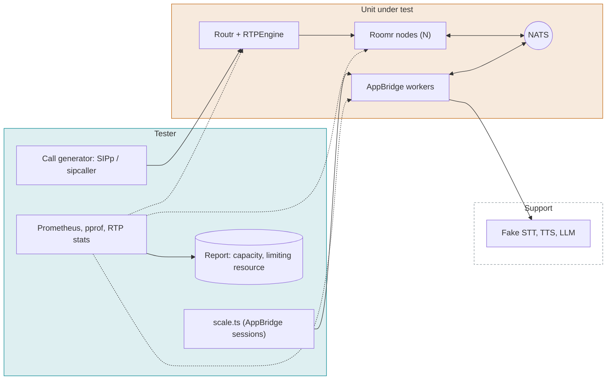

#### LDS-001 Call setup rate ramp

P1 · release · Ref: observability

**Objective.** Find the calls-per-second ceiling and what fails first.

**Preconditions.** Stack on dedicated hardware. Calls last 30 s.

**Steps.**

1. Start at 1 CPS and double every 2 minutes until the failure criteria.
2. Record the CPS at the first failure and the resource that saturated.

**Pass.** Ceiling and limiting resource are recorded. Below the ceiling, 99.9% of calls connect and setup time p95 is within budget (set at baseline).

**Fail.** Failures below the ceiling, or no recorded limiting resource.

#### LDS-002 Concurrent calls ceiling

P1 · release · Ref: roomr

**Objective.** Find the highest concurrent call count with acceptable quality.

**Preconditions.** Calls hold for 10 min with a known audio.

**Steps.**

1. Ramp concurrency in steps of 100.
2. At each step score a sample of calls (ViSQOL) and read CPU, memory, network.
3. Stop when quality drops below the floor.

**Pass.** The number N is recorded with the limiting resource, at the quality floor.

**Fail.** Quality degrades without a recorded cause.

#### LDS-003 Registration storm

P1 · release · Ref: control-plane

**Objective.** Many softphones re-register at once after a restart.

**Preconditions.** 5,000 simulated registrations.

**Steps.**

1. Restart Routr.
2. All clients re-register within 10 s.
3. Place a test call during the storm.

**Pass.** All registrations succeed within the budget. The test call connects.

**Fail.** Registrations dropped, or calls fail.

#### LDS-004 Single node capacity

P1 · release · Ref: roomr

**Objective.** A Roomr node's session capacity per size.

**Preconditions.** One node of a given size.

**Steps.**

1. Add two-leg rooms until quality drops (defined floor or p99 packet-out interval over 25 ms).
2. Record CPU, memory, network.

**Pass.** Capacity and limiting resource recorded for each node size.

**Fail.** No limit recorded.

#### LDS-005 Fairness: one slow participant

P0 · release · Ref: roomr

**Objective.** A slow or stalled participant does not harm others in the room or node.

**Preconditions.** Rooms of five.

**Steps.**

1. Stall one leg's RTP (stop sending) in one room.
2. Score the other legs in that room and in other rooms.

**Pass.** Other legs' scores are unchanged within tolerance. The stalled leg is removed after the dead-leg timeout.

**Fail.** Other legs degrade.

#### LDS-006 AppBridge session scale

P1 · release · Ref: voice-session

**Objective.** AppBridge capacity per worker.

**Preconditions.** scale.ts, fake providers.

**Steps.**

1. Run 100, 500 and 1000 sessions for 60 s each.
2. Record memory per session, event-loop lag, NATS message rate.

**Pass.** Numbers are recorded. Event-loop lag p99 within budget. Memory returns to baseline within 60 s after the sessions end.

**Fail.** Lag over budget, or memory not released.

#### LDS-007 Soak 24 hours

P1 · release · Ref: observability

**Objective.** No leaks or drift over a day.

**Preconditions.** Steady load at 50% of the ceiling.

**Steps.**

1. Run for 24 h.
2. Sample goroutines, memory, file descriptors, ports and RTPEngine sessions every minute.

**Pass.** All series are flat (no trend above the noise band). Call success rate stays at or above 99.9%.

**Fail.** Any growing series, or a drop in success rate.

#### LDS-008 Node kill under load

P0 · release · Ref: roomr, media-control

**Objective.** Losing a node affects only its calls.

**Preconditions.** Three nodes at 50% load.

**Steps.**

1. Kill one node with SIGKILL.
2. Watch calls, node.down and new call placement.

**Pass.** The calls on that node end cleanly (caller hears hangup, records are sealed). Other calls are unaffected. New calls avoid the dead node within the detection time.

**Fail.** Other calls degrade, or new calls are routed to the dead node.

#### LDS-009 Overload behavior

P1 · release · Ref: roomr

**Objective.** Beyond capacity the platform refuses new calls instead of degrading all calls.

**Preconditions.** Load at 150% of capacity.

**Steps.**

1. Push beyond the ceiling.
2. Score established calls.

**Pass.** New calls are refused with a clear response. Established calls keep their quality.

**Fail.** Established calls degrade.

## APB

### AppBridge

The per-call TypeScript service: the session protocol, turn-taking, the speech layer, call records and webhooks. Roomr and every provider are fakes.

| | |
| --- | --- |
| Level | L2 Integration (service) |
| Unit under test | AppBridge (mods/appbridge) |
| Tester | Conformance runner that plays the app, fake Roomr node, fake STT, TTS and LLM providers, replay tool and turn corpus |
| Environment | Local with NATS; dedicated runner for timing numbers |
| Cadence | Every pull request; timing, replay and Pipecat nightly |

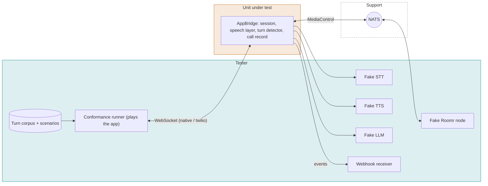

#### APB-001 Session lifecycle

P0 · pr · Ref: voice-session

**Objective.** A session is created, runs and is cleaned up on hangup.

**Preconditions.** Fake node.

**Steps.**

1. Fake node sends an inbound call.
2. Runner connects as the app.
3. End the call from each side in turn.

**Pass.** The session starts once, ends once, and resources are released within 5 s. The call record is sealed.

**Fail.** A leaked session, a double end, or an unsealed record.

#### APB-002 Native flavor: full scenario set

P0 · pr · Ref: voice-session, conformance · Runs: `scenarios/voice-session` (64 scenario files)

**Objective.** Every native-flavor scenario passes.

**Preconditions.** Scenario files for voice-session.

**Steps.**

1. Run all voice-session scenarios.

**Pass.** All scenarios pass. None skipped.

**Fail.** Any failure or skip.

#### APB-003 Twilio flavor: full scenario set

P0 · pr · Ref: twilio-media-streams-flavor · Runs: `scenarios/twilio-media-streams-flavor` (10 scenario files)

**Objective.** Every Twilio-flavor scenario passes.

**Preconditions.** Scenario files for twilio-media-streams-flavor.

**Steps.**

1. Run all scenarios.

**Pass.** All scenarios pass.

**Fail.** Any failure.

#### APB-004 Turn-taking corpus

P0 · nightly · trials 5×1 · Ref: turn-taking · Runs: `scenarios/turn-taking` (20 scenario files)

**Objective.** End-of-turn decisions meet the pass bars.

**Preconditions.** Turn corpus and replay tool. Bars from docs/turn-taking.md.

**Steps.**

1. Run replay over the corpus.
2. Read the report.

**Pass.** Every metric meets its bar (premature cut-in rate, late response rate, barge-in stop time).

**Fail.** Any metric misses its bar.

#### APB-005 Interruption stop budget

P0 · nightly · trials 5×1 · Ref: turn-taking

**Objective.** Playback stops quickly when the caller interrupts.

**Preconditions.** Fake TTS streaming audio.

**Steps.**

1. Start long playback.
2. Inject caller speech.
3. Measure time to the last audio frame.

**Pass.** Stop time p95 within the budget (50 ms in the T1 timing bar).

**Fail.** Over budget.

#### APB-006 Speech layer: STT final and partial

P0 · pr · Ref: voice-session

**Objective.** Partial and final transcripts are delivered once and in order.

**Preconditions.** Fake STT emits partials then a final.

**Steps.**

1. Stream audio.
2. Read events at the app.

**Pass.** Partials arrive in order, one final per utterance, no duplicates (including provider duplicate-final bugs).

**Fail.** Duplicate, missing or reordered transcript events.

#### APB-007 Speech layer: TTS streaming and play

P0 · pr · Ref: voice-session

**Objective.** TTS audio is sent to the node in order and complete.

**Preconditions.** Fake TTS returns a known waveform.

**Steps.**

1. App sends say.
2. Capture the audio at the fake node.

**Pass.** Captured audio equals the waveform in order and length, at the node's rate.

**Fail.** Gaps, reorder or truncation.

#### APB-008 Provider selection from the catalog

P1 · pr · Ref: provider-registry

**Objective.** Catalog ids resolve to the right provider and settings.

**Preconditions.** Catalog with fake and real entries.

**Steps.**

1. Create apps with different catalog ids.
2. Run calls.
3. Check which provider receives audio.

**Pass.** The selected provider is used. An unknown id fails at save time, not at call time.

**Fail.** Wrong provider, or a call-time failure for an invalid id.

#### APB-009 Call record content and signature

P0 · pr · Ref: call-record

**Objective.** The call record is complete and tamper-evident.

**Preconditions.** A completed call with speech, DTMF and a transfer.

**Steps.**

1. Fetch the record.
2. Verify the signature.
3. Alter one byte and verify again.

**Pass.** Record has parties, timings, transcript, DTMF, transfer and hangup reason. Signature verifies; the altered copy fails.

**Fail.** Missing content, or tampering not detected.

#### APB-010 Webhook delivery

P1 · pr · Ref: workspace-webhooks

**Objective.** Workspace webhooks are delivered, signed and retried.

**Preconditions.** Webhook endpoint that fails twice, then succeeds.

**Steps.**

1. Complete a call.
2. Observe deliveries.

**Pass.** The event arrives with a valid signature, is retried with backoff, and is delivered once successfully. Order per call is preserved.

**Fail.** No retry, a bad signature, or reordered events.

#### APB-011 Twilio app unchanged

P1 · pr · Ref: twilio-media-streams-flavor

**Objective.** An existing Twilio Media Streams app works without changes.

**Preconditions.** Reference Twilio-style app.

**Steps.**

1. Point a number at the app.
2. Place a call.
3. Compare behavior with the reference transcript.

**Pass.** Behavior matches the reference.

**Fail.** Any difference.

#### APB-012 Timing: end of turn to first audio

P1 · nightly · trials 3×1 · Ref: conformance

**Objective.** The added latency of AppBridge is known and within bars.

**Preconditions.** Dedicated runner. Fake providers with fixed latencies.

**Steps.**

1. Run 200 turns (CONFORMANCE_TIMING_RUNS=200).
2. Read T1 to Tn results.

**Pass.** Every T bar is met at the stated percentile.

**Fail.** A bar is missed.

#### APB-013 Autopilot scenario set

P0 · pr · trials 3×1 · Ref: autopilot, turn-taking · Runs: `scenarios/autopilot` (26 scenario files)

**Objective.** Every Autopilot scenario passes.

**Preconditions.** Autopilot engine, fake STT, TTS and LLM, scenario files for autopilot.

**Steps.**

1. Run all autopilot scenarios with the conformance runner.

**Pass.** All scenarios pass and none is skipped.

**Fail.** Any failure or skip.

## FLT

### Fault injection

Suppress: break each dependency on purpose and check the expected behavior. Where the behavior is not written down, writing it is part of the test.

| | |
| --- | --- |
| Level | L2/L3 Integration (negative) |
| Unit under test | AppBridge and Roomr, plus their reaction to app, provider, NATS and node failures |
| Tester | Fakes with fault switches, a NATS proxy (toxiproxy or a container restart), process kill |
| Environment | Local stack with fakes |
| Cadence | Nightly; every pull request for the fast subset |

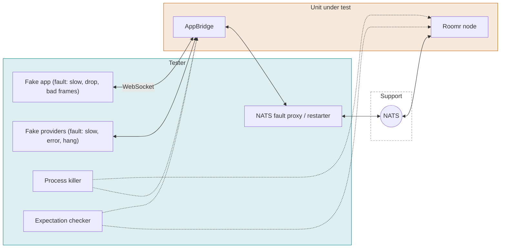

#### FLT-001 App is a slow reader

P0 · nightly · Ref: voice-session

**Objective.** A slow app cannot exhaust AppBridge memory or stall the call.

**Preconditions.** Fake app that reads at 10% of the audio rate.

**Steps.**

1. Start a call with continuous inbound audio.
2. Watch AppBridge memory and the call for 2 min.

**Pass.** Memory stays bounded. Per the spec, audio is dropped or the session closed with the documented code. Other sessions are unaffected.

**Fail.** Unbounded memory growth or impact on other sessions.

#### FLT-002 App disconnects mid-call

P0 · nightly · Ref: voice-session

**Objective.** A closed app socket ends the call cleanly.

**Preconditions.** Active call.

**Steps.**

1. Close the app WebSocket without a goodbye.

**Pass.** The caller is released with the documented behavior (hangup or fallback) within the timeout, and the record shows the reason.

**Fail.** The call stays up in silence.

#### FLT-003 App sends bad and huge frames

P0 · nightly · Ref: voice-session

**Objective.** Malformed input from an app is contained.

**Preconditions.** Fake app.

**Steps.**

1. Send invalid JSON, a 100 MB frame, binary before start, and 10,000 messages per second.

**Pass.** The session closes with the documented code. AppBridge keeps serving other sessions.

**Fail.** Crash, hang or CPU starvation.

#### FLT-004 STT provider disconnects mid-stream

P0 · nightly · Ref: provider-registry

**Objective.** A provider drop is retried or reported.

**Preconditions.** Fake STT with a disconnect switch.

**Steps.**

1. Disconnect STT during an utterance.
2. Continue speaking.

**Pass.** AppBridge reconnects or switches per policy. The app receives an error event if recovery fails. The call stays up.

**Fail.** Silent loss of transcripts without an event.

#### FLT-005 TTS provider slow or erroring

P0 · nightly · Ref: provider-registry

**Objective.** A failing TTS does not hang the turn.

**Preconditions.** Fake TTS with latency and error switches.

**Steps.**

1. Set TTS to a 10 s first-byte delay.
2. Set TTS to return 500.
3. Send say.

**Pass.** The app gets an error or timeout event within the budget. The call can continue.

**Fail.** A hang with dead air and no event.

#### FLT-006 LLM provider hangs (Autopilot)

P1 · nightly · Ref: autopilot

**Objective.** Autopilot recovers from a stuck LLM call.

**Preconditions.** Autopilot app, fake LLM that never answers.

**Steps.**

1. Ask a question.
2. Wait for the timeout.

**Pass.** The agent says its fallback line within the configured timeout, and the next turn works.

**Fail.** The call stalls.

#### FLT-007 Wrong audio format from a provider

P1 · nightly · Ref: provider-registry

**Objective.** A provider returning an unexpected format is rejected or converted.

**Preconditions.** Fake TTS returning 24 kHz when 8 kHz is expected.

**Steps.**

1. Send say.

**Pass.** The audio is resampled or an error is raised. No chipmunk audio reaches the caller.

**Fail.** Wrong-speed audio on the call.

#### FLT-008 NATS restart

P0 · nightly · Ref: deployment

**Objective.** A bus restart does not kill active calls.

**Preconditions.** Ten active calls.

**Steps.**

1. Restart NATS.
2. Watch calls for 60 s.
3. Place a new call.

**Pass.** RTP calls continue. Control reconnects within the budget. Commands issued during the gap are retried or fail with a clear error. New calls work.

**Fail.** Dropped calls, a stuck process, or lost records.

#### FLT-009 NATS partition

P1 · nightly · Ref: media-control

**Objective.** A network partition between AppBridge and the node is detected.

**Preconditions.** Active call.

**Steps.**

1. Block NATS traffic for the node for 30 s.
2. Restore.

**Pass.** The node is marked down after the timeout and the call is ended cleanly on both sides, or recovers if shorter than the timeout.

**Fail.** A zombie call, or a leaked room.

#### FLT-010 Roomr node crash mid-call

P0 · nightly · Ref: media-control

**Objective.** A node crash is detected and callers are released.

**Preconditions.** Active calls on one node.

**Steps.**

1. SIGKILL the node.
2. Observe AppBridge, Routr and the records.

**Pass.** AppBridge receives node.down, ends the sessions, and seals records marked as node failure. Routr stops sending to the node.

**Fail.** Sessions stuck, or unsealed records.

#### FLT-011 AppBridge crash mid-call

P0 · nightly · Ref: voice-session

**Objective.** An AppBridge crash does not leave the media node holding the call forever.

**Preconditions.** Active calls.

**Steps.**

1. Kill the AppBridge process.

**Pass.** The node ends the orphaned rooms within the timeout. The record is sealed as failed by the recovery path.

**Fail.** Orphaned rooms.

#### FLT-012 Clock skew between services

P2 · nightly · Ref: voice-session

**Objective.** Signature checks and timestamps tolerate normal skew.

**Preconditions.** Services with a 2 s skew, then 10 min.

**Steps.**

1. Start a call with each skew.

**Pass.** 2 s skew works. 10 min skew is refused with a clear error.

**Fail.** Failures at 2 s, or acceptance at 10 min.

## SEC

### Security and isolation

Workspace isolation on the API and on SIP, keys and secrets, service-to-service trust, and signing.

| | |
| --- | --- |
| Level | L3 System (negative) |
| Unit under test | Apiserver, identity, Routr, Roomr, AppBridge, NATS and webhook signing |
| Tester | An attacker-role client with legitimate credentials for workspace A, a packet capture, and a log scanner |
| Environment | Full stack with two workspaces and distinct data |
| Cadence | Every pull request for the API rows; nightly for SIP and NATS rows |

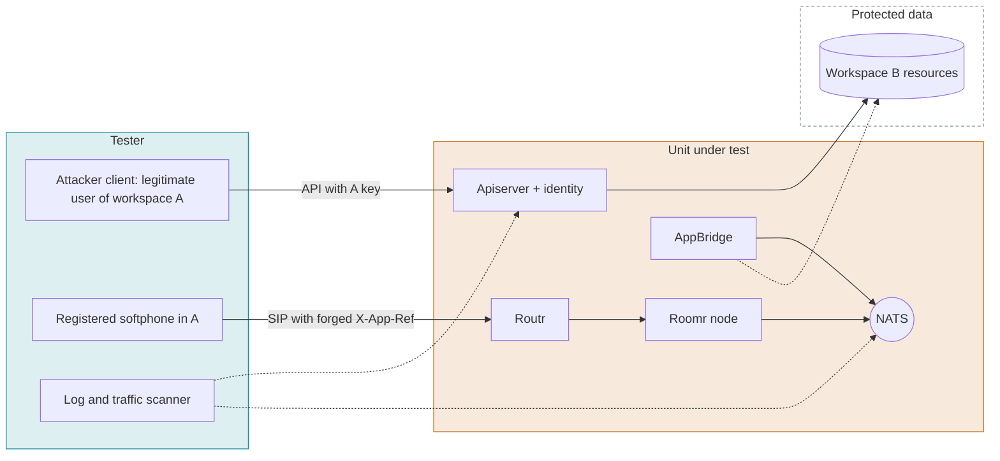

#### SEC-001 API: cross-workspace read, update, delete

P0 · pr · Ref: identity

**Objective.** No RPC reaches another workspace's data.

**Preconditions.** Resources in A and B. A's key.

**Steps.**

1. For every RPC, call with ids from B using A's key (see API area).

**Pass.** All denied with no information leak.

**Fail.** Any access.

#### SEC-002 SIP: forged X-App-Ref across workspaces

P0 · nightly · Ref: roomr

**Objective.** A registered softphone cannot start a session for another workspace's application.

**Preconditions.** Softphone registered in A. Application in B.

**Steps.**

1. Send INVITE with B's X-App-Ref to the media-node peer.
2. Check for a session in B.

**Pass.** Refused. No session in B.

**Fail.** A session starts. Known gap, expected to fail until fixed.

#### SEC-003 Talk-in-browser is workspace checked

P0 · pr · Ref: talk-in-browser

**Objective.** A browser test call cannot target an application in another workspace.

**Preconditions.** A user in A; an application in B.

**Steps.**

1. Request a test call for B's application with A's token.

**Pass.** Denied by the gateway.

**Fail.** The call starts.

#### SEC-004 Token tampering

P0 · pr · Ref: identity

**Objective.** Altered, replayed or unsigned tokens are rejected.

**Preconditions.** A valid access token.

**Steps.**

1. Change the workspace claim.
2. Change the role claim.
3. Strip the signature.
4. Use an old refresh token after rotation.

**Pass.** Each is rejected.

**Fail.** Any is accepted.

#### SEC-005 API key scope and revocation

P0 · pr · Ref: identity

**Objective.** Keys are limited to their role, and revocation is immediate.

**Preconditions.** A member-role key.

**Steps.**

1. Use an owner-only RPC with the key.
2. Revoke the key.
3. Use it again within 5 s.

**Pass.** Denied the first time. Revoked key fails within the documented time.

**Fail.** Role bypass, or the revoked key still works.

#### SEC-006 Secrets never appear in logs or responses

P0 · pr · Ref: observability

**Objective.** Trunk passwords, API keys and provider keys are not leaked.

**Preconditions.** Secrets with a known marker value.

**Steps.**

1. Exercise create, get, update and failing paths.
2. Scan all service logs, traces and API responses for the marker.

**Pass.** The marker appears nowhere except where the user must see it once (key creation).

**Fail.** Any occurrence.

#### SEC-007 NATS authentication between services

P0 · nightly · Ref: deployment

**Objective.** Only services with credentials can publish and subscribe, and only on their subjects.

**Preconditions.** NATS with per-service credentials.

**Steps.**

1. Connect with no credentials.
2. Connect as Routr and subscribe to _INBOX.>.
3. Publish a MediaControl command from an unrelated service.

**Pass.** Unauthenticated connections are refused. Cross-service subjects are denied. Known gap: _INBOX.> is readable; expected to fail until fixed.

**Fail.** Any unauthorized subscribe or publish.

#### SEC-008 Webhook and session signatures

P0 · pr · Ref: workspace-webhooks, voice-session

**Objective.** Receivers can verify messages and reject forgeries.

**Preconditions.** Receiver code from the docs.

**Steps.**

1. Verify a real delivery.
2. Alter the body.
3. Replay an old delivery after the tolerance.

**Pass.** The real delivery verifies. The altered and replayed ones fail.

**Fail.** Any forged message verifies.

#### SEC-009 Transport security

P1 · nightly · Ref: deployment

**Objective.** TLS and SRTP are enforced where configured.

**Preconditions.** TLS trunk and SRTP-required number.

**Steps.**

1. Connect to the API over plain HTTP.
2. Place a call over SIP/TLS.
3. Capture RTP on an SRTP-required call.

**Pass.** Plain HTTP is refused or redirected. The capture shows no clear RTP on the SRTP-required call.

**Fail.** Clear media or an unencrypted API.

#### SEC-010 Hostile SIP input does not crash the edge

P1 · nightly · Ref: deployment

**Objective.** Malformed or oversized SIP is rejected and the edge keeps serving calls.

**Preconditions.** Active calls and a SIP fuzz tool.

**Steps.**

1. Send malformed requests, giant headers, an INVITE flood and unknown methods for 5 min.
2. Watch the active calls.

**Pass.** Hostile traffic is rejected. Active calls are unaffected. No crash.

**Fail.** A crash, or call degradation.

#### SEC-011 Recording and record access

P0 · pr · Ref: call-record

**Objective.** Recordings and call records follow workspace access rules.

**Preconditions.** Records in A and B.

**Steps.**

1. With A's key, fetch B's recording URL and record id.
2. Use an expired signed URL.

**Pass.** Denied for B. Expired URLs fail.

**Fail.** Access granted.

## BRG

### Billing, metering and regions

Money and distribution: usage metering and the credit ledger against the Stripe fake, and private regions enrolled from another machine.

| | |
| --- | --- |
| Level | L3 System |
| Unit under test | Billing service, usage metering, region agent and region enrollment |
| Tester | Stripe fake (same events and behavior as Stripe) and a scripted call generator; for regions, a second machine or container stack |
| Environment | Compose stack with the Stripe fake; two stacks for the region rows |
| Cadence | Every pull request for billing; nightly for regions |

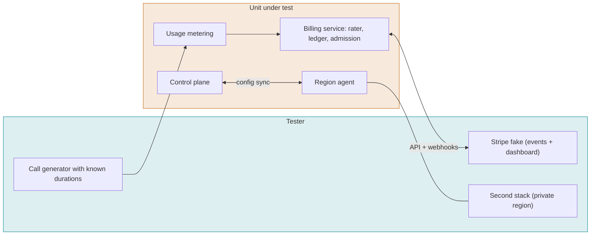

#### BRG-001 Metering accuracy

P0 · nightly · Ref: usage-metering

**Objective.** Billed usage equals actual usage.

**Preconditions.** Calls with known durations and features (AMD, noise cancelling).

**Steps.**

1. Place 20 calls of known length.
2. Read usage after they end.

**Pass.** Usage equals the known totals within the rounding rule. Each feature is metered separately.

**Fail.** A difference above the rounding rule.

#### BRG-002 Credit ledger

P0 · nightly · Ref: usage-metering

**Objective.** Credits are debited correctly and never go below the rule.

**Preconditions.** Workspace with 1,000 credits ($0.01 each).

**Steps.**

1. Use credits through calls.
2. Read the ledger and balance.

**Pass.** Ledger entries sum to the balance. Each entry references its usage.

**Fail.** A mismatch.

#### BRG-003 Admission when credits run out

P0 · nightly · Ref: usage-metering

**Objective.** Calls are refused when the workspace cannot pay.

**Preconditions.** Balance near zero.

**Steps.**

1. Place a call that would exceed the balance.

**Pass.** The call is refused (or ended) per the documented rule, with a clear reason. Other workspaces are unaffected.

**Fail.** Unbounded negative balance.

#### BRG-004 Subscribe, pay and invoice

P0 · nightly · Ref: usage-metering

**Objective.** A plan purchase works through Stripe events.

**Preconditions.** Stripe fake.

**Steps.**

1. As owner, subscribe to a plan ($25 minimum).
2. Complete payment in the fake.
3. Check the workspace.

**Pass.** The plan is active after the paid event. An invoice is visible to the workspace owner role.

**Fail.** State differs from the Stripe fake's.

#### BRG-005 Payment failure and recovery

P0 · nightly · Ref: usage-metering

**Objective.** A failed payment restricts the workspace and recovery restores it.

**Preconditions.** Active plan.

**Steps.**

1. Fail the next payment in the fake.
2. Observe the workspace.
3. Pay successfully.

**Pass.** The workspace follows the documented grace and restriction rules, and is restored after payment.

**Fail.** No restriction, or no recovery.

#### BRG-006 Duplicate and out-of-order Stripe events

P0 · nightly · Ref: usage-metering

**Objective.** Webhook processing is idempotent.

**Preconditions.** Stripe fake able to replay.

**Steps.**

1. Send each event twice.
2. Send events out of order.

**Pass.** The final state is correct and no double charge or credit occurs.

**Fail.** Double processing.

#### BRG-007 Private region enrollment

P1 · nightly · Ref: private-regions

**Objective.** A private region can be enrolled from a second stack.

**Preconditions.** Second stack (a second Compose project or VM) with the region agent image.

**Steps.**

1. Create a region through the API and take the enrollment command.
2. Run the command in the second stack from the test script.
3. Poll the region status.

**Pass.** The region becomes online within the timeout. Config syncs. The nodes are listed.

**Fail.** Enrollment fails or the status is wrong.

#### BRG-008 Call in a private region

P1 · nightly · Ref: private-regions

**Objective.** A call is handled in the region and records reach the control plane.

**Preconditions.** Enrolled region and an application assigned to it.

**Steps.**

1. A SIP bot calls a number in the region.
2. Exchange tones and hang up.
3. Capture RTP at the global stack's edge.
4. Read the record through the API.

**Pass.** All media terminates inside the region (no RTP seen at the global edge). The record appears in the control plane.

**Fail.** Media goes through another region, or the record is missing.

#### BRG-009 Region offline

P1 · nightly · Ref: regions

**Objective.** A lost region is shown as offline and does not affect others.

**Preconditions.** Enrolled region.

**Steps.**

1. Disconnect the region.
2. Place calls in other regions.
3. Reconnect.

**Pass.** The region shows offline within the timeout. Other regions are unaffected. Config resyncs on return.

**Fail.** Wrong status or cross-region impact.

#### BRG-010 Placement skips unavailable nodes

P1 · nightly · Ref: regions

**Objective.** New sessions go only to nodes that are up and have capacity.

**Preconditions.** Region with three nodes, one down, one full.

**Steps.**

1. Place 10 calls.

**Pass.** All calls land on the healthy node. Known gap: full nodes are not skipped today.

**Fail.** A call lands on a down or full node.

#### BRG-011 Region scenario set

P1 · nightly · Ref: regions, private-regions · Runs: `scenarios/regions` (8 scenario files)

**Objective.** Every region scenario passes.

**Preconditions.** Region agent and control plane, scenario files for regions.

**Steps.**

1. Run all region scenarios with the conformance runner.

**Pass.** All scenarios pass and none is skipped.

**Fail.** Any failure or skip.

## OPS

### Deployment, upgrade, Kubernetes and observability

Does it install, upgrade, recover and tell us what it is doing. Functional rows run on kind or k3d; scale rows run on a rented cluster. Media results from kind are not trusted.

| | |
| --- | --- |
| Level | L3 System (operations) |
| Unit under test | Compose bundle, Helm chart, all services, upgrade and migration paths, telemetry |
| Tester | Install scripts, kubectl/helm, a chaos script, the 10-call smoke, an OpenTelemetry collector with assertions |
| Environment | kind or k3d (functional); a real cluster for a few days (scale); a dedicated media setup (host networking, dedicated nodes) |
| Cadence | Install, upgrade and smoke on every release candidate; chaos and scale before release |

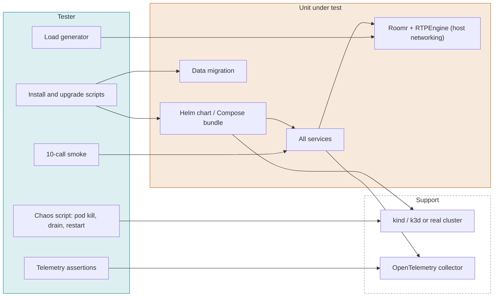

#### OPS-001 Compose install from scratch

P0 · release · Ref: self-host-installer

**Objective.** The bundle starts a working self-hosted platform.

**Preconditions.** A clean VM or container host with Docker. The bundle from ops/bundle.

**Steps.**

1. Extract the install commands from ops/bundle/README.md and run them unchanged.
2. Wait for every service health check.
3. Run the 10-call smoke.

**Pass.** All services are healthy within the documented time. The smoke passes without any additional command.

**Fail.** A README command fails, or another action is needed.

#### OPS-002 Helm install from scratch

P0 · release · Ref: deployment

**Objective.** The chart installs on an empty cluster.

**Preconditions.** Empty kind or k3d cluster.

**Steps.**

1. helm install with the default values.
2. Wait for readiness.
3. Run the smoke.

**Pass.** All pods ready. Smoke passes.

**Fail.** Failure or crash loops.

#### OPS-003 Helm upgrade and rollback

P0 · release · Ref: deployment

**Objective.** Upgrading and rolling back keep data and settings.

**Preconditions.** Installed previous release with data.

**Steps.**

1. helm upgrade to the candidate.
2. Run the smoke and read old data.
3. helm rollback.
4. Read again.

**Pass.** Data intact after both. Smoke passes after each.

**Fail.** Data loss or errors.

#### OPS-004 Migration from v0.x

P0 · release · Ref: control-plane, deployment

**Objective.** An existing v0.x installation upgrades to the rebuild without data loss.

**Preconditions.** A v0.x installation image seeded with applications, numbers, trunks, agents and keys by a fixture script.

**Steps.**

1. Run the documented migration.
2. Export every resource through the API before and after, and diff them.
3. Run the call smoke for inbound and outbound.

**Pass.** Every resource is present and working. Differences are only those listed as retired in the migration notes.

**Fail.** Lost data, an unlisted difference, or broken calls.

#### OPS-005 Config change and secret rotation

P1 · release · Ref: service-config

**Objective.** Configuration and secret changes apply without outage.

**Preconditions.** Running stack.

**Steps.**

1. Change a service YAML value.
2. Rotate a provider key and a signing secret.
3. Place calls throughout.

**Pass.** Changes apply on rollout. Calls started before the change are not dropped by the config itself.

**Fail.** Dropped calls, or the old secret still in use.

#### OPS-006 Random pod kill

P0 · release · Ref: deployment

**Objective.** The stack recovers from losing any single pod.

**Preconditions.** Stack under light call load.

**Steps.**

1. Kill one pod of each service in turn.
2. Watch the calls and recovery.

**Pass.** Each pod is replaced within the budget. Only calls on that pod are affected. New calls keep working.

**Fail.** A multi-service outage.

#### OPS-007 Rolling update with live calls

P0 · release · Ref: deployment

**Objective.** Updating Roomr and AppBridge does not drop active calls.

**Preconditions.** 50 active calls.

**Steps.**

1. Roll out a new image for Roomr, then AppBridge.
2. Watch the calls.

**Pass.** Pods drain: active calls finish on the old pod (or are handled per the documented policy) and new calls go to new pods.

**Fail.** Active calls dropped without the documented policy.

#### OPS-008 Node drain with active calls

P1 · release · Ref: deployment

**Objective.** Draining a Kubernetes node behaves as documented.

**Preconditions.** Real cluster, calls on the node.

**Steps.**

1. kubectl drain the node.
2. Observe calls and rescheduling.

**Pass.** Calls follow the drain policy (finish within the grace period or are ended cleanly with sealed records).

**Fail.** Hard drops, or records not sealed.

#### OPS-009 Autoscaling

P1 · release · Ref: deployment

**Objective.** Services scale with load and back down.

**Preconditions.** Autoscaling enabled.

**Steps.**

1. Ramp load to 2x one pod's capacity.
2. Hold, then drop the load.

**Pass.** Pods scale up before quality drops, and scale down after the cool-down without dropping calls.

**Fail.** Quality loss while scaling, or a drop on scale-down.

#### OPS-010 Media networking on the supported setup

P0 · release · Ref: deployment

**Objective.** Audio quality on Kubernetes matches the bare-metal baseline.

**Preconditions.** Supported media setup (host networking, dedicated nodes). Baseline from MQ-001.

**Steps.**

1. Run the baseline and 5% loss tests on the cluster.
2. Compare scores.

**Pass.** Scores are within the tolerance of the baseline. UDP port ranges are as documented.

**Fail.** A lower score or port problems.

#### OPS-011 Cross-zone and noisy neighbors

P2 · release · Ref: deployment

**Objective.** Cluster placement effects are known.

**Preconditions.** Real cluster across zones, with a noisy workload on the same node.

**Steps.**

1. Place Roomr and RTPEngine in different zones.
2. Run a CPU hog on the Roomr node.
3. Score calls.

**Pass.** Impact is measured and recorded. Placement rules in the docs prevent the bad cases.

**Fail.** Unknown impact.

#### OPS-012 Trace for a call

P1 · release · Ref: observability

**Objective.** One call produces one linked trace across services.

**Preconditions.** OpenTelemetry collector.

**Steps.**

1. Place a call.
2. Query the trace by call id.

**Pass.** A single trace links Routr, node, AppBridge and the apiserver, with the span names in the spec.

**Fail.** A broken or missing trace.

#### OPS-013 Metrics and health endpoints

P1 · release · Ref: observability

**Objective.** Every service exposes health and the documented metrics.

**Preconditions.** Stack running.

**Steps.**

1. Scrape each service.
2. Compare with the metric list in the spec.

**Pass.** All metrics in the spec exist with the right labels. Health endpoints reflect real readiness.

**Fail.** Missing metrics, or false-healthy.

#### OPS-014 Data retention and erasure

P2 · release · Ref: call-record

**Objective.** Retention settings and erasure requests are honored.

**Preconditions.** Records and recordings older than the retention period, created by a fixture with backdated timestamps.

**Steps.**

1. Run the retention job.
2. Request erasure for one call.
3. List the records, query storage and the search index.

**Pass.** Expired data is removed. Erased data is gone from the database and object storage. Known gap: there is no CLI or UI for erasure; the test uses the API, and the missing interface is tracked as a feature gap.

**Fail.** Data remains.

#### OPS-015 Dev container: first open

P1 · release · Ref: developer-environment

**Objective.** A fresh clone opens in the dev container with healthy dependencies and generated config.

**Preconditions.** A fresh clone and the devcontainer CLI.

**Steps.**

1. Build and start the dev container.
2. Read the health of NATS, Postgres and MinIO.
3. List .dev/ and run git status.

**Pass.** All three dependencies are healthy. .dev/.env, .dev/config/*.yaml and .dev/config/keys/ exist and git status shows them untracked or ignored.

**Fail.** An unhealthy dependency, or secrets showing as changes.

#### OPS-016 Dev container: dependencies match the bundle

P2 · release · Ref: developer-environment

**Objective.** The dev dependencies use the same images as the release bundle.

**Preconditions.** The repository.

**Steps.**

1. Render .devcontainer/compose.yaml with docker compose config.
2. Compare each dependency image with ops/bundle/compose.yaml.

**Pass.** Each image is identical.

**Fail.** Any mismatch.

#### OPS-017 Dev container: old commands are gone

P2 · release · Ref: developer-environment

**Objective.** Retired development paths no longer exist.

**Preconditions.** The repository.

**Steps.**

1. Search for npm run start:services, compose.dev.yaml and the other retired commands in package.json, scripts and CONTRIBUTING.md.

**Pass.** None exists, and CONTRIBUTING.md describes only the dev container.

**Fail.** Any retired command remains.

#### OPS-018 Dev config: re-render keeps secrets

P1 · release · Ref: developer-environment

**Objective.** Regenerating dev config does not rotate secrets.

**Preconditions.** An opened dev container.

**Steps.**

1. Hash .dev/.env.
2. Run npm run dev:config.
3. Hash again and compare the service files.

**Pass.** Every value in .dev/.env is unchanged and the service files are rendered again.

**Fail.** A changed secret.

#### OPS-019 Dev stack: everything up

P0 · release · Ref: developer-environment

**Objective.** npm run dev brings up the whole platform.

**Preconditions.** An opened dev container.

**Steps.**

1. Run npm run dev.
2. Request the dashboard on the host port.
3. Sign in as the owner, create an agent with the fake models and call it with a SIP bot.

**Pass.** The dashboard answers, sign-in works, the Roomr node answers the call and the bot hears the agent. No provider keys were needed.

**Fail.** Any step fails.

#### OPS-020 Dev stack: reload per component

P2 · release · Ref: developer-environment

**Objective.** Saving a file reloads only its component.

**Preconditions.** npm run dev running.

**Steps.**

1. Touch a file under mods/appbridge/src.
2. Touch a .go file under go/roomr while npm run dev:roomr runs, once valid and once with a build error.
3. Watch the processes.

**Pass.** AppBridge restarts and the others keep running. Roomr rebuilds and restarts, or prints the build error and keeps the previous binary running.

**Fail.** Other components restart, or a build error kills the node.

#### OPS-021 Dev tests use the test NATS

P2 · release · Ref: developer-environment

**Objective.** Test suites run against the test NATS, not the dev stack's.

**Preconditions.** Dev stack and test NATS both running.

**Steps.**

1. Run npm test and the Go tests.
2. Capture connections on each NATS.

**Pass.** The suites connect only to the test NATS.

**Fail.** A connection to the dev NATS.

## PRD

### Production synthetic checks

The platform as customers see it. Short synthetic calls and one sign-in against production after every deploy and on a schedule. A failure alerts. This is the only layer that sees what pre-release gates miss.

| | |
| --- | --- |
| Level | L5 Production |
| Unit under test | The deployed production platform: edge, media nodes, AppBridge, Autopilot, control plane, dashboard |
| Tester | A synthetic-check job with a SIP peer bot behind a production number, a fixture Autopilot agent in a dedicated workspace, a headless browser, and the alerting pipeline |
| Environment | Production, a dedicated check workspace, a production number routed to the peer bot |
| Cadence | After every deploy and every 15 minutes; results feed the next release report |

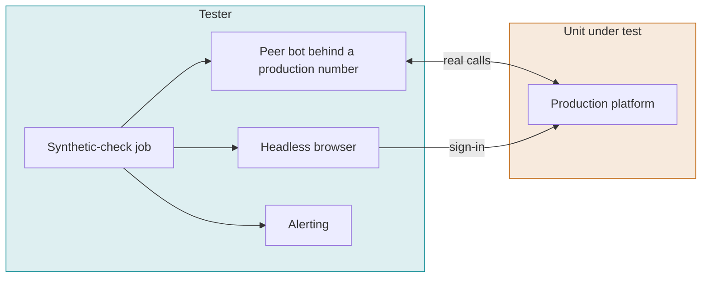

#### PRD-001 Inbound call after deploy

P0 · production · Ref: voice-session, control-plane

**Objective.** An inbound call to a production number reaches its application and gets a reply.

**Preconditions.** A production number linked to the fixture agent. Peer bot ready.

**Steps.**

1. The peer bot calls the number.
2. The bot plays a phrase and records the reply.
3. The bot hangs up.

**Pass.** Answered within the budget, reply audio present, call record created.

**Fail.** No answer, silence, or no record. Alert raised.

**Proof.** Point the check at a number with no application; the check must fail.

#### PRD-002 Outbound call after deploy

P0 · production · Ref: control-plane, roomr

**Objective.** An outbound call created through the production API reaches the peer.

**Preconditions.** Check workspace with an outbound trunk.

**Steps.**

1. Create a call to the peer bot through the API.
2. The bot answers and plays a tone.
3. The bot hangs up.

**Pass.** The bot receives the call and the tone is detected both ways.

**Fail.** No call or one-way audio. Alert raised.

**Proof.** Use a trunk with wrong credentials in a staging run; the check must fail.

#### PRD-003 DTMF after deploy

P1 · production · Ref: voice-session

**Objective.** Digits reach the application in production.

**Preconditions.** Inbound check call.

**Steps.**

1. The bot sends 1 2 3 #.
2. Read the events the fixture agent saw.

**Pass.** 123# received once, in order.

**Fail.** Missing or wrong digits. Alert raised.

**Proof.** Send digits with the fixture's DTMF handler disabled; the check must fail.

#### PRD-004 Transfer after deploy

P1 · production · Ref: media-control

**Objective.** A cold transfer connects the caller to a second peer.

**Preconditions.** Two peer bots.

**Steps.**

1. The fixture agent transfers the caller to the second bot.
2. The second bot answers and exchanges tones.

**Pass.** transfer.result success and tones detected.

**Fail.** No transfer or dropped caller. Alert raised.

**Proof.** Transfer to an invalid number; the check must fail.

#### PRD-005 Autopilot turn after deploy

P0 · production · trials 3×1 · Ref: autopilot, turn-taking

**Objective.** The hosted Autopilot answers one turn with real providers.

**Preconditions.** Fixture agent with the production default STT, TTS and LLM.

**Steps.**

1. The bot asks a fixed question.
2. Record and transcribe the reply.
3. Measure end-of-turn to first audio.

**Pass.** The reply contains the expected answer and the latency is within the budget set from the baseline.

**Fail.** Wrong or missing reply, or latency over budget. Alert raised.

**Proof.** Point the agent at a revoked LLM key; the check must fail.

#### PRD-006 Dashboard sign-in after deploy

P0 · production · Ref: dashboard, identity-client

**Objective.** A user can sign in and load the overview.

**Preconditions.** A check user in the check workspace.

**Steps.**

1. Open the dashboard in a headless browser.
2. Sign in.
3. Wait for the overview to load.

**Pass.** Overview renders with the workspace name within the budget.

**Fail.** Sign-in fails or the page errors. Alert raised.

**Proof.** Use a wrong password; the check must fail.
