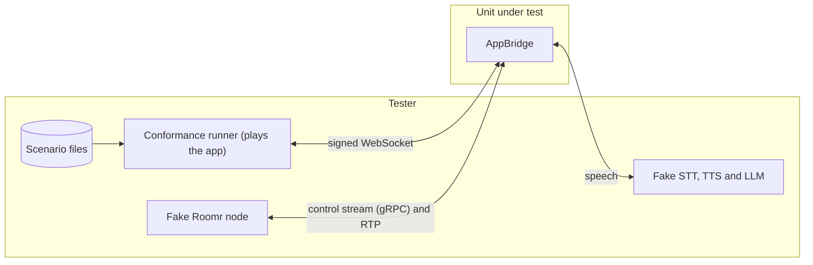

# AppBridge and the session protocol

What an app sees from the platform. AppBridge dials the app, signs the connection, opens the session
with `session.start`, turns the caller's audio into turn events and transcripts, speaks the app's
text through the Speech layer, carries call control to the Roomr node, and records every message.
The voice-session and turn-taking scenario files describe it on the wire; the runner plays the app
and checks each message. What needs more than one app, or no app at all (fallback, handoff,
outbound calls, listeners, filters, the call record), is proven by the integration suite.

The Twilio flavor of the protocol is proven in the Voice SDK area (VSD-013 to VSD-016). Tests of
AppBridge that belong to other areas are listed at the end.

## Systems

## Hand-off to other areas

These AppBridge tests run in CI but prove behavior other areas own, and are tagged when those
areas are brought:

| Tests | Area |
| --- | --- |
| records, crash, usage, sessions, replicas, boundedState | Call records and usage (call-record, usage-metering) |
| vendors, adapterConformance, catalogProviders, catalogSeed, workspaceKeys, keyUnavailable, cellSecrets | Providers (provider-registry) |
| testCalls | Dashboard (talk-in-browser) |
| timing | Media quality (conformance "AppBridge latency pass bar") |
| observability, tracePropagation | Operations |
| config, apps, appsFreshLookup, openUntilReady | Deployment and operations |

Every AppBridge suite runs against a real Roomr node in roomr-fake (`@fonoster/roomr/fake`); the
node itself (SRTP, codecs, listeners, its gRPC contract) is proven in fonoster/roomr, whose release
the gate requires (extract-roomr). Pure unit tests (pcm, OutputQueue, labels, detectors, replay,
turn, signing, playFetch, srtpCipher, admit) stay unit tests; the replay tool run as a process on a
corpus is APB-040. Of AppBridge's drain, only what AppBridge
does is here (APB-030); the control plane's side of it is in the API area.

## Cases

### APB-001 Sessions are signed for the app and delivered over WebSocket

- **Spec:** voice-session / Sessions are delivered over WebSocket / Fonoster protocol framing
- **Spec:** voice-session / Connection requests are signed / Signature reflects the secret
- **Spec:** voice-session / Connection requests are signed / App verifies a genuine request
- **Spec:** voice-session / Connection requests are signed / Stale timestamp
- **Spec:** voice-session / Connection requests are bound to the app / A signature cannot be reused for another tenant's app
- **Spec:** voice-session / Connection requests are bound to the app / Apps that verify only the URL keep working
- **Priority:** P0
- **Proof:** Sign a different URL than the app's (`signatureHeaders` in `mods/appbridge/src/signing.ts`); the tests must go red on signature-verified.
- **Fault:** faults/APB-001.patch
- **Test:** mods/appbridge/test/conformance.test.ts, mods/appbridge/test/integration.test.ts
- **Runs:** scenarios/voice-session/fonoster-protocol-framing.yaml
- **Runs:** scenarios/voice-session/signature-reflects-secret.yaml
- **Runs:** scenarios/voice-session/signature-verified.yaml

**Pass.** AppBridge dials the app over WebSocket with a signature over the app's URL and the app binding that a verifying app accepts, and frames fonoster-protocol messages as the spec says. **Fail.** A connection an app can't verify, or one that verifies for another app.

### APB-002 A session opens with session.start, answered on verified connect

- **Spec:** voice-session / session.start opens every fonoster-protocol session / Start message content
- **Spec:** voice-session / Inbound calls are answered on verified connect / Auto-answer
- **Spec:** voice-session / An app is a WebSocket URL, a protocol and speech defaults / Inbound routing
- **Priority:** P0
- **Proof:** Leave the caller's number out of session.start (`Call.ts`); the test must go red on session-start-content.
- **Fault:** faults/APB-002.patch
- **Test:** mods/appbridge/test/conformance.test.ts
- **Runs:** scenarios/voice-session/session-start-content.yaml
- **Runs:** scenarios/voice-session/auto-answer.yaml
- **Runs:** scenarios/voice-session/inbound-routing.yaml
- **Runs:** scenarios/voice-session/ring-before-answer.yaml

**Pass.** An inbound call routed by its number reaches the right app, the caller hears ringing while the app connects, the call is answered once the connection is verified, and session.start carries the call's facts. **Fail.** A call answered before the app is there, or a start message missing a field.

### APB-003 Outbound sessions open only when the callee answers

- **Spec:** voice-session / Outbound sessions open when the callee answers / Answered callee
- **Spec:** voice-session / Outbound sessions open when the callee answers / Busy callee
- **Priority:** P0
- **Proof:** Leave the callee's progress out of a failed call's record (`writeFailedCall` in `record/maintenance.ts`); the tests must go red on the busy call's sealed record.
- **Fault:** faults/APB-003.patch
- **Test:** mods/appbridge/test/conformance.test.ts, mods/appbridge/test/integration.test.ts, mods/appbridge/test/failedCallRecord.test.ts
- **Runs:** scenarios/voice-session/outbound-answered.yaml
- **Runs:** scenarios/voice-session/outbound-busy.yaml

A busy, unanswered or rejected callee never opens a control stream, so no AppBridge hears of it:
the control plane reads the node's call.ended and has the region's record writer seal the call's
minimal record (call.started, call.progress, call.failed).

**Pass.** The app is dialed only after the callee answers; a busy callee never reaches the app and its sealed record holds its progress and failure, nothing else; a callee hang-up is recorded as callee_hangup. **Fail.** An app session for an unanswered call, or a failed call without its record.

### APB-004 Unreachable apps fall back

- **Spec:** voice-session / Unreachable apps fall back / App down, fallback app configured
- **Spec:** voice-session / Unreachable apps fall back / App down, no fallback app
- **Spec:** voice-session / AppBridge produces call lifecycle events / App never reached
- **Priority:** P0
- **Proof:** Never dial the fallback app (`Call.ts`); the tests must go red on fallback-app.
- **Fault:** faults/APB-004.patch
- **Test:** mods/appbridge/test/conformance.test.ts, mods/appbridge/test/integration.test.ts
- **Runs:** scenarios/voice-session/fallback-app.yaml
- **Runs:** scenarios/voice-session/fallback-message.yaml
- **Runs:** scenarios/voice-session/app-never-reached.yaml

**Pass.** When the app is down or refuses the signature, the call goes to the fallback app or hears the fallback message, and a call that never reached an app produces call.failed. **Fail.** A silent call or a missing lifecycle event.

### APB-005 Sessions end with a reason, and only the call's own workspace can end them

- **Spec:** voice-session / Session ending / App drops mid-call
- **Spec:** voice-session / Session ending / App hangs up
- **Spec:** voice-session / Session ending / Caller hangs up
- **Spec:** voice-session / AppBridge produces call lifecycle events / Normal call
- **Spec:** voice-session / Session ending / Node lost
- **Spec:** voice-session / Session ending / Node's audio stops
- **Priority:** P0
- **Proof:** Report a media timeout and a node error as the caller hanging up (`sessionEndReason` in `Call.ts`); the tests must go red on media-timeout-ends-session.
- **Fault:** faults/APB-005.patch
- **Test:** mods/appbridge/test/conformance.test.ts, mods/appbridge/test/integration.test.ts, mods/appbridge/test/stream.test.ts
- **Runs:** scenarios/voice-session/app-drops-mid-call.yaml
- **Runs:** scenarios/voice-session/app-hangup.yaml
- **Runs:** scenarios/voice-session/caller-hangs-up.yaml
- **Runs:** scenarios/voice-session/media-timeout-ends-session.yaml
- **Runs:** scenarios/voice-session/node-crash-ends-session.yaml
- **Runs:** scenarios/voice-session/normal-call-lifecycle.yaml

**Pass.** Every ending carries its reason (app hang-up, app dropped, caller hang-up, no RTP, node killed) and the lifecycle events match; an app that stops answering pings is dropped; a call is never merged into a live call with the same ref, and another workspace can't hang it up. **Fail.** A wrong or missing reason, or a call ended by another workspace.

### APB-006 Messages are versioned, and errors are events

- **Spec:** voice-session / Message envelope and versioning / Id echo
- **Spec:** voice-session / Message envelope and versioning / Unknown message from the app
- **Spec:** voice-session / Errors are events / Malformed command
- **Spec:** voice-session / Errors are events / Provider fails mid-call
- **Spec:** voice-session / Streamed speech output / Invalid catalog id
- **Priority:** P1
- **Proof:** Answer a malformed command with the wrong error code (`onCommand` in `Call.ts`); the test must go red on malformed-speak.
- **Fault:** faults/APB-006.patch
- **Test:** mods/appbridge/test/conformance.test.ts
- **Runs:** scenarios/voice-session/id-echo.yaml
- **Runs:** scenarios/voice-session/unknown-message-ignored.yaml
- **Runs:** scenarios/voice-session/malformed-speak.yaml
- **Runs:** scenarios/voice-session/tts-failure-is-an-error.yaml
- **Runs:** scenarios/voice-session/invalid-catalog-id.yaml
- **Runs:** scenarios/voice-session/tts-outage-is-not-switched.yaml

**Pass.** Ids are echoed, unknown messages ignored, a malformed command and a provider failure come back as error events, and a TTS outage is reported, never switched to another vendor. **Fail.** A dropped session or a silent switch.

### APB-007 Streamed speech output

- **Spec:** voice-session / Streamed speech output / Tokens streamed as they arrive
- **Spec:** voice-session / Streamed speech output / Per-item voice override
- **Priority:** P0
- **Proof:** Record the use of a deprecated or retired voice under another event (`Call.ts`); the tests must go red on deprecated-voice-is-reported.
- **Fault:** faults/APB-007.patch
- **Test:** mods/appbridge/test/conformance.test.ts, mods/appbridge/test/integration.test.ts
- **Runs:** scenarios/voice-session/tokens-streamed.yaml
- **Runs:** scenarios/voice-session/per-item-voice-override.yaml
- **Runs:** scenarios/voice-session/deprecated-voice-is-reported.yaml
- **Runs:** scenarios/voice-session/retired-voice-resolves.yaml

**Pass.** Tokens are spoken as they arrive, a per-item voice is used for that item, a deprecated voice warns and a retired one plays its replacement and is recorded. **Fail.** Speech waits for the whole text, or a retired voice fails the call.

### APB-008 One output queue: queue, preempt, clear and play

- **Spec:** voice-session / One output queue / Items queue by default
- **Spec:** voice-session / One output queue / Preempt
- **Spec:** voice-session / One output queue / Clear
- **Spec:** voice-session / Playing media / Play a file
- **Priority:** P0
- **Proof:** Never preempt a speak (`OutputQueue.ts`); the test must go red on preempt.
- **Fault:** faults/APB-008.patch
- **Test:** mods/appbridge/test/conformance.test.ts
- **Runs:** scenarios/voice-session/items-queue-by-default.yaml
- **Runs:** scenarios/voice-session/preempt.yaml
- **Runs:** scenarios/voice-session/say-interrupted-by-clear.yaml
- **Runs:** scenarios/voice-session/play-a-file.yaml

**Pass.** Items play in order, preempt cuts the current one, clear empties the queue and reports what was heard, and a file plays. **Fail.** Items out of order or audio after clear.

### APB-009 Output lifecycle, barge-in and marks

- **Spec:** voice-session / Output lifecycle and interruption report / Caller barges in
- **Spec:** voice-session / Output lifecycle and interruption report / Caller talks over an item the app keeps
- **Spec:** voice-session / Marks / Mark cleared
- **Spec:** voice-session / Marks / Mark reached
- **Priority:** P0
- **Proof:** Report nothing heard on an interruption (`OutputQueue.ts`); the tests must go red on caller-barges-in.
- **Fault:** faults/APB-009.patch
- **Test:** mods/appbridge/test/conformance.test.ts
- **Runs:** scenarios/voice-session/caller-barges-in.yaml
- **Runs:** scenarios/voice-session/non-interruptible-item.yaml
- **Runs:** scenarios/voice-session/clear-returns-marks.yaml
- **Runs:** scenarios/voice-session/mark-reached.yaml

**Pass.** A barge-in reports the interruption with what was heard, a non-interruptible item keeps playing, marks come back when reached or cleared. **Fail.** A wrong interruption report or a lost mark.

### APB-010 Turn events reach every client

- **Spec:** voice-session / Turn events reach every client / Default events
- **Spec:** voice-session / Turn events reach every client / Abandoned turn
- **Spec:** voice-session / Turn events reach every client / Opt-in estimate
- **Priority:** P0
- **Proof:** Leave abandoned off an abandoned turn (`endTurn` in `Pacing.ts`); the test must go red on abandoned-turn.
- **Fault:** faults/APB-010.patch
- **Test:** mods/appbridge/test/conformance.test.ts
- **Runs:** scenarios/voice-session/default-turn-events.yaml
- **Runs:** scenarios/voice-session/abandoned-turn.yaml
- **Runs:** scenarios/voice-session/opt-in-estimate.yaml
- **Runs:** scenarios/voice-session/no-estimate-without-subscribe.yaml

**Pass.** Default turn events arrive for every session, an abandoned turn is reported, and the estimate only after subscribing (audio-only sessions are APB-038). **Fail.** Missing or unrequested events.

### APB-011 How the caller is heard can change mid-call

- **Spec:** voice-session / Changing how the caller is heard / Switch language mid-call
- **Priority:** P1
- **Proof:** Stay quiet about an STT model outside the catalog (`Call.ts`); the test must go red on reporting the unknown model.
- **Fault:** faults/APB-011.patch
- **Test:** mods/appbridge/test/conformance.test.ts, mods/appbridge/test/integration.test.ts
- **Runs:** scenarios/voice-session/switch-language.yaml

**Pass.** The language switches mid-call, STT opens with the app's catalog model and hints plus listen.update hints, and a model outside the catalog is reported. **Fail.** The old language kept or an unknown model used.

### APB-012 Raw audio in both directions, in every format

- **Spec:** voice-session / Raw audio in both directions / Caller audio cadence
- **Spec:** voice-session / Raw audio in both directions / Agent audio faster than real time
- **Spec:** voice-session / Raw audio in both directions / Off-menu format
- **Priority:** P0
- **Proof:** Ignore the app's audio format (`Call.ts`); the tests must go red on the format menu.
- **Fault:** faults/APB-012.patch
- **Test:** mods/appbridge/test/conformance.test.ts, mods/appbridge/test/formats.test.ts
- **Runs:** scenarios/voice-session/caller-audio-cadence.yaml
- **Runs:** scenarios/voice-session/agent-audio-faster-than-real-time.yaml
- **Runs:** scenarios/voice-session/caller-audio-to-stt.yaml
- **Runs:** scenarios/voice-session/text-to-first-audio.yaml

**Pass.** Caller frames arrive every 20 ms, agent audio sent faster than real time plays at real time, and every format an app may pick is announced, framed and carried end to end. **Fail.** A wrong cadence, format or rate.

### APB-013 Call control: transfers, hold and keypresses

- **Spec:** voice-session / Call control / Cold transfer stays in the room
- **Spec:** voice-session / Call control / Warm transfer
- **Spec:** voice-session / Call control / Warm transfer not answered
- **Spec:** voice-session / Call control / Failed transfer
- **Spec:** voice-session / Call control / Transfer by SIP REFER
- **Spec:** voice-session / Call control / Hold and resume
- **Spec:** voice-session / Call control / Speaking while on hold
- **Spec:** voice-session / Call control / Keypress while the agent speaks
- **Spec:** voice-session / Call control / Transfer with a reserved header
- **Spec:** voice-session / Call control / Transfer headers
- **Priority:** P0
- **Proof:** Never mark the caller on hold (`hold` in `Call.ts`); the tests must go red on the call on hold.
- **Fault:** faults/APB-013.patch
- **Test:** mods/appbridge/test/conformance.test.ts, mods/appbridge/test/integration.test.ts
- **Runs:** scenarios/voice-session/cold-transfer.yaml
- **Runs:** scenarios/voice-session/warm-transfer.yaml
- **Runs:** scenarios/voice-session/warm-transfer-not-answered.yaml
- **Runs:** scenarios/voice-session/failed-transfer.yaml
- **Runs:** scenarios/voice-session/refer-transfer.yaml
- **Runs:** scenarios/voice-session/hold-and-resume.yaml
- **Runs:** scenarios/voice-session/hold-music-private-refused.yaml
- **Runs:** scenarios/voice-session/speak-while-on-hold.yaml
- **Runs:** scenarios/voice-session/keypress-while-speaking.yaml

**Pass.** Cold, warm and REFER transfers do what they say and report failures, custom headers pass and reserved ones are refused, hold plays music (never from a private address) and resumes, and keypresses arrive while the agent speaks. **Fail.** A transfer the node receives with a forbidden header, or a call left on hold.

### APB-014 Handoff between apps

- **Spec:** voice-session / Handoff between apps / IVR hands off to Autopilot
- **Priority:** P1
- **Proof:** Accept any handoff payload size (`handoffRefusal` in `Call.ts`); the test must go red on the oversized payload.
- **Fault:** faults/APB-014.patch
- **Test:** mods/appbridge/test/conformance.test.ts, mods/appbridge/test/integration.test.ts
- **Runs:** scenarios/voice-session/handoff.yaml

**Pass.** The call moves to another app with its payload and the caller stays connected; a handoff to a private address or with an oversized payload is refused and the session kept. **Fail.** A dropped caller or a handoff to a refused destination.

### APB-015 Listen-only sockets

- **Spec:** voice-session / Listen-only sockets / Both tracks
- **Spec:** voice-session / Listen-only sockets / Listener tries to hang up
- **Priority:** P1
- **Proof:** Answer a listener's command without read_only (`Call.ts`); the tests must go red on listener-hangup-refused.
- **Fault:** faults/APB-015.patch
- **Test:** mods/appbridge/test/conformance.test.ts, mods/appbridge/test/integration.test.ts
- **Runs:** scenarios/voice-session/listener-both-tracks.yaml
- **Runs:** scenarios/voice-session/listener-hangup-refused.yaml

**Pass.** A listener gets both tracks as separate tagged frames, and its commands are answered read_only while the call goes on. **Fail.** A listener that can control the call.

### APB-016 Audio filters fail open

- **Spec:** voice-session / Audio filters come from app configuration / Filter configured
- **Spec:** voice-session / Audio filters come from app configuration / Filter fails during the call
- **Spec:** voice-session / Audio filters come from app configuration / Filter unavailable
- **Spec:** voice-session / Audio filters come from app configuration / Credential comes from the registry, never from the app
- **Priority:** P1
- **Proof:** Record a failed filter under another event (`Call.ts`); the tests must go red on filter-fails-mid-call.
- **Fault:** faults/APB-016.patch
- **Test:** mods/appbridge/test/conformance.test.ts, mods/appbridge/test/integration.test.ts
- **Runs:** scenarios/voice-session/filter-configured.yaml
- **Runs:** scenarios/voice-session/filter-fails-mid-call.yaml
- **Runs:** scenarios/voice-session/filter-unavailable.yaml

**Pass.** STT and turn detection hear the filtered audio; a filter that can't start or fails mid-call leaves the call running unfiltered and recorded; a filter gets its provider's credential from the registry, and fails open without one. **Fail.** A call that breaks with its filter.

### APB-017 Every message is recorded, with notes and turn decisions

- **Spec:** voice-session / Every message is part of the call record / Commands and events recorded
- **Spec:** voice-session / Apps can annotate the call record / Autopilot records a turn trace
- **Priority:** P0
- **Proof:** Accept app notes of any size (`Call.ts`); the test must go red on the oversized note.
- **Fault:** faults/APB-017.patch
- **Test:** mods/appbridge/test/conformance.test.ts, mods/appbridge/test/integration.test.ts
- **Runs:** scenarios/voice-session/records-every-message.yaml
- **Runs:** scenarios/voice-session/record-note.yaml

**Pass.** Every command and event in both directions is in the call record, app notes are kept and oversized ones refused, and turn decisions carry their estimate and label. **Fail.** A message missing from the record.

### APB-018 The Roomr node receives only control

- **Spec:** voice-session / The Roomr node receives only control / Speech never reaches the Roomr node
- **Priority:** P0
- **Proof:** Send the spoken text to the Roomr node as DTMF digits (`dispatch` in `Call.ts`); the test must go red on speech-never-reaches-node.
- **Fault:** faults/APB-018.patch
- **Test:** mods/appbridge/test/conformance.test.ts
- **Runs:** scenarios/voice-session/speech-never-reaches-node.yaml

**Pass.** Speech stays in AppBridge: the node gets only control messages on the call's control stream and audio as RTP. **Fail.** Speech content (text) reaches the node.

### APB-019 Answering-machine detection reaches the app

- **Spec:** voice-session / Answering-machine detection reaches the app / Voicemail answers an outbound call
- **Spec:** voice-session / Answering-machine detection reaches the app / Detection off
- **Priority:** P1
- **Proof:** Report every verdict as unknown (`detectAnsweringMachine` in `Call.ts`); the tests must go red on the classified result.
- **Fault:** faults/APB-019.patch
- **Test:** mods/appbridge/test/amd.test.ts

**Pass.** An app with AMD gets one amd.result classified from the caller's track, its window starting when the caller speaks, no_speech when the caller is silent, and unknown without a classifier; apps without AMD get nothing. **Fail.** No verdict, or one for an app that didn't ask.

### APB-020 App URLs are public destinations

- **Spec:** voice-session / An app is a WebSocket URL, a protocol and speech defaults / App URLs are public destinations
- **Priority:** P0
- **Proof:** Skip the public-address guard for tenant apps (`connectApp.ts`); the tests must go red on the private address.
- **Fault:** faults/APB-020.patch
- **Test:** mods/appbridge/test/appDestinations.test.ts

**Pass.** A tenant app or listener at a private address, or a name that resolves to one, is refused without retrying; operator apps and allow-listed destinations are dialed. **Fail.** AppBridge dials a private address for a tenant.

### APB-021 Turn events derive from the end-of-thought estimate

- **Spec:** turn-taking / The Detector publishes a continuous end-of-thought estimate / The estimate rises as a thought completes
- **Spec:** turn-taking / The Detector publishes a continuous end-of-thought estimate / The estimate falls when the caller resumes
- **Spec:** turn-taking / The Pacing policy derives turn events from the estimate / False alarm
- **Spec:** turn-taking / The Pacing policy derives turn events from the estimate / Turn events are ordered per turn
- **Spec:** turn-taking / The Pacing policy derives turn events from the estimate / Prepare, then speak
- **Spec:** turn-taking / The baseline Detector reproduces today's behavior / Silence timeout ends the turn
- **Spec:** turn-taking / Turn-taking runs in AppBridge's Speech layer / A simple speech app gets turn events
- **Priority:** P0
- **Proof:** Never reach the prepare threshold (`Pacing.ts`); the test must go red on prepare-then-speak.
- **Fault:** faults/APB-021.patch
- **Test:** mods/appbridge/test/conformance.test.ts
- **Runs:** scenarios/turn-taking/estimate-rises.yaml
- **Runs:** scenarios/turn-taking/estimate-falls.yaml
- **Runs:** scenarios/turn-taking/false-alarm.yaml
- **Runs:** scenarios/turn-taking/ordered-turn-events.yaml
- **Runs:** scenarios/turn-taking/prepare-then-speak.yaml
- **Runs:** scenarios/turn-taking/silence-timeout-ends-turn.yaml
- **Runs:** scenarios/turn-taking/simple-speech-app.yaml

**Pass.** The estimate rises as a thought completes and falls when the caller resumes; prepare comes before speak, events are ordered per turn, a false alarm is withdrawn, and the baseline Detector ends a turn on silence. **Fail.** Events out of order or a turn that never ends.

### APB-022 The estimate is available on request

- **Spec:** turn-taking / The estimate is available on request / Not opted in
- **Spec:** turn-taking / The estimate is available on request / Opting in
- **Priority:** P1
- **Proof:** Never send estimates (`Call.ts`); the test must go red on opting-in.
- **Fault:** faults/APB-022.patch
- **Test:** mods/appbridge/test/conformance.test.ts
- **Runs:** scenarios/turn-taking/not-opted-in.yaml
- **Runs:** scenarios/turn-taking/opting-in.yaml

**Pass.** Only a session that subscribed gets estimates. **Fail.** Estimates without opting in, or none after.

### APB-023 The app decides whether an interruption stops output

- **Spec:** turn-taking / The app decides whether an interruption stops output / The caller cuts in and the app clears
- **Spec:** turn-taking / The app decides whether an interruption stops output / The app keeps talking
- **Priority:** P0
- **Proof:** Treat a backchannel like any speech (`Pacing.ts`); the test must go red on backchannel-over-output.
- **Fault:** faults/APB-023.patch
- **Test:** mods/appbridge/test/conformance.test.ts
- **Runs:** scenarios/turn-taking/app-clears-on-interruption.yaml
- **Runs:** scenarios/turn-taking/app-keeps-talking.yaml
- **Runs:** scenarios/turn-taking/backchannel-over-output.yaml

**Pass.** A caller cutting in lets the app clear or keep talking, and a backchannel never interrupts. **Fail.** AppBridge stops output on its own, or a backchannel cuts the agent.

### APB-024 Patience per app, and turns that never end

- **Spec:** turn-taking / Patience is configurable per app and adapts only within a call / A patient app waits longer
- **Spec:** turn-taking / Turns that never end are abandoned / Noise then silence
- **Priority:** P1
- **Proof:** Give every patience the same timing (`Pacing.ts`); the tests must go red on patient-app-waits.
- **Fault:** faults/APB-024.patch
- **Test:** mods/appbridge/test/conformance.test.ts
- **Runs:** scenarios/turn-taking/patient-app-waits.yaml
- **Runs:** scenarios/turn-taking/impatient-app-is-quick.yaml
- **Runs:** scenarios/turn-taking/noise-then-silence.yaml

**Pass.** A patient app waits longer than an impatient one, and noise followed by silence is abandoned. **Fail.** Patience ignored, or a turn left open.

### APB-025 Every turn decision is labeled

- **Spec:** turn-taking / Every turn decision is recorded with its outcome / A clean turn is labeled
- **Spec:** turn-taking / Every turn decision is recorded with its outcome / A cut-off is labeled
- **Spec:** turn-taking / Every turn decision is recorded with its outcome / A slow reply is labeled
- **Priority:** P1
- **Proof:** Label slow replies ok (`TurnLabeler.ts`); the test must go red on slow-reply-labeled.
- **Fault:** faults/APB-025.patch
- **Test:** mods/appbridge/test/conformance.test.ts
- **Runs:** scenarios/turn-taking/clean-turn-labeled.yaml
- **Runs:** scenarios/turn-taking/cut-off-labeled.yaml
- **Runs:** scenarios/turn-taking/slow-reply-labeled.yaml

**Pass.** Clean turns, cut-offs and slow replies are recorded with their label. **Fail.** A decision without its outcome.

### APB-026 Detectors are pluggable

- **Spec:** turn-taking / Detectors are pluggable behind one interface / Swapping the Detector
- **Spec:** turn-taking / Detectors are pluggable behind one interface / A turn-aware STT as the Detector
- **Priority:** P2
- **Proof:** Ignore the choice of another Detector (`createDetector.ts`); the test must go red on swapping-the-detector.
- **Fault:** faults/APB-026.patch
- **Test:** mods/appbridge/test/conformance.test.ts
- **Runs:** scenarios/turn-taking/swapping-the-detector.yaml
- **Runs:** scenarios/turn-taking/turn-aware-stt.yaml

**Pass.** A different Detector, or a turn-aware STT as the Detector, drives the same turn events. **Fail.** Turn events tied to one Detector.

### APB-027 AppBridge answers on the control stream, or rejects the call

- **Spec:** voice-session / The Roomr node receives only control / AppBridge answers on the stream
- **Spec:** voice-session / An app is a WebSocket URL, a protocol and speech defaults / Missing app reference
- **Priority:** P0
- **Proof:** Reject a call that names no app with 480 instead of 404 (`AppBridge.ts`); the test must go red on the rejected call.
- **Fault:** faults/APB-027.patch
- **Test:** mods/appbridge/test/stream.test.ts

AppBridge takes an inbound call on its control stream: Answer, with its RTP endpoint, only once the
app has the session, and the caller's audio arrives as RTP. A call whose headers name no app is
refused on the stream and never dials an app.

**Pass.** Answer follows session.start and carries AppBridge's RTP endpoint, the app hears the caller, and a call naming no app gets Reject 404 with no socket opened. **Fail.** An answer before the app is there, or a call naming no app that is answered or refused with another status.

### APB-028 Every node cause maps to a session ending

- **Spec:** voice-session / Session ending / Every cause mapped
- **Spec:** voice-session / Session ending / Unknown cause
- **Priority:** P1
- **Proof:** Map a cause AppBridge does not know to caller_hangup (`sessionEndReason` in `Call.ts`); the test must go red on the unknown cause.
- **Fault:** faults/APB-028.patch
- **Test:** mods/appbridge/test/stream.test.ts

**Pass.** Every Ended cause the node sends maps to its session.end reason (removed after a transfer is transfer), an unknown cause is error, and the record keeps callee_hangup, media_timeout and node_error as they are. **Fail.** A cause that maps to another reason, or an unknown one reported as a hang-up.

### APB-029 An answered outbound call opens from Start and sends Ready

- **Spec:** voice-session / Outbound sessions open when the callee answers / Answered callee
- **Priority:** P0
- **Proof:** Ignore the API caller's app_metadata in Start (`appMetadata` in `AppBridge.ts`); the tests must go red on the session's metadata.
- **Fault:** faults/APB-029.patch
- **Test:** mods/appbridge/test/stream.test.ts

**Pass.** Start's metadata names the app (app_ref) and carries the API caller's metadata, session.start says outbound with the parties from Start, and AppBridge sends Ready, never Answer. **Fail.** Another app, lost metadata, or Answer on an outbound call.

### APB-030 AppBridge drains on SIGTERM

- **Spec:** control-plane / AppBridge drains on SIGTERM / Health check
- **Spec:** control-plane / AppBridge drains on SIGTERM / Live sessions survive SIGTERM
- **Spec:** control-plane / AppBridge drains on SIGTERM / Maximum wait reached
- **Priority:** P0
- **Proof:** Keep reporting SERVING while draining (`drain` in `media/SessionServer.ts`); the test must go red on the health check.
- **Fault:** faults/APB-030.patch
- **Test:** mods/appbridge/test/stream.test.ts

AppBridge serves grpc.health.v1 on its Session port. A drain turns it NOT_SERVING, so the Service
sends new calls to other replicas, and keeps live calls until they end or the drain's maximum wait
passes. The session keys (listen, drainWait, keepalive) and mediaTimeout are read and checked.

**Pass.** SERVING, then NOT_SERVING while draining with the live call kept; the drain ends when the last call does; at the maximum wait what is left ends with error and a hangup on the stream. **Fail.** SERVING while draining, a live call dropped by the drain, or a drain that never ends.

### APB-031 AppBridge carries calls through a Roomr node

- **Spec:** voice-session / Raw audio in both directions / Any SIP codec reaches any app format
- **Spec:** voice-session / Raw audio in both directions / Caller audio cadence
- **Priority:** P1
- **Proof:** AppBridge drops the caller's audio from the node (`Call.ts` in `mods/appbridge`); the tests must go red on the voice-session files that hear the caller.
- **Fault:** faults/APB-031.patch
- **Test:** mods/appbridge/test/gonode.test.ts

The voice-session scenario files that a real node can run go through AppBridge, a Roomr node and
its phone (roomr-fake): real SIP, RTP and the per-call control stream end to end. No NATS message
carries audio while a call has audio both ways.

**Pass.** Every runnable voice-session file passes through the node, and the bus carries only text, no subject at frame rate. **Fail.** A file that passes with scripted node state and fails through the node, or audio on the bus.

### APB-032 Outbound calls reach the app their metadata names

- **Spec:** voice-session / An app is a WebSocket URL, a protocol and speech defaults / Outbound routing
- **Priority:** P0
- **Proof:** Pick the app by the dialed number instead of `Start.metadata.app_ref` (`onOutbound` in `AppBridge.ts`); the test must go red on the second app's session.
- **Fault:** faults/APB-032.patch
- **Test:** mods/appbridge/test/stream.test.ts

Two apps, and an answered outbound call whose `Start.metadata` names the second.

**Pass.** The named app gets the session (session.start with its appRef, outbound) and the other app is never dialed. **Fail.** Another app dialed, or none.

### APB-033 An Autopilot agent is an ordinary app

- **Spec:** voice-session / An app is a WebSocket URL, a protocol and speech defaults / Autopilot is an ordinary app
- **Priority:** P1
- **Proof:** Load Autopilot agents with the twilio protocol (`appFromRow` in `apps/AppStore.ts`); the test must go red on the agent's session.start.
- **Fault:** faults/APB-033.patch
- **Test:** mods/appbridge/test/applicationsApi.test.ts

An Autopilot agent and a STREAM app are created through the Applications API (the apiserver's
handlers on a throwaway Postgres); AppBridge reads both from that database, as in production.

**Pass.** A call to the agent reaches the hosted Autopilot's URL from the apiserver's configuration, signed, with a session.start that has the same fields and protocol as the STREAM app's. **Fail.** The agent is dialed elsewhere, with another protocol, or gets a different start message.

### APB-034 Audio filters are set through the Applications API

- **Spec:** voice-session / An app's audio filters are set through the Applications API / Enabling noise cancelling on an app
- **Spec:** voice-session / An app's audio filters are set through the Applications API / A public option is accepted
- **Spec:** voice-session / An app's audio filters are set through the Applications API / A server-side option is rejected
- **Spec:** voice-session / An app's audio filters are set through the Applications API / An unknown filter is rejected
- **Spec:** voice-session / An app's audio filters are set through the Applications API / Clearing the filters
- **Priority:** P1
- **Proof:** Store no filters on create or update (`toAppColumns` in the apiserver's `appModel.ts`); the tests must go red on reading the app back and on the filtered call.
- **Fault:** faults/APB-034.patch
- **Test:** mods/appbridge/test/applicationsApi.test.ts

The apiserver's UpdateApplication and GetApplication handlers on a throwaway Postgres, and
AppBridge reading the app from it. The ai-coustics filter is replaced in AppBridge by one with the
same name and public options that counts the frames it filtered (its SDK and model are not in the
test environment; the filter itself is unit-tested).

**Pass.** `filters: [{ name: "aiCoustics" }]` reads back as written and the next call runs the filter on the caller's audio; a public option is stored; a server-side option or an unknown filter fails with INVALID_ARGUMENT naming it and leaves the app as it was; an empty list or no list clears the filters and the next call is unfiltered. **Fail.** A filter that is not stored, not run, or stored when it should be refused.

### APB-035 Autopilot reports model usage to the call

- **Spec:** voice-session / Autopilot reports model usage to the call / Autopilot reports a turn's tokens
- **Spec:** voice-session / Autopilot reports model usage to the call / Not an Autopilot agent
- **Spec:** voice-session / Autopilot reports model usage to the call / Meter outside the allowed set
- **Priority:** P0
- **Proof:** Take usage.report from any app (`onCommand` in `Call.ts`); the test must go red on the STREAM app's report.
- **Fault:** faults/APB-035.patch
- **Test:** mods/appbridge/test/usageReport.test.ts

The protocol side of the report; how the sealed usage is rated and billed is BIL-009.

**Pass.** An Autopilot agent's 1,200 input and 340 output tokens are in the call's sealed usage with their provider, model and key source, and nothing goes back to the app or to the Roomr node; a STREAM app's report, or a report for `call.seconds`, is answered with bad_message and adds nothing. **Fail.** Tokens lost, an event or node command for a report, or usage taken from an app or meter that may not report it.

### APB-036 Calls are admitted before they start

- **Spec:** voice-session / Calls are admitted before they start / Out of credits
- **Spec:** voice-session / Calls are admitted before they start / Authorization slow
- **Spec:** voice-session / Calls are admitted before they start / Outbound refused
- **Priority:** P0
- **Proof:** Let CreateCall place a call that admission refused with concurrency_limit (`createCall.ts` in the apiserver); the test must go red on the placed call.
- **Fault:** faults/APB-036.patch
- **Test:** mods/appbridge/test/admission.test.ts, mods/appbridge/test/applicationsApi.test.ts

AppBridge asks a fake Authz service (CheckSessionAuthorized) before an inbound call starts; the
apiserver's CreateCall asks before placing an outbound one. The Roomr node sends 180 Ringing before
AppBridge is asked, so a refused call ends 180 then 402: rejected before it is answered, as the spec
says.

**Pass.** AppBridge asks with the call's app, workspace and parties; a refusal is rejected with 402 (insufficient_balance) or 503 (concurrency_limit) before it is answered (180 at most, never 200), never reaches the app, and sends call.failed with the reason; an answer slower than 500 ms admits the call at the timeout and logs it; CreateCall refused with concurrency_limit answers FAILED_PRECONDITION naming it and places nothing. **Fail.** A refused call answered or placed, or a slow authorization that holds the call up.

### APB-037 Media at an internal address is never played

- **Spec:** voice-session / Playing media / Play an internal address
- **Priority:** P0
- **Proof:** Fetch play URLs with plain fetch instead of safeFetch (`defaultFetch` in `OutputQueue.ts`); the test must go red on play-internal-address.
- **Fault:** faults/APB-037.patch
- **Test:** mods/appbridge/test/conformance.test.ts
- **Runs:** scenarios/voice-session/play-internal-address.yaml

**Pass.** A play of the cloud metadata address is answered with play_fetch_failed for its id, saying the address is not public, nothing plays, and the session goes on. **Fail.** The address is fetched, or the refusal is not reported.

### APB-038 Audio-only sessions get no turn-taking

- **Spec:** turn-taking / Turn-taking runs in AppBridge's Speech layer / Audio-only sessions do not require turn-taking
- **Priority:** P1
- **Proof:** Start the Speech layer with every session (`attach` in `Call.ts`); the test must go red on audio-only-no-stt.
- **Fault:** faults/APB-038.patch
- **Test:** mods/appbridge/test/conformance.test.ts
- **Runs:** scenarios/turn-taking/audio-only-no-stt.yaml

**Pass.** An app that only exchanges audio gets no turn events and opens no STT stream. **Fail.** Turn events, or recognition paid for, without the Speech layer.

### APB-039 Patience adapts within a call only

- **Spec:** turn-taking / Patience is configurable per app and adapts only within a call / Nothing is remembered across calls
- **Priority:** P1
- **Proof:** Carry the adaptation over to the next call (`Pacing.ts`); the test must go red on the second call's adapted patience.
- **Fault:** faults/APB-039.patch
- **Test:** mods/appbridge/test/integration.test.ts

Two calls to an app with patience high, each with a caller who pauses mid-sentence (a false alarm,
which makes the Pacing policy more patient for the rest of that call).

**Pass.** Both calls adapt from the app's patience: the first adaptation is 1.84 (high, 1.6, times one step) in each. **Fail.** The second call starts from what the first adapted to.

### APB-040 Detectors are compared by replay before adoption

- **Spec:** turn-taking / Detectors are compared by replay before adoption / A regressing candidate is rejected
- **Spec:** turn-taking / Detectors are compared by replay before adoption / Non-consented calls are excluded
- **Priority:** P2
- **Proof:** Replay calls of customers who did not opt in (`replay` in `turn/replay.ts`); the test must go red on the corpus count.
- **Fault:** faults/APB-040.patch
- **Test:** mods/appbridge/test/replayTool.test.ts

The replay tool (`npm run replay -w @fonoster/appbridge`, `scripts/replay.ts`) run as a process on a
corpus file the test writes. The candidate is backchannel-hold, which waits 500 ms before calling
speech over the agent an interruption, so a 300 ms barge-in is missed.

**Pass.** The report marks the candidate FAIL with the regressing metric and never says it may become the default, the default Detector stays the baseline, and only synthetic, internal and opted-in customer calls are replayed. **Fail.** A regressing candidate passes, or a call without consent is in the replay.

### APB-041 An app's endpoint is a WebSocket URL

- **Spec:** voice-session / An app is a WebSocket URL, a protocol and speech defaults / Create with an endpoint that is not a WebSocket URL
- **Spec:** voice-session / An app is a WebSocket URL, a protocol and speech defaults / Update to an endpoint that is not a WebSocket URL
- **Spec:** voice-session / An app is a WebSocket URL, a protocol and speech defaults / WebSocket endpoints are accepted
- **Priority:** P0
- **Proof:** Let `url` start with http:// or https:// too, in both of its checks (`wsUrl` and `checkDestination` in the apiserver's `appModel.ts`); the test must go red on the https endpoint.
- **Fault:** faults/APB-041.patch
- **Test:** mods/appbridge/test/applicationsApi.test.ts

The apiserver's CreateApplication, UpdateApplication and GetApplication handlers on a throwaway
Postgres. AppBridge dials only what the API stored, so an app it can't reach over WebSocket can't
exist.

**Pass.** A bare host:port, an https:// or a grpc:// endpoint is refused at create with INVALID_ARGUMENT naming `url` and no app is created; an update to https:// is refused the same way and the app keeps its URL; ws:// and wss:// are accepted at create and update and read back as written. **Fail.** An app stored with an endpoint AppBridge can't dial over WebSocket, or a WebSocket one refused.
