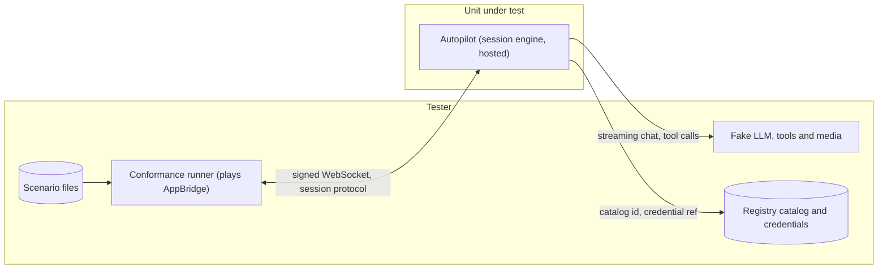

# Autopilot

What a caller gets from an Autopilot agent, and what Autopilot asks of the platform. Autopilot is
an ordinary app: AppBridge dials it with a signed fonoster-protocol session, it decides when to
speak only from turn events, streams its model's reply into `speak` pieces, stops on barge-in and
keeps in its history only what the caller heard, runs tools through a port, and ends calls with
the goodbye message on idle, on its maximum duration or when the model calls `hangup`. The
autopilot scenario files describe it on the wire; the runner plays AppBridge and checks each
message, once against the session engine and once against the hosted Autopilot, which loads the
agent for the signed app and resolves its model through the provider registry with the key from a
credential ref. What a scenario file can't show (signatures bound to the app, the hosted config,
credentials and knowledge, tool destinations, telemetry, model usage) has its own tests.

The language-model adapters behind the registry (`session/llmConformance.test.ts`) belong to the
Providers area, listed at the end.

## Running

```sh
npm run build
LOGS_LEVEL=none npx mocha --exit --timeout 30000 \
  mods/autopilot/test/session/{conformance,hosted,tools,telemetry,usage}.test.ts
# nightly: the full stack on NATS and the latency stopwatch
docker run -d --name apt-nats -p 4222:4222 nats:2.11.8 -js
export CONFORMANCE_NATS_URL=nats://127.0.0.1:4222
LOGS_LEVEL=none npx mocha --exit --timeout 60000 \
  mods/autopilot/test/session/fullstack.integration.test.ts \
  mods/autopilot/test/session/latency.integration.test.ts
node mods/conformance/catalog/prove.cjs --area APT     # the proofs, one run per case
```

## Systems



The full-stack case (APT-020) puts the real AppBridge with fake STT and TTS between the runner's
fake Roomr node, on NATS, and Autopilot.

## Hand-off to other areas

| Tests | Area |
| --- | --- |
| `mods/autopilot/test/session/llmConformance.test.ts` (LLM adapter conformance, catalog seed) | Providers (provider-registry) |

Unit tests stay unit tests: `test/tools.test.ts`, `test/turnTakingRemoved.test.ts`,
`test/session/unit.test.ts` and `test/evaluations/*.test.ts`. The paid evaluation run
(`evalScenarios.integration.test.ts`, `test:evals`) was deleted: it skipped without vendor keys and
had no case.

## Cases

### APT-001 Autopilot reacts to turn events and never detects turns itself

- **Spec:** autopilot / Autopilot reacts to turn events and never detects turns itself / Normal turn
- **Spec:** autopilot / Autopilot reacts to turn events and never detects turns itself / Backchannel is ignored
- **Spec:** autopilot / Autopilot reacts to turn events and never detects turns itself / Subscribing to the estimate
- **Priority:** P0
- **Proof:** Subscribe to no events at the start of a session (`greet` in `Agent.ts`); the tests must go red on subscribes-to-estimate.
- **Fault:** faults/APT-001.patch
- **Test:** mods/autopilot/test/session/conformance.test.ts, mods/autopilot/test/session/hosted.test.ts
- **Runs:** scenarios/autopilot/normal-turn.yaml
- **Runs:** scenarios/autopilot/backchannel-ignored.yaml
- **Runs:** scenarios/autopilot/subscribes-to-estimate.yaml

**Pass.** A session starts with a subscribe to `turn.estimate`; on `turn.ended` Autopilot answers with speak pieces under one id; a backchannel while it speaks sends no clear. **Fail.** No subscription, a reply outside one speak id, or a backchannel that cuts the agent.

### APT-002 The pacing policy decides when Autopilot prepares and speaks

- **Spec:** autopilot / Pacing policy / Patient agent waits for the detector's final event
- **Spec:** autopilot / Pacing policy / Adapting to a caller who pauses often
- **Priority:** P0
- **Proof:** Adapt only after thirty resumes (`resumed` in `Agent.ts`); the tests must go red on adapts-to-pauses.
- **Fault:** faults/APT-002.patch
- **Test:** mods/autopilot/test/session/conformance.test.ts, mods/autopilot/test/session/hosted.test.ts
- **Runs:** scenarios/autopilot/patient-waits.yaml
- **Runs:** scenarios/autopilot/adapts-to-pauses.yaml

**Pass.** A patient agent sends no speak before `turn.ended`; after three resumes in one call Autopilot stops preparing on `turn.likely_ended` and records the adjustment. **Fail.** Speech before the final turn event, or a fourth early generation.

### APT-003 Replies stream into speech

- **Spec:** autopilot / Replies stream into speech / First sentence starts before generation ends
- **Spec:** autopilot / Replies stream into speech / Prepared reply is discarded on resume
- **Priority:** P0
- **Proof:** Wait for the whole reply before the first speak (`speakRound` in `Agent.ts`); the tests must go red on first-sentence-streams.
- **Fault:** faults/APT-003.patch
- **Test:** mods/autopilot/test/session/conformance.test.ts, mods/autopilot/test/session/hosted.test.ts
- **Runs:** scenarios/autopilot/first-sentence-streams.yaml
- **Runs:** scenarios/autopilot/turn-end-to-first-speak.yaml
- **Runs:** scenarios/autopilot/prepared-reply-discarded.yaml

**Pass.** The first sentence is spoken while the model still generates, every piece shares one speak id and the last carries `last: true`; a reply prepared on `turn.likely_ended` is dropped on `turn.resumed` and never spoken or kept. **Fail.** Speech that waits for the whole reply, or a discarded reply that leaks.

### APT-004 Barge-in stops speech and keeps history honest

- **Spec:** autopilot / Barge-in stops speech and keeps history honest / Interrupted reply
- **Spec:** autopilot / Barge-in stops speech and keeps history honest / Barge-in disabled
- **Spec:** autopilot / Barge-in stops speech and keeps history honest / A new turn cancels an in-flight reply
- **Priority:** P0
- **Proof:** Keep the whole reply in the history when the caller cut it (`speakRound` in `Agent.ts`); the tests must go red on interrupted-reply.
- **Fault:** faults/APT-004.patch
- **Test:** mods/autopilot/test/session/conformance.test.ts, mods/autopilot/test/session/hosted.test.ts
- **Runs:** scenarios/autopilot/interrupted-reply.yaml
- **Runs:** scenarios/autopilot/barge-in-disabled.yaml
- **Runs:** scenarios/autopilot/new-turn-cancels-reply.yaml

**Pass.** The caller cutting in gets a clear and only the heard text enters the history; with barge-in off nothing is cleared; a new turn cancels the reply in flight and both turns reach the model as user messages. **Fail.** Unheard text in the history, a clear the agent disallowed, or a cancelled reply that is still spoken.

### APT-005 Tools are structured and behind a port

- **Spec:** autopilot / Tools are structured and behind a port / Tool call during a turn
- **Spec:** autopilot / Tools are structured and behind a port / Tool start message
- **Spec:** autopilot / Tools are structured and behind a port / Tool failure
- **Priority:** P0
- **Proof:** Record a failed tool as an empty result (`runTools` in `Agent.ts`); the tests must go red on tool-failure.
- **Fault:** faults/APT-005.patch
- **Test:** mods/autopilot/test/session/conformance.test.ts, mods/autopilot/test/session/hosted.test.ts
- **Runs:** scenarios/autopilot/tool-call.yaml
- **Runs:** scenarios/autopilot/tool-start-message.yaml
- **Runs:** scenarios/autopilot/tool-failure.yaml

**Pass.** A tool call and its result are tool messages the model's next request carries with no synthetic user prompt, the start message is spoken before the tool returns, and a failure is recorded as an error the model continues from. **Fail.** A tool result as a user message, a silent tool, or a lost error.

### APT-006 Built-in hangup and transfer

- **Spec:** autopilot / Built-in hangup and transfer / Hangup tool
- **Spec:** autopilot / Built-in hangup and transfer / Transfer tool
- **Priority:** P0
- **Proof:** Transfer to a number one digit short (`transfer` in `Agent.ts`); the tests must go red on transfer-tool.
- **Fault:** faults/APT-006.patch
- **Test:** mods/autopilot/test/session/conformance.test.ts, mods/autopilot/test/session/hosted.test.ts
- **Runs:** scenarios/autopilot/hangup-tool.yaml
- **Runs:** scenarios/autopilot/transfer-tool.yaml

**Pass.** `hangup` speaks the goodbye and sends hangup after output.done; `transfer` speaks the transfer message and sends transfer to the agent's number. **Fail.** A call left open, or a transfer to another number.

### APT-007 Voices and recognition hints come from the agent

- **Spec:** autopilot / Plugs, not vendors / Voice override
- **Spec:** autopilot / Plugs, not vendors / Recognition hints
- **Priority:** P1
- **Proof:** Send all but the first hint (`greet` in `Agent.ts`); the tests must go red on recognition-hints.
- **Fault:** faults/APT-007.patch
- **Test:** mods/autopilot/test/session/conformance.test.ts, mods/autopilot/test/session/hosted.test.ts
- **Runs:** scenarios/autopilot/voice-override.yaml
- **Runs:** scenarios/autopilot/recognition-hints.yaml

**Pass.** Every speak carries the agent's voice, and the agent's hints go out with listen.update when the session starts. **Fail.** The app's default voice, or a hint missing.

### APT-008 Idle handling

- **Spec:** autopilot / Idle handling / Idle message then goodbye
- **Spec:** autopilot / Idle handling / Idle clock paused while speaking
- **Spec:** autopilot / Idle handling / A turn with no words is not an answer
- **Priority:** P1
- **Proof:** Allow one idle announcement more than the maximum (`idleExhausted` in `Agent.ts`); the tests must go red on idle-then-goodbye.
- **Fault:** faults/APT-008.patch
- **Test:** mods/autopilot/test/session/conformance.test.ts, mods/autopilot/test/session/hosted.test.ts
- **Runs:** scenarios/autopilot/idle-then-goodbye.yaml
- **Runs:** scenarios/autopilot/idle-paused-while-speaking.yaml
- **Runs:** scenarios/autopilot/idle-ignores-empty-turn.yaml

**Pass.** Silence gets the idle message, then the goodbye and a hangup at the maximum count; the clock does not run while Autopilot speaks; a turn with no words is not an answer and keeps the count. **Fail.** A call that never ends, or an idle message over the agent's own speech.

### APT-009 Optional filler while thinking

- **Spec:** autopilot / Optional filler while thinking / Filler configured
- **Spec:** autopilot / Optional filler while thinking / No filler configured
- **Priority:** P1
- **Proof:** Speak the reply without preempting the filler (`respondTurn` in `Agent.ts`); the tests must go red on filler-while-thinking.
- **Fault:** faults/APT-009.patch
- **Test:** mods/autopilot/test/session/conformance.test.ts, mods/autopilot/test/session/hosted.test.ts
- **Runs:** scenarios/autopilot/filler-while-thinking.yaml
- **Runs:** scenarios/autopilot/no-filler.yaml

**Pass.** A configured filler plays, interruptible, before the reply, and the reply's first speak preempts it; with no filler nothing plays. **Fail.** A filler over the reply, or one nobody configured.

### APT-010 Every turn is traced in the call record

- **Spec:** autopilot / Conversation events in the call record / Complete turn trace
- **Priority:** P1
- **Proof:** Never mark a turn interrupted (`speakRound` in `Agent.ts`); the tests must go red on complete-turn-trace.
- **Fault:** faults/APT-010.patch
- **Test:** mods/autopilot/test/session/conformance.test.ts, mods/autopilot/test/session/hosted.test.ts
- **Runs:** scenarios/autopilot/complete-turn-trace.yaml

**Pass.** Each turn is a record note with the user text, the reply, what was heard and the timings, and an interrupted turn is marked interrupted. **Fail.** A turn missing from the record, or an interruption recorded as a clean turn.

### APT-011 Session limits

- **Spec:** autopilot / Session limits / Maximum duration
- **Spec:** autopilot / Session limits / Caller hangs up mid-reply
- **Priority:** P0
- **Proof:** Never fire the maximum-duration timer (`greet` in `Agent.ts`); the tests must go red on max-duration.
- **Fault:** faults/APT-011.patch
- **Test:** mods/autopilot/test/session/conformance.test.ts, mods/autopilot/test/session/hosted.test.ts
- **Runs:** scenarios/autopilot/max-duration.yaml
- **Runs:** scenarios/autopilot/caller-hangs-up-mid-reply.yaml

**Pass.** At the maximum duration Autopilot says goodbye and hangs up; when the caller hangs up mid-reply it stops, sends nothing more and raises no unhandled error. **Fail.** A call that outlives its limit, or work after the session ended.

### APT-012 Language models come from the registry by catalog id

- **Spec:** autopilot / Plugs, not vendors / Model chosen by catalog id
- **Priority:** P1
- **Proof:** Call a model that needs a key without one (`RegistryLlmResolver` in `llm.ts`); the tests must go red on the refused model.
- **Fault:** faults/APT-012.patch
- **Test:** mods/autopilot/test/session/hosted.test.ts

**Pass.** A catalog id resolves to its provider, adapter endpoint and credential ref; a keyless provider is called at its catalog endpoint unless the config overrides it; a model without its credential, or an id that is not a language model, is refused; a deprecated model is reported for the call record; a model that cannot be resolved gets the error message and a hangup. **Fail.** A vendor call without its key, or a silent line.

### APT-013 Agent configs carry no vendor keys and no webhooks

- **Spec:** autopilot / Plugs, not vendors / Agent config with an inline key
- **Spec:** autopilot / No agent webhooks / Old config with eventsHook
- **Priority:** P1
- **Proof:** Drop the apiKey rule from the agent schema (`sessionAgentSchema.ts` in `@fonoster/common`, rebuilt by the area's reset); the tests must go red on the inline key.
- **Fault:** faults/APT-013.patch
- **Test:** mods/autopilot/test/session/hosted.test.ts

**Pass.** An agent with an `apiKey` is refused with a message pointing to workspace secrets, and one with `eventsHook` with a message pointing to workspace webhooks. **Fail.** A vendor key or an agent webhook accepted, or a refusal that doesn't say where they belong.

### APT-014 Keys, knowledge and agents come from the workspace

- **Spec:** autopilot / Plugs, not vendors / Model chosen by catalog id
- **Priority:** P1
- **Proof:** Fall back to the next key source when the workspace's key store fails (`LayeredCredentials` in `llm.ts`); the tests must go red on the platform key.
- **Fault:** faults/APT-014.patch
- **Test:** mods/autopilot/test/session/hosted.test.ts

**Pass.** The workspace's own key wins over the platform's and an unreadable workspace key ends with key_unavailable, never the platform key; vendor keys are found through the credential ref's provider in the database or in the cell's secret store; the knowledge base gets its keys from credential refs and a failing one is logged, not an unhandled rejection; an Autopilot app's agent is read from its record and cached. **Fail.** The platform paying for a workspace's call, or a key taken from the agent config.

### APT-015 Only signed sessions for the signed app's workspace

- **Spec:** autopilot / Autopilot is an ordinary application / A call reaches Autopilot like any app
- **Spec:** autopilot / Autopilot is an ordinary application / Bad signature
- **Spec:** autopilot / Autopilot is an ordinary application / Signature for another tenant's app
- **Priority:** P0
- **Proof:** Serve any signed session whatever its workspace (`signedWorkspaceOnly` in `hosted.ts`); the tests must go red on the workspace check.
- **Fault:** faults/APT-015.patch
- **Test:** mods/autopilot/test/session/hosted.test.ts

**Pass.** A bad signature is refused before any agent loads, a signature not bound to the app is refused, and a session that names another app or an app outside the signed workspace is closed without running its agent; a signed session for the app runs its agent (every scenario file passes through the hosted Autopilot). **Fail.** One tenant's signature running another tenant's agent.

### APT-016 The hosted Autopilot refuses a config it can't run safely

- **Spec:** autopilot / Autopilot is an ordinary application / Missing public URL
- **Priority:** P0
- **Proof:** Accept any string as the public URL (`hostedConfigSchema` in `hosted.ts`); the tests must go red on publicUrl.
- **Fault:** faults/APT-016.patch
- **Test:** mods/autopilot/test/session/hosted.test.ts

**Pass.** A config without `publicUrl`, or with one that is not ws:// or wss://, is refused naming `publicUrl`; the example config loads; `secret://` references resolve and an unresolved one is named; database sources need a database section whose URL comes from the file. **Fail.** A hosted Autopilot that starts checking signatures against the wrong URL.

### APT-017 Tools call public destinations only

- **Spec:** autopilot / Tools are structured and behind a port / Tool call during a turn
- **Priority:** P0
- **Proof:** Allow every tool URL's own host (`HttpToolPort` in `tools.ts`); the tests must go red on the private destinations.
- **Fault:** faults/APT-017.patch
- **Test:** mods/autopilot/test/session/tools.test.ts

**Pass.** The HTTP tool port refuses private, metadata and internal-name destinations without calling them, and calls one the operator allowed. **Fail.** A tenant's tool reaching the platform's own network.

### APT-018 Turns and model requests are traced and counted

- **Spec:** autopilot / Conversation events in the call record / Complete turn trace
- **Priority:** P1
- **Proof:** Stop counting turns (`respond` in `Agent.ts`); the tests must go red on the turn metrics.
- **Fault:** faults/APT-018.patch
- **Test:** mods/autopilot/test/session/telemetry.test.ts

**Pass.** Each turn is an `autopilot.turn` span with an `autopilot.llm.request` child under the call's trace, counted with its latency; a model error marks the request span failed; without an OTLP endpoint telemetry is off. **Fail.** A turn with no span or metric, or a failure recorded as success.

### APT-019 Every model request is metered, interrupted ones too

- **Spec:** autopilot / Barge-in stops speech and keeps history honest / An interrupted reply is still metered
- **Priority:** P1
- **Proof:** Report an interrupted reply as missing usage instead of reading it to its end (`meteredThink.ts`); the tests must go red on the barge-in drain.
- **Fault:** faults/APT-019.patch
- **Test:** mods/autopilot/test/session/usage.test.ts

**Pass.** The vendor's token counts are reported for completed and interrupted replies (read silently to the end), missing usage is reported as missing, a failed request reports nothing, the key source says whose key paid, and embeddings are metered per request. **Fail.** An interrupted reply nobody pays for, or a usage chunk spoken to the caller.

### APT-020 The full stack answers a caller and stops when cut off

- **Spec:** autopilot / Autopilot is an ordinary application / A call reaches Autopilot like any app
- **Spec:** autopilot / Barge-in stops speech and keeps history honest / Interrupted reply
- **Priority:** P0
- **Tier:** nightly
- **Proof:** Autopilot never stops its speech: replies are not interruptible and its clear sends nothing (`speechOptions` and `clear` in `Agent.ts`); the test must go red on the caller cutting in.
- **Fault:** faults/APT-020.patch
- **Test:** mods/autopilot/test/session/fullstack.integration.test.ts

Caller audio from the fake Roomr node on NATS goes through the real AppBridge (fake STT, turn
detection, fake TTS, output queue) to Autopilot and the fake LLM. Without NATS the case fails; it
never skips.

**Pass.** The greeting is spoken, the caller's question reaches the model, the reply is played as audio and every message is in the call record; when the caller cuts in, Autopilot (the app) sends clear and keeps only the heard text. **Fail.** No audio at the caller, or AppBridge stopping output on its own.

### APT-021 Autopilot adds little time between turn end and first speak

- **Spec:** autopilot / Replies stream into speech / First sentence starts before generation ends
- **Priority:** P2
- **Tier:** nightly
- **Trials:** 3×1
- **Proof:** Wait 100 ms before the first speak (`speakRound` in `Agent.ts`); the test must go red on the p95 budget.
- **Fault:** faults/APT-021.patch
- **Test:** mods/autopilot/test/session/latency.integration.test.ts

The turn-end-to-first-speak scenario, repeated (20 runs by default, `AUTOPILOT_TIMING_RUNS`), scored
relative to its baseline: the time from turn.ended to the first speak minus the fake LLM's own
delay. A trend for the release report, never a gate.

**Pass.** Autopilot's own share stays at or under 50 ms at p95 in each of three trials. **Fail.** A p95 over 50 ms.
