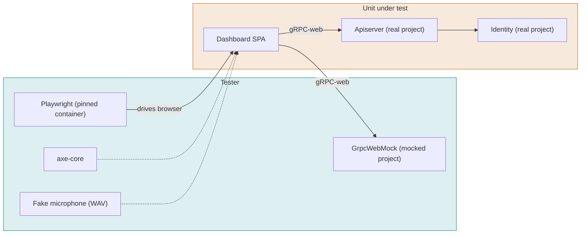

# Dashboard

What the user sees. Every screen and state in `designs/dashboard.pen`, in the community and cloud
editions. The mocked project proves the SPA's own behavior on every pull request in minutes; the
real project proves it against the platform nightly. Screenshot goldens are captured from the app
inside the pinned Playwright container, reviewed against the design once, and changed only through a
reviewed pull request. Few screenshots; structure checks carry the rest.

## Systems

## Cases

The first eight are the tests that exist today in `mods/dashboard/e2e`, mapped to the spec. The
rest are the scenarios the spec promises and nothing tests yet, in the order to take them.

### DSH-001 Sign in with email and password and land on the workspaces list

- **Spec:** dashboard / Sign-in options follow the advertised methods / Community defaults
- **Spec:** dashboard / Users land on the workspaces list after sign-in / Signed in with workspaces
- **Spec:** dashboard / Users land on the workspaces list after sign-in / Opening the root with a session
- **Priority:** P0
- **Proof:** Build the SPA with `landingTarget` returning the first workspace's path; the test must go red on the URL after sign-in and after reload.
- **Fault:** faults/DSH-001.patch
- **Test:** mods/dashboard/e2e/community.spec.ts

A community install offers only the password method. A valid sign-in lands on the workspaces list, and so does a reload of `/`; nothing is remembered.

**Pass.** The sign-in form shows the password method only; after sign-in and again after a reload the URL is `/workspaces` with the Choose a workspace heading; choosing one opens its overview. **Fail.** Another method is offered, or the user lands anywhere but the list.

### DSH-002 An invitee sets a password before anything else

- **Spec:** dashboard / Invitees set a password before using the app / First sign-in from an invite
- **Spec:** dashboard / Invitees set a password before using the app / Password set
- **Priority:** P0
- **Proof:** Build the SPA with the set-password guard disabled (`guards.tsx`); the test must go red on the redirect to `/set-password`.
- **Fault:** faults/DSH-002.patch
- **Test:** mods/dashboard/e2e/community.spec.ts

**Pass.** The first sign-in from an invite shows the set-password screen before any other screen, every other route redirects to it, and after setting the password the user lands on the workspaces list. **Fail.** Any other screen appears first, or the user lands anywhere but the list.

### DSH-003 Sign-out leaves a clean sign-in page

- **Spec:** dashboard / The session persists in the browser and ends cleanly / Sign-out
- **Priority:** P0
- **Proof:** Drop the `client.logout()` call from `signOut` (`lib/auth.tsx`); the test must go red on the logout poll.
- **Fault:** faults/DSH-003.patch
- **Test:** mods/dashboard/e2e/community.spec.ts

**Pass.** After sign-out the user is on sign-in, storage holds nothing token-like, the server logout was called, and a second user signing in sees only their own workspaces. **Fail.** A token remains, no logout call, or the first user's data shows for the second.

### DSH-004 List and open an agent with its saved configuration

- **Spec:** dashboard / The sidebar names Agents and Apps / Sidebar labels
- **Spec:** dashboard / Agent pickers offer the catalog / A saved item that is no longer offered
- **Spec:** dashboard / Agent pickers offer the catalog / A saved agent opens with its configuration
- **Priority:** P1
- **Proof:** Make `CatalogPicker` drop a provider the catalog no longer offers instead of marking it unavailable; the test must go red on the Provider select.
- **Fault:** faults/DSH-004.patch
- **Test:** mods/dashboard/e2e/community.spec.ts

**Pass.** The sidebar links Agents to `/agents` and Apps to `/apps` with nothing labeled Streams or Autopilot; the list shows the seeded agent; opening it shows the saved prompt and first message decoded through the SDK; the voice row's Provider shows `deepgram (unavailable)` because the mocked catalog offers only `fake`. **Fail.** A wrong or missing sidebar label, a missing field, or the stale provider replaced or blank.

### DSH-005 Usage in a community install shows minutes and no money

- **Spec:** dashboard / The workspace has a Usage page / Community install
- **Spec:** dashboard / Usage shows minutes apart from test minutes / Calls and tests
- **Spec:** dashboard / Usage shows AI usage by vendor and key / Own key and platform key
- **Priority:** P1
- **Proof:** Make the summary fold browser-test seconds into Calls (`summary.ts`); the test must go red on both figures.
- **Fault:** faults/DSH-005.patch
- **Test:** mods/dashboard/e2e/community.spec.ts

**Pass.** The Usage page shows Calls 1,284 min and Browser tests 96 min as separate figures, the AI table says Your key for the workspace-key row and Fonoster key for the platform-key row, and nothing on the page is a price, cost or balance. **Fail.** Tests folded into calls, a wrong key source, or any amount shown.

### DSH-006 Sign in with an emailed code

- **Spec:** dashboard / Sign-in options follow the advertised methods / Cloud
- **Priority:** P0
- **Proof:** Hide the "Email me a sign-in code instead" link when both methods are on (`sign-in.page.tsx`); the test must go red.
- **Fault:** faults/DSH-006.patch
- **Test:** mods/dashboard/e2e/cloud.spec.ts

**Pass.** On Cloud the password form shows first; the link swaps it for the code form; the code is sent and accepted; the user lands on the workspaces list. **Fail.** No link, the password field stays, the code is not accepted, or the user lands anywhere but the list.

### DSH-007 Sign in with GitHub and check the state

- **Spec:** dashboard / Sign-in options follow the advertised methods / Cloud
- **Priority:** P0
- **Proof:** Leave the state out of the authorize URL (`auth/github.ts`); the test must go red on the state it checks.
- **Fault:** faults/DSH-007.patch
- **Test:** mods/dashboard/e2e/cloud.spec.ts

**Pass.** The GitHub button sends the user to the advertised authorize URL with a state, the callback with that state signs the user in, and the user lands on the workspaces list. **Fail.** No state, sign-in without it, or a landing anywhere but the list.

### DSH-008 Refuse a GitHub callback the app did not start

- **Spec:** dashboard / Sign-in options follow the advertised methods / GitHub state mismatch
- **Priority:** P0
- **Proof:** Accept any state on the callback (`consumeGitHubState` in `auth/github.ts`); the test must go red on the refused callback.
- **Fault:** faults/DSH-008.patch
- **Test:** mods/dashboard/e2e/cloud.spec.ts

**Pass.** A callback with an unknown state is refused and no token is stored. **Fail.** The callback signs the user in.

### DSH-009 A sign-in never reveals whether an email has an account

- **Spec:** dashboard / Sign-in options follow the advertised methods / Wrong credentials
- **Priority:** P0
- **Proof:** Make the code screen show the server's message for a refused exchange (`check-email.page.tsx`); the test must go red on the account text.
- **Fault:** faults/DSH-009.patch
- **Test:** mods/dashboard/e2e/cloud.spec.ts

The wrong-password half is asserted by DSH-001 and DSH-016. This case covers the code path, where the risk is enumeration: asking for a code and entering a wrong one must look the same for an email with an account and one without.

**Pass.** Asking for a code for an unknown email shows Check your email; a refused exchange shows the wrong-code message and nothing about the account, even when the server's message says so. **Fail.** Any screen or message reveals that the email has no account.

### DSH-010 Reload keeps the session

- **Spec:** dashboard / The session persists in the browser and ends cleanly / Reload
- **Spec:** dashboard / The session persists in the browser and ends cleanly / No token in storage
- **Spec:** dashboard / Users land on the workspaces list after sign-in / Deep link with a session
- **Priority:** P0
- **Proof:** Make the restore-on-load navigate to the workspaces list (`auth.tsx`); the test must go red on the route after reload.
- **Fault:** faults/DSH-010.patch
- **Test:** mods/dashboard/e2e/community.spec.ts

A token that expires in 30 s forces the timer-based renewal right after sign-in, so the renewal path is exercised without waiting.

**Pass.** The renewal runs from the timer and leaves nothing token-like in local or session storage; a reload on `/w/ws-1/agents` restores the user on that same route with storage still clean. **Fail.** No renewal, anything token-like in storage, or a reload that lands anywhere but the same route.

### DSH-011 Refresh token rejected

- **Spec:** dashboard / The session persists in the browser and ends cleanly / Refresh token rejected
- **Priority:** P0
- **Proof:** Drop `next` from both places that add it, the expiry redirect in `signOut` (`auth.tsx`) and the signed-out redirect in `RequireAuth` (`guards.tsx`); the test must go red on the sign-in URL. Either alone leaves the other, which is why both are named.
- **Fault:** faults/DSH-011.patch
- **Test:** mods/dashboard/e2e/community.spec.ts

A 68-second token makes the renewal fire about 8 seconds after sign-in, once the test is on a deep route; the mock then refuses it. Writing this case found that the sign-in guard raced the form and dropped `next` (fixed in `guards.tsx`, with a unit test).

**Pass.** When the renewal is refused the user lands on `/sign-in?next=/w/ws-1/agents` with nothing token-like in storage, and signing in again returns to `/w/ws-1/agents`. **Fail.** A blank page, a spinner, no `next`, a token left behind, or a sign-in that lands anywhere else.

### DSH-012 No workspaces after sign-in

- **Spec:** dashboard / Users land on the workspaces list after sign-in / No workspaces
- **Priority:** P1
- **Proof:** Make the create page stay on the form after creating (`create-workspace.page.tsx`); the test must go red on the URL.
- **Fault:** faults/DSH-012.patch
- **Test:** mods/dashboard/e2e/community.spec.ts

The deep-link scenario is cited by DSH-010, whose reload step opens `/w/ws-1/agents` directly.

**Pass.** With no workspaces, sign-in goes to Create workspace; creating one opens its overview at `/w/<ref>` showing the new name; the workspaces list then contains it. **Fail.** The list or any other screen first, no overview after creating, or a list that does not show the new workspace.

### DSH-013 A private region's fee follows billing

- **Spec:** dashboard / Cloud-only screens follow capabilities and ownership / Region fee follows billing
- **Priority:** P1
- **Proof:** Drop the `billing.enabled` guard around the fee in `region-drawer.tsx`; the community test must go red.
- **Fault:** faults/DSH-013.patch
- **Test:** mods/dashboard/e2e/community.spec.ts and mods/dashboard/e2e/cloud.spec.ts (one case, both projects)

The same region, with a fee, served to both projects over the regions HTTP API. Writing this case found that the SDK called a detached `globalThis.fetch` ("Illegal invocation" in browsers), so the dashboard never listed private regions and silently showed the default; fixed in `@fonoster/sdk` `Regions` and `CallRecords`, with a unit test that calls the SDK with a `this`-checking fetch. The Billing tab scenarios of the open billing change get their own cases when that change lands; today there is no tab to test.

**Pass.** In the community project the region drawer shows no Monthly fee and no amount; in the cloud project it shows the fee. **Fail.** Any amount in community, or no fee on Cloud.

### DSH-014 Noise cancelling is one select fed by the catalog

- **Spec:** dashboard / Noise cancelling is one select fed by the catalog / No noise-cancelling provider is offered
- **Spec:** dashboard / Noise cancelling is one select fed by the catalog / Turning noise cancelling on
- **Spec:** dashboard / Noise cancelling is one select fed by the catalog / Turning it off
- **Spec:** dashboard / Noise cancelling is one select fed by the catalog / Agents set it on the Advanced tab
- **Priority:** P1
- **Proof:** Map every choice to the first noise-cancelling filter (`filtersFor` in `session/noise-cancelling.ts`); the test must go red on the saved filters.
- **Fault:** faults/DSH-014.patch
- **Test:** mods/dashboard/e2e/community.spec.ts

Runs through the real SDK encoding of `filters` on `UpdateApplication`, which the unit tests do not reach.

**Pass.** On the agent's Advanced tab the select offers None and the catalog's nc provider by label; picking the provider sends nothing until Save, then saves `filters: [{ name: "aiCoustics" }]`; picking None saves an empty list; with no nc provider in the catalog the select offers None only. **Fail.** A missing or extra option, a request before Save, a wrong filter list, or a select with more than None when nothing is offered.

### DSH-015 Talk drawer: call, mute and hang up

- **Spec:** talk-in-browser / Talk drawer calls from the browser / Call, mute and hang up
- **Spec:** talk-in-browser / A browser call reaches the agent / Call the saved agent
- **Priority:** P0
- **Tier:** nightly
- **Proof:** Name another agent in the call's `X-App-Ref` (`agents/talk/use-browser-call.ts`); with no app to take it, the test must go red on Connected.
- **Fault:** faults/DSH-015.patch
- **Test:** mods/dashboard/e2e/talk.real.spec.ts (the `real` project, `npm run test:e2e:real` against `ops/rebuild/stack up && seed`)

The first case of the real project: Chromium with a fake microphone against the running platform, the seeded owner and the seeded Autopilot agent on the fake providers. The fake STT is scripted, so this case checks the call's lifecycle and that a record is written, not what was said. Bringing it up found three breaks on `main` that the path-filtered nightly had not reported: `ops/rebuild/stack` still emitted the `registry` config key removed in #1011 (apiserver would not start); `seed.cjs` shadowed its `agent()` config builder with the SIP agent (#1012), so every seed failed and retried into the sign-in throttle; and the AppBridge image lacked the nested `ws` module (`Cannot find module 'ws'`), so no AppBridge ever claimed a call and the drawer reported 503.

**Pass.** Talk to agent, Call: the drawer shows Connected with a running timer; Mute reads Unmute; Hang up shows Call ended with Call again; the call then appears in the workspace's calls. **Fail.** No connection, a stuck state, a mute that does not toggle, or no call record.

### DSH-016 Sign in with email and password on Cloud

- **Spec:** dashboard / Sign-in options follow the advertised methods / Cloud
- **Spec:** dashboard / Sign-in options follow the advertised methods / Wrong credentials
- **Spec:** dashboard / Users land on the workspaces list after sign-in / Signed in with workspaces
- **Priority:** P0
- **Proof:** Never render the password form on Cloud (`sign-in.page.tsx`); the test must go red on the password field.
- **Fault:** faults/DSH-016.patch
- **Test:** mods/dashboard/e2e/cloud.spec.ts

Every edition offers email and password. On Cloud it sits next to GitHub and the code link.

**Pass.** Cloud sign-in shows Continue with GitHub, the email and password form and the code link; a wrong password shows the documented message; the right one lands on the workspaces list. **Fail.** A method missing, a wrong message, or a landing anywhere but the list.

### DSH-017 Add a number, reroute it to a SIP agent and remove it

- **Spec:** dashboard / Numbers route calls to an agent, an app or a SIP agent / Add a number routed to an agent
- **Spec:** dashboard / Numbers route calls to an agent, an app or a SIP agent / Reroute a number to a SIP agent
- **Spec:** dashboard / Numbers route calls to an agent, an app or a SIP agent / A number that isn't E.164
- **Spec:** dashboard / Numbers route calls to an agent, an app or a SIP agent / The number can't be changed
- **Spec:** dashboard / Resource screens share one shape / Empty state
- **Spec:** dashboard / Resource screens share one shape / Delete needs DELETE
- **Priority:** P0
- **Proof:** Make the number drawer send a SIP agent route as `appRef` (`number-drawer.tsx`); the test must go red on the saved `agentAor`.
- **Fault:** faults/DSH-017.patch
- **Test:** mods/dashboard/e2e/resources.community.spec.ts

Runs against an in-memory SIP network that answers like the API (`e2e/sipnet.ts`). Writing this case found that the SDK's `listAgents`, `getAgent` and `getNumber` called `toObject()` on objects its decoder had already made plain, so any SIP agent with a domain broke the SIP agents screen and the route picker; fixed in `@fonoster/sdk`, with unit tests.

**Pass.** A non-E.164 number is refused with nothing sent; `+1 (809) 555-0100` routed to the Receptionist agent is sent as `tel:+18095550100` with the trunk and the agent's `appRef`; the saved number and location are locked; rerouting sends `sip:maria@acme.sip.fonoster.local` and no `appRef`; Remove needs `DELETE` and empties the list. **Fail.** A wrong request, an editable number, or a delete without `DELETE`.

### DSH-018 Create a trunk, refuse a taken inbound URI, and say what deleting it stops

- **Spec:** dashboard / Trunks connect a carrier / Create a trunk
- **Spec:** dashboard / Trunks connect a carrier / Taken inbound URI
- **Spec:** dashboard / Trunks connect a carrier / Deleting a trunk with numbers
- **Priority:** P1
- **Proof:** Never map `ALREADY_EXISTS` to the inbound URI field (`trunk-page.tsx`); the test must go red on the taken message.
- **Fault:** faults/DSH-018.patch
- **Test:** mods/dashboard/e2e/resources.community.spec.ts

**Pass.** The inbound URI follows the name as `acme-carrier.pstn.fonoster.local`; `CreateTrunk` carries it, the ACL and one UDP outbound URI on 5060; a taken URI says "That inbound URI is taken. Pick another." and leaves the other trunk untouched; with two numbers on it, the delete confirmation names both and deleting returns to the list. **Fail.** A wrong inbound URI or request, a taken URI saved or shown elsewhere, or a confirmation that hides the numbers.

### DSH-019 Create a domain with an egress rule and lock its URI

- **Spec:** dashboard / Domains are where SIP agents register / Create a domain with an egress rule
- **Spec:** dashboard / Domains are where SIP agents register / A bad egress pattern
- **Spec:** dashboard / Domains are where SIP agents register / The domain URI can't be changed
- **Priority:** P1
- **Proof:** Drop the pattern checks from `domainSchema` (`domain-drawer.tsx`); the test must go red on the refused pattern.
- **Fault:** faults/DSH-019.patch
- **Test:** mods/dashboard/e2e/resources.community.spec.ts

**Pass.** A pattern with `:` is refused and nothing is sent; `CreateDomain` carries `acme.sip.fonoster.local` and the rule `^\+1` with the number's ref; the saved domain's URI is disabled and says to add a new domain instead; delete needs `DELETE`. **Fail.** A bad pattern sent, a wrong request, or an editable URI.

### DSH-020 Create a SIP agent and disable it from the list

- **Spec:** dashboard / SIP agents register phones to a domain / Create a SIP agent
- **Spec:** dashboard / SIP agents register phones to a domain / Disable from the list
- **Spec:** dashboard / SIP agents register phones to a domain / Invalid SIP agent
- **Priority:** P1
- **Proof:** Make the row's Enabled switch always send `enabled: true` (`sip-agents/index.tsx`); the test must go red on the saved value.
- **Fault:** faults/DSH-020.patch
- **Test:** mods/dashboard/e2e/resources.community.spec.ts

**Pass.** A username with capitals or spaces, Max contacts 101 and no domain are refused with nothing sent; `CreateAgent` carries the username, domain, credentials and max contacts; the row shows `sip:maria@acme.sip.fonoster.local`; the switch sends `enabled: false` with no form opened; the saved username is disabled. **Fail.** An invalid agent sent, a wrong request, or a switch that opens a form or saves the wrong value.

### DSH-021 Create an ACL of addresses and ranges

- **Spec:** dashboard / ACLs allow addresses and reject the rest / Create an ACL
- **Spec:** dashboard / ACLs allow addresses and reject the rest / Not an address
- **Priority:** P1
- **Proof:** Make `isAllowedEntry` accept any value (`acls/cidr.ts`); the test must go red on the refused entries.
- **Fault:** faults/DSH-021.patch
- **Test:** mods/dashboard/e2e/resources.community.spec.ts

**Pass.** The screen says anything not listed is rejected; `10.0.0.0/33` and a host name are refused with nothing sent; `CreateAcl` carries `190.80.12.0/24` and `10.0.0.5`; delete needs `DELETE`. **Fail.** A bad entry sent, or a wrong allow list.

### DSH-022 Credentials' passwords stay write-only

- **Spec:** dashboard / Credentials keep passwords write-only / Edit without changing the password
- **Priority:** P1
- **Proof:** Prefill New password with the saved one when editing (`credentials-drawer.tsx`); the test must go red on the empty field.
- **Fault:** faults/DSH-022.patch
- **Test:** mods/dashboard/e2e/resources.community.spec.ts

**Pass.** Create sends the name, username and password; editing shows an empty New password and the password nowhere; renaming with it empty sends no password. **Fail.** The password shown, or sent again on a rename.

### DSH-023 Secrets: write-only values and a refused save kept in the form

- **Spec:** dashboard / Secrets keep values write-only / Create a secret
- **Spec:** dashboard / Secrets keep values write-only / Invalid secret name
- **Spec:** dashboard / Resource screens share one shape / A refused save stays in the form
- **Priority:** P1
- **Proof:** Hide the mutation error in the secret drawer (`secret-drawer.tsx`); the test must go red on the API's message.
- **Fault:** faults/DSH-023.patch
- **Test:** mods/dashboard/e2e/resources.community.spec.ts

**Pass.** `ab` and a name with spaces are refused with nothing sent; when the API refuses the create, its message shows in the still-open drawer with the name kept and nothing listed; the saved secret is listed without its value; editing shows an empty New value; delete needs `DELETE`. **Fail.** An invalid name sent, the API's message lost, or the value shown.

### DSH-024 API keys: the secret once, Regenerate in one click

- **Spec:** dashboard / API keys show their secret once / Create an API key
- **Spec:** dashboard / API keys show their secret once / Regenerate an API key
- **Priority:** P0
- **Proof:** Make the Regenerate confirmation ask for `DELETE` (`api-keys/index.tsx`); the test must go red on the confirmation.
- **Fault:** faults/DSH-024.patch
- **Test:** mods/dashboard/e2e/resources.community.spec.ts

**Pass.** A Workspace admin key expiring in 90 days is requested with that expiry; the dialog shows the secret with the only-time warning and closes only after "I've saved it"; the list never shows the secret; Regenerate takes one confirmation and shows the new secret once; delete needs `DELETE`. **Fail.** A secret shown twice or listed, or Regenerate asking for `DELETE`.

### DSH-025 Webhooks: HTTPS only, the secret once, and rotation

- **Spec:** dashboard / Webhooks deliver signed events to HTTPS endpoints / Plain HTTP refused
- **Spec:** dashboard / Webhooks deliver signed events to HTTPS endpoints / Create a webhook
- **Spec:** dashboard / Webhooks deliver signed events to HTTPS endpoints / Rotate the signing secret
- **Priority:** P1
- **Proof:** Let `validateWebhook` accept `http://` (`session/webhooks.tsx`); the test must go red on the refused URL.
- **Fault:** faults/DSH-025.patch
- **Test:** mods/dashboard/e2e/resources.community.spec.ts

**Pass.** An `http://` URL is refused with nothing sent; a webhook for Call ended and Call record sealed shows its signing secret once and is listed with both events; Rotate takes one confirmation that says the previous secret keeps verifying for 24 hours, and shows the new secret once. **Fail.** Plain HTTP accepted, a secret shown again, or Rotate asking for `DELETE`.

### DSH-026 Invite a member with a role and remove one

- **Spec:** dashboard / Members are invited and removed in Settings / Invite a member
- **Spec:** dashboard / Members are invited and removed in Settings / Remove a member
- **Priority:** P1
- **Proof:** Give the owner's row the actions menu (`settings/members.tsx`); the test must go red on the owner's row.
- **Fault:** faults/DSH-026.patch
- **Test:** mods/dashboard/e2e/resources.community.spec.ts

**Pass.** The owner's row says Owner and has no actions; inviting Maria as Admin sends that name, email and `WORKSPACE_ADMIN` and lists her as Invite sent; removing Bob needs `DELETE` and drops him from the list. **Fail.** A removable owner, a wrong invite, or a removal without `DELETE`.

### DSH-027 Rename the workspace and delete it by name

- **Spec:** dashboard / The workspace is renamed and deleted in Settings / Rename the workspace
- **Spec:** dashboard / The workspace is renamed and deleted in Settings / Delete the workspace
- **Priority:** P0
- **Proof:** Enable the delete button whatever is typed (`type-to-confirm-dialog.tsx`); the test must go red on the disabled button.
- **Fault:** faults/DSH-027.patch
- **Test:** mods/dashboard/e2e/resources.community.spec.ts

**Pass.** Settings shows the access key ID; renaming to Acme Sales saves it and the workspace switcher shows it; Delete workspace stays disabled with `DELETE` typed and deletes once the name is typed, leaving the workspace and its link gone. **Fail.** A rename not shown, or a delete enabled before the name is typed.

### DSH-028 Create an agent from a template, save it, rename and delete it

- **Spec:** dashboard / Agents are created from a template and edited as one form / Create from a template
- **Spec:** dashboard / Agents are created from a template and edited as one form / Save the prompt and a tool
- **Spec:** dashboard / Agents are created from a template and edited as one form / An invalid tool marks its tab
- **Spec:** dashboard / Agents are created from a template and edited as one form / Rename in place
- **Spec:** dashboard / Agents are created from a template and edited as one form / Delete an agent
- **Spec:** dashboard / Agent pickers offer the catalog / A new agent prefers keyless providers
- **Priority:** P0
- **Proof:** Stop `tabsWithErrors` from reporting the Tools tab (`agent-form.ts`); the test must go red on the Fix-the-highlighted-fields message.
- **Fault:** faults/DSH-028.patch
- **Test:** mods/dashboard/e2e/apps.community.spec.ts

Runs against in-memory applications that store what the dashboard sends (`e2e/apps.ts`), with a catalog of the keyless fakes and keyed Deepgram.

**Pass.** The Receptionist template creates Front desk with the fake voice and models and opens Configure; the voice picker offers Fakes and Deepgram; a tool named `check invoice` makes Save say to fix the highlighted fields in Tools with nothing sent; after fixing it one update carries the new system prompt and the `check_invoice` tool and Unsaved changes clears; Enter in the name field saves the new title; Delete from Advanced needs `DELETE` and returns to the list with the agent gone. **Fail.** A keyed provider chosen by default, an invalid tool sent or its tab not named, a save that loses a field, or a delete without `DELETE`.

### DSH-029 Create an app, rotate its secret and delete it

- **Spec:** dashboard / Apps connect a voice server / A URL that isn't a WebSocket
- **Spec:** dashboard / Apps connect a voice server / The signing secret is shown once
- **Spec:** dashboard / Apps connect a voice server / Twilio apps have no speech settings
- **Spec:** dashboard / Apps connect a voice server / The recording policy is saved
- **Spec:** dashboard / Apps connect a voice server / Rotate an app's signing secret
- **Spec:** dashboard / Apps connect a voice server / Delete an app
- **Spec:** dashboard / The sidebar names Agents and Apps / Creating an app
- **Priority:** P0
- **Proof:** Show the Speech panel for every protocol (`app-detail.tsx`); the test must go red once the protocol is Twilio.
- **Fault:** faults/DSH-029.patch
- **Test:** mods/dashboard/e2e/apps.community.spec.ts

**Pass.** New app refuses an `https://` URL with nothing sent; a `wss://` app is created as a Fonoster stream app, its page opens with the signing secret and the only-time warning, and the secret is gone after "I've saved it"; switching to Twilio hides Speech; On after consent prompt saves `recording: "consent"`; Rotate secret takes one confirmation and shows the new secret once; Delete app needs `DELETE` and returns to the list. **Fail.** A non-WebSocket URL sent, a secret shown twice, speech settings on a Twilio app, a wrong recording policy, or a delete without `DELETE`.

### DSH-030 The Calls list: newest first, filtered by status, more on request

- **Spec:** dashboard / The Calls page lists the workspace's records / Newest first
- **Spec:** dashboard / The Calls page lists the workspace's records / Filter by status
- **Spec:** dashboard / The Calls page lists the workspace's records / More than one page
- **Priority:** P1
- **Proof:** Name every failed call Failed (`recordStatus` in `calls/records.ts`); the test must go red on the busy call's Busy. Never asking for a next page (`getNextPageParam` in `session/calls.tsx`) goes red on Load more.
- **Fault:** faults/DSH-030.patch
- **Test:** mods/dashboard/e2e/calls.community.spec.ts

The records API is served from vCons the call-record module builds from its own fixture calls (`e2e/records.ts`), two to a page.

**Pass.** Today's call (Front desk) is listed before yesterday's (Billing reminders), with the customer, the Fonoster number and Completed; the count reads 2+ calls; the third comes with Load more, reads Busy, its request carries the page token and the count becomes 3 calls; picking Failed asks for `status=failed` and lists only the busy call. **Fail.** A wrong order, a ref instead of the agent's name, no Load more, a lost page token, or a status filter applied only in the browser.

### DSH-031 A completed call reads as the conversation, and its recording plays

- **Spec:** dashboard / The call detail reads as the conversation / A completed call
- **Spec:** dashboard / Recordings play in the page / Play and download
- **Priority:** P0
- **Proof:** Ignore the vCon `duration` of each turn (`session/sdk-api.ts`); the test must go red on the caller turn's timing.
- **Fault:** faults/DSH-031.patch
- **Test:** mods/dashboard/e2e/calls.community.spec.ts

Writing this case found that the record builder stamped a caller's turn at its end and wrote no duration; fixed in `mods/callrecord/src/vcon.ts` with a unit test.

**Pass.** The title is `+1 555 000 5555 with Front desk`, the call went via +1 555 000 2222 and the timeline ends with The caller hung up; the caller turn reads 0:01 and 1.8 s, the first agent turn 0:00 and 1.0 s; the recording plays from a blob URL in a waveform player with Play and Seek, and Download saves `call-1.wav`, fetched once. **Fail.** A ref for a title or an app, a code for the ending, a turn without its duration, or a recording that only downloads.

### DSH-032 A failed call says why, with its SIP status

- **Spec:** dashboard / The call detail reads as the conversation / A failed call
- **Spec:** dashboard / Recordings play in the page / No recording
- **Priority:** P1
- **Proof:** Drop the record's failure from the detail (`session/sdk-api.ts`); the test must go red on the SIP status.
- **Fault:** faults/DSH-032.patch
- **Test:** mods/dashboard/e2e/calls.community.spec.ts

**Pass.** The busy outbound call is titled by the number called (+1 555 000 4444) and says The line was busy (SIP 486), that it wasn't recorded and that nothing was said, with no player. **Fail.** No reason or SIP status, or a player for a call with no recording.

### DSH-033 Erased and unknown records say so

- **Spec:** dashboard / Unavailable records say why / An erased record
- **Spec:** dashboard / Unavailable records say why / An unknown call
- **Priority:** P1
- **Proof:** Treat a 410 like any other error (`session/sdk-api.ts`); the test must go red on the Erased heading.
- **Fault:** faults/DSH-033.patch
- **Test:** mods/dashboard/e2e/calls.community.spec.ts

**Pass.** An erased record shows Call record erased within four seconds and no "records API" text; an unknown call ref shows Call record not found and names the ref. **Fail.** A raw API error, a long load, or the same page for both.

### DSH-034 A browser call shows up in Calls with its transcript and a playable recording

- **Spec:** dashboard / The call detail reads as the conversation / A completed call
- **Spec:** dashboard / Recordings play in the page / Play and download
- **Spec:** dashboard / The call detail reads as the conversation / A browser test call
- **Priority:** P0
- **Tier:** nightly
- **Proof:** Never render the recording (`session/calls.tsx`); the test must go red on the call recording player.
- **Fault:** faults/DSH-034.patch
- **Test:** mods/dashboard/e2e/calls.real.spec.ts (the `real` project, `npm run test:e2e:real` against `ops/rebuild/stack up && seed`)

The seeded agent records calls (`ops/rebuild/seed.cjs`). Bringing this case up found that every AppBridge image built from a checkout that hadn't run the package build crashed at start (identity-client's git-ignored proto was never synced into the image), so every call was rejected with 503; fixed in `mods/appbridge/Dockerfile`. It also found that browser test calls were recorded as `internal → roomr` (#1060): the test token now names the signed-in user and AppBridge records them and the agent instead. And it found that the local stack seeded the demo agent with Deepgram without a key, so every local call was silent (HTTP 401 both ways); the seed now picks only keyless providers and those with a key.

**Pass.** After a browser call to the seeded agent (muted, so the fake microphone doesn't cut the greeting), the newest row in Calls is new, handled by the agent and Completed; its detail is titled `<signed-in email> with <agent>`, shows the greeting with its start and duration, plays the recording from a blob URL and downloads a `.wav`. **Fail.** No new record within 90 seconds, a missing or untimed turn, or no playable recording.

### DSH-043 Calls filter by direction and by agent, and export as CSV

- **Spec:** dashboard / The Calls page lists the workspace's records / Filter by direction and agent
- **Spec:** dashboard / The Calls page lists the workspace's records / Export CSV
- **Priority:** P1
- **Proof:** Don't send the direction to the records API (`listCalls` in `session/sdk-api.ts`); the test must go red on the inbound call still listed under Outbound.
- **Fault:** faults/DSH-043.patch
- **Test:** mods/dashboard/e2e/calls.community.spec.ts

The records API's `direction` search (call-record "Search by direction") is unit-tested in `mods/apiserver/test/records/records.test.ts`.

**Pass.** Outbound asks for `direction=outbound` and lists only the Billing reminders call; Front desk asks for `appRef=app-1` and the count reads 1 call; Export CSV saves `calls.csv` with the header and one row for the inbound Front desk call with its raw numbers. **Fail.** A filter applied only in the browser, a wrong count, or a CSV of other rows than those listed.

### DSH-044 The call detail shows how the agent did, and exports the vCon

- **Spec:** dashboard / The call detail shows how the agent did / Response time, tools and usage
- **Spec:** dashboard / The call detail shows how the agent did / An interrupted answer
- **Spec:** dashboard / The call detail shows how the agent did / Export the record
- **Priority:** P1
- **Proof:** Don't compute the answer's response time (`fromVcon` in `session/sdk-api.ts`); the test must go red on first audio 100 ms.
- **Fault:** faults/DSH-044.patch
- **Test:** mods/dashboard/e2e/calls.community.spec.ts

The record carries tool names and outcomes (Autopilot's `autopilot.turn` note) and usage quantities (`usage.snapshot`). It doesn't carry the answering machine result, tool parameters and responses, knowledge searches, per-stage latency, the trunk or prices, so the page shows none of them.

**Pass.** The answer to the caller shows first audio 100 ms and Response time p50 100 ms; the timeline shows the `get_hours` tool call as ok; Usage lists Speech-to-text · deepgram 0:04 and LLM input · gpt-4o-mini 1.2K tokens with no price; In this call reads 2 agent · 1 caller and names get_hours; the Events tab lists `turn.ended`; Export JSON saves `call-1.vcon.json` with its dialog; a call where the caller cut the agent off says interrupted at 0:03 and counts one interruption. **Fail.** A missing or estimated figure, a price, or a vCon that isn't the record's.

### DSH-045 Calls say who answered, by answering machine detection

- **Spec:** dashboard / Calls say who answered / A call that reached voicemail
- **Spec:** dashboard / Calls say who answered / A call without AMD
- **Priority:** P2
- **Proof:** Leave the verdict out of the vCon (`buildVcon` in `mods/callrecord/src/vcon.ts`); the test must go red on Voicemail in the list.
- **Fault:** faults/DSH-045.patch
- **Test:** mods/dashboard/e2e/calls.community.spec.ts

The record builder, the index and the records API carry the verdict since #1066; their unit tests are in `mods/callrecord/test/vconAmd.test.ts` and `mods/apiserver/test/records/records.test.ts`.

**Pass.** The call where AMD found voicemail reads Voicemail under Answered by; the call without AMD shows neither Human nor Voicemail; the detail says Answered by voicemail, and its Call answered row shows AMD, voicemail 0.94 and 820 ms. **Fail.** No verdict, a verdict on a call where AMD didn't run, or a verdict missing from the detail.

### DSH-035 Billing is offered only to an owner on Cloud

- **Spec:** dashboard / Cloud-only screens follow capabilities and ownership / No billing for users who own no workspace
- **Spec:** dashboard / Cloud-only screens follow capabilities and ownership / Billing page in Cloud
- **Priority:** P0
- **Proof:** Make `useBillingAvailable` true for everyone (`billing/billing.service.ts`); the test must go red on the non-owner's menu.
- **Fault:** faults/DSH-035.patch
- **Test:** mods/dashboard/e2e/billing.cloud.spec.ts

Runs against a billing account that behaves like the billing service in front of Stripe (`e2e/billing.ts`); visits to Stripe's Customer Portal are recorded and stopped.

**Pass.** A user who owns no workspace has no Billing item in the account menu and `/billing` sends them to the workspace picker; the owner's menu has Billing and it opens `/billing?from=ws-1`, a page of its own. **Fail.** Billing offered to a non-owner, or no Billing for the owner.

### DSH-036 The account at a glance, a failed payment and an ended Trial

- **Spec:** dashboard / Cloud-only screens follow capabilities and ownership / Billing page in Cloud
- **Spec:** dashboard / Owners manage billing from the Billing page / A failed payment
- **Spec:** dashboard / Owners manage billing from the Billing page / The Trial ended
- **Priority:** P0
- **Proof:** Hide the failed-payment alert (`billing/index.tsx`); the test must go red on it.
- **Fault:** faults/DSH-036.patch
- **Test:** mods/dashboard/e2e/billing.cloud.spec.ts

**Pass.** A Pay-as-you-go account shows 1,840 credits, the 200-credit overdraft, the plan with its renewal and the credits by source, and Manage payment methods and invoices opens the portal; past due, the page says the last payment failed and Update payment method opens the portal; after an ended Trial it says calls are paused and offers Upgrade to Pay-as-you-go. **Fail.** A wrong figure, no portal, or a failure or ended Trial left unsaid.

### DSH-037 A top-up arrives, and auto-recharge refuses less than the smallest top-up

- **Spec:** dashboard / Owners manage billing from the Billing page / A top-up
- **Spec:** dashboard / Owners manage billing from the Billing page / Auto-recharge below the smallest top-up
- **Priority:** P0
- **Proof:** Accept any auto-recharge amount (`billing/auto-recharge-dialog.tsx`); the test must go red on the refusal.
- **Fault:** faults/DSH-037.patch
- **Test:** mods/dashboard/e2e/billing.cloud.spec.ts

**Pass.** Buying 1,000 credits sends `credits: 1000`, shows Payment in progress, and the balance grows from 500 to 1,500 once the account confirms it; an auto-recharge of 500 says At least 1,000 credits with Save disabled and nothing sent, and 1,000 saves. **Fail.** No progress, a balance that never grows, or an amount below the minimum sent.

### DSH-038 Upgrading from the Trial, through the portal when there is no card

- **Spec:** dashboard / Owners manage billing from the Billing page / Upgrade without a payment method
- **Spec:** dashboard / Owners manage billing from the Billing page / Upgrade from the Trial
- **Spec:** dashboard / Paid credits show up without a reload / Plan credits after an upgrade
- **Priority:** P0
- **Proof:** Never resume the upgrade on return from the portal (`billing/index.tsx`); the test must go red on the plan.
- **Fault:** faults/DSH-038.patch
- **Test:** mods/dashboard/e2e/billing.cloud.spec.ts

Writing this case found that after an upgrade the page never read the account again, so the plan's 2,500 credits appeared only after a reload; the page now polls for them as it does for a top-up.

**Pass.** Without a card, Upgrade opens the portal with a return to `/billing?from=ws-1&upgrade=1`; back with a card, the upgrade finishes once, the plan reads Pay-as-you-go and the balance reaches 3,500 credits by itself. **Fail.** No portal, no return link, the upgrade sent twice or never, or plan credits that need a reload.

### DSH-039 The Billing page against the stack and the Stripe fake

- **Spec:** dashboard / Owners manage billing from the Billing page / Upgrade from the Trial
- **Spec:** dashboard / Owners manage billing from the Billing page / A top-up
- **Priority:** P1
- **Tier:** release
- **Proof:** Offer Billing to no one (`useBillingAvailable` in `billing/billing.service.ts`); the test must go red on the Billing menu item.
- **Fault:** faults/DSH-039.patch
- **Test:** mods/dashboard/e2e-stack/billing.spec.ts (`ops/rebuild/stack billing-page-e2e`)

The test from #1058, now tagged: the owner's real account in the billing service, with Stripe played by the Stripe fake.

**Pass.** The page shows the Trial with 1,000 credits, the portal opens, a card attached in the fake lets the upgrade reach Pay-as-you-go with 3,500 credits, and a 1,000-credit top-up reaches 4,500. **Fail.** Any step that doesn't reach its figure.

### DSH-040 A self-hosted install has no Billing

- **Spec:** dashboard / Cloud-only screens follow capabilities and ownership / No billing without billing
- **Priority:** P0
- **Proof:** Drop the `billing.enabled` check from `useBillingAvailable` (`billing/billing.service.ts`); the test must go red on the menu.
- **Fault:** faults/DSH-040.patch
- **Test:** mods/dashboard/e2e/billing.community.spec.ts

**Pass.** With `billing.enabled` false the owner's account menu has no Billing, `/billing` goes to the workspace picker, and the billing API is never called. **Fail.** Billing shown or called on a self-hosted install.

### DSH-041 A SIP network built through the UI against the platform, then taken down

- **Spec:** dashboard / Numbers route calls to an agent, an app or a SIP agent / Add a number routed to an agent
- **Spec:** dashboard / Trunks connect a carrier / Create a trunk
- **Spec:** dashboard / Domains are where SIP agents register / Create a domain with an egress rule
- **Spec:** dashboard / SIP agents register phones to a domain / Create a SIP agent
- **Spec:** dashboard / ACLs allow addresses and reject the rest / Create an ACL
- **Spec:** dashboard / Resource screens share one shape / Delete needs DELETE
- **Priority:** P0
- **Tier:** nightly
- **Proof:** Create domains under another name than the one typed (`domains/domain-drawer.tsx`); the test must go red on the new domain's row.
- **Fault:** faults/DSH-041.patch
- **Test:** mods/dashboard/e2e/resources.real.spec.ts (the `real` project, `npm run test:e2e:real` against `ops/rebuild/stack up && seed`)

Names are unique per run (`e2e-<run>`) so the seeded Demo resources and Routr's unique names are untouched; if a step fails, an SDK sweep deletes whatever the run left behind.

**Pass.** Credentials, a domain under `sip.<domain>`, a SIP agent on it with those credentials, an ACL, a trunk with that ACL and a number on the trunk routed to the seeded agent are created through the UI, read back after a reload, then deleted in reverse with `DELETE`, leaving no row of the run. **Fail.** A save the platform refuses, a row that doesn't read back, or a resource left behind.

### DSH-042 An agent created in the UI answers its first call at once

- **Spec:** dashboard / Agents are created from a template and edited as one form / Create from a template
- **Spec:** dashboard / Agents are created from a template and edited as one form / A new agent answers at once
- **Spec:** dashboard / Agents are created from a template and edited as one form / Delete an agent
- **Priority:** P0
- **Tier:** nightly
- **Proof:** Create new agents as streams instead of Autopilot agents (`agents/agent-form.ts`); the test must go red on the first call.
- **Fault:** faults/DSH-042.patch
- **Test:** mods/dashboard/e2e/agents.real.spec.ts (the `real` project)

Writing this case found that AppBridge refreshed its apps every five seconds, so an agent called right after it was created was rejected with 404; a miss now reloads the apps once.

**Pass.** An agent made from the Receptionist template connects in Talk to agent right away, hangs up cleanly, and is deleted after typing `DELETE`. Three runs in a row. **Fail.** A rejected first call, or an agent left behind.

### DSH-046 The API unreachable at boot: a retry, and no sign-in form

- **Spec:** dashboard / The dashboard is configured at run time with one setting / API unreachable at boot
- **Priority:** P1
- **Proof:** Give the Try again button a no-op instead of the capabilities reload (`app/app.tsx`); the test must go red on the sign-in form after the retry.
- **Fault:** faults/DSH-046.patch
- **Test:** mods/dashboard/e2e/shell.community.spec.ts

**Pass.** While `GetCapabilities` fails the page says it can't reach the Fonoster API at the configured URL, with Try again and no sign-in form; once the API answers, Try again asks again and the sign-in form appears. **Fail.** A sign-in form while the API is unreachable, no URL, or a retry that doesn't recover.

### DSH-047 Started without DASHBOARD_API_URL, the page names it

- **Spec:** dashboard / The dashboard is configured at run time with one setting / Missing API URL
- **Priority:** P1
- **Proof:** Make `readRuntimeConfig` fall back to `http://localhost:8449` when nothing is set (`lib/runtime.ts`); the test must go red on the configuration error.
- **Fault:** faults/DSH-047.patch
- **Test:** mods/dashboard/e2e/shell.community.spec.ts

The test serves `/config.js` as `nginx/40-fonoster-config.sh` writes it for an empty variable (`window.__FONOSTER__ = undefined;`); that the image runs the script is the Operations area's.

**Pass.** The page says the dashboard isn't configured, names `DASHBOARD_API_URL`, shows no sign-in form and asks no API anything. **Fail.** A sign-in form, a guessed API, or an error that doesn't name the variable.

### DSH-048 The sidebar collapses to icons with tooltips, and stays collapsed

- **Spec:** dashboard / The navigation can collapse / Collapse
- **Priority:** P2
- **Proof:** Always store the sidebar as expanded (`app/shell/app-shell.tsx`); the test must go red after the reload.
- **Fault:** faults/DSH-048.patch
- **Test:** mods/dashboard/e2e/shell.community.spec.ts

**Pass.** Expanded, the items read as text; collapsed, each item is an icon reachable by its name with the label as a tooltip, the header shows the bubble mark linking to all workspaces and the workspace's avatar, and after a reload it is still collapsed. **Fail.** Labels shown when collapsed, no tooltip, or expanded again after a reload.

### DSH-049 An older version's stored session moves into the cookie

- **Spec:** dashboard / The session persists in the browser and ends cleanly / Older stored session
- **Priority:** P1
- **Proof:** Delete the stored session without handing its refresh token to the cookie session (`takeLegacyRefreshToken` in `lib/auth.tsx`); the test must go red on landing signed in.
- **Fault:** faults/DSH-049.patch
- **Test:** mods/dashboard/e2e/shell.community.spec.ts

**Pass.** With `fonoster.session` left in `localStorage` by an older dashboard, a load posts its refresh token to `/api/session` once, lands signed in on the workspaces list, and leaves nothing token-like in storage. **Fail.** The user is sent to sign in, the token is lost, or the old session stays in storage.

### DSH-050 Old section paths go to the workspace's Overview

- **Spec:** dashboard / The sidebar names Agents and Apps / Old paths
- **Priority:** P2
- **Proof:** Put back `<Navigate to="." replace />` for unknown sections (`app/routes.tsx`); the test must go red on the URL.
- **Fault:** faults/DSH-050.patch
- **Test:** mods/dashboard/e2e/shell.community.spec.ts

Writing this case found that `Navigate to="."` in the splat route stayed on the unknown path and rendered an empty page; unknown sections now navigate to `/w/<workspace>`.

**Pass.** `/w/ws-1/streams`, `/w/ws-1/autopilot` and `/w/ws-1/sip-users` each end on `/w/ws-1` showing the Overview. **Fail.** A redirect to Apps or Agents, or an empty page on the old path.

### DSH-051 Talk drawer: a blocked microphone

- **Spec:** talk-in-browser / Talk drawer calls from the browser / Microphone blocked
- **Priority:** P1
- **Proof:** Stop treating `NotAllowedError` as a refused microphone (`micError` in `agents/talk/use-browser-call.ts`); the test must go red on the message.
- **Fault:** faults/DSH-051.patch
- **Test:** mods/dashboard/e2e/talk.community.spec.ts

**Pass.** With `getUserMedia` refused (`NotAllowedError`), Call shows Call failed, says to allow microphone access, offers Call again, asks for no test token, and the agent's number stays listed. **Fail.** A generic error, no Call again, or a token issued for a call that couldn't start.

### DSH-052 Talk drawer: not a secure context

- **Spec:** talk-in-browser / Talk drawer calls from the browser / Not a secure context
- **Priority:** P1
- **Proof:** Accept any `isSecureContext` value in `canCallFromBrowser` (`agents/talk/use-browser-call.ts`); the test must go red on the Call button.
- **Fault:** faults/DSH-052.patch
- **Test:** mods/dashboard/e2e/talk.community.spec.ts

The page reports `isSecureContext` false, as a browser does for plain HTTP on an address other than localhost.

**Pass.** The drawer says browser calls need HTTPS or localhost, shows no Call button, and still lists the agent's number. **Fail.** A Call button, no note, or no numbers.

### DSH-053 Talk drawer: the server rejects the INVITE

- **Spec:** talk-in-browser / Talk drawer calls from the browser / Call rejected
- **Priority:** P1
- **Proof:** Show a generic message instead of the SIP status when the INVITE is rejected (`agents/talk/use-browser-call.ts`); the test must go red on `403 Forbidden`.
- **Fault:** faults/DSH-053.patch
- **Test:** mods/dashboard/e2e/talk.community.spec.ts

A stand-in SIP server on the WebSocket the test token names (`page.routeWebSocket`) answers every INVITE with 403; the microphone is an oscillator. The connected call is DSH-015.

**Pass.** The INVITE carries `X-App-Ref` and `X-Connect-Token`; the drawer shows Call failed with `403 Forbidden`, offers Call again, and still lists the agent's number. **Fail.** No status, no Call again, or a call left connecting.

### DSH-054 Calls filter by an app

- **Spec:** dashboard / Calls can be filtered by app / Filter calls by app
- **Priority:** P2
- **Proof:** Offer only Autopilot agents in the Agent or app filter (`session/calls.tsx`); the test must go red on the Order status option.
- **Fault:** faults/DSH-054.patch
- **Test:** mods/dashboard/e2e/calls.community.spec.ts

**Pass.** With an agent and a stream app each handling one call, choosing the app lists only its call and asks the records API for `appRef=app-2`. **Fail.** The app is not offered, or another app's call is listed.

### DSH-055 The call detail flags an unfiltered call, and only that call

- **Spec:** dashboard / The call detail flags unfiltered calls / A filter failed
- **Spec:** dashboard / The call detail flags unfiltered calls / Filtering worked
- **Priority:** P2
- **Proof:** Ignore the vCon's failed filters (`session/sdk-api.ts`); the test must go red on the Unfiltered badge.
- **Fault:** faults/DSH-055.patch
- **Test:** mods/dashboard/e2e/calls.community.spec.ts

The records are built by the call-record module's own vCon builder, a `filter.failed` event added to one of them.

**Pass.** The call whose record has `filter.failed` with reason `license rejected` shows the Unfiltered badge with `aiCoustics: license rejected` and no bare problem line; the agent's other call, filtered without failure, shows no badge. **Fail.** A missing badge or reason, or a badge on the call whose filter worked.

### DSH-056 Cloud without GitHub

- **Spec:** dashboard / Sign-in options follow the advertised methods / Cloud without GitHub
- **Priority:** P1
- **Proof:** Show the code link only when GitHub is also on (`auth/sign-in.page.tsx`); the test must go red on the link.
- **Fault:** faults/DSH-056.patch
- **Test:** mods/dashboard/e2e/cloud.spec.ts

**Pass.** With methods `[password, email_code]` sign-in shows the email and password form and "Email me a sign-in code instead", and no GitHub button. **Fail.** A GitHub button, or a missing form or link.

### DSH-057 Open sign-up creates the account and signs the user in

- **Spec:** dashboard / Sign-in options follow the advertised methods / Open sign-up
- **Priority:** P1
- **Proof:** Skip the sign-in after the account is created (`auth/sign-up.page.tsx`); the test must go red on the workspaces list.
- **Fault:** faults/DSH-057.patch
- **Test:** mods/dashboard/e2e/cloud.spec.ts

**Pass.** With sign-up open and the password method on, sign-in links to Create your account; submitting sends `CreateUser` with the name, email and password, signs in with them once, and lands on the workspaces list. **Fail.** No link, no account created, or the user sent back to sign in.

### DSH-058 The language model picker leaves out providers with no model

- **Spec:** dashboard / Agent pickers offer the catalog / Models Autopilot cannot run are not offered
- **Priority:** P1
- **Proof:** Offer every catalog provider in each picker (`providerOptions` in `agents/catalog.ts`); the test must go red on the options.
- **Fault:** faults/DSH-058.patch
- **Test:** mods/dashboard/e2e/catalog.community.spec.ts

**Pass.** With Anthropic and Google in the catalog but no language model of theirs, the agent's Language model provider offers only Fakes. **Fail.** Anthropic or Google offered.

### DSH-059 Vendor keys: adding an ai-coustics key

- **Spec:** dashboard / Vendor keys offers noise-cancelling providers / Adding an ai-coustics key
- **Priority:** P1
- **Proof:** Drop noise-cancelling providers from the catalog the screens read (`toCatalog` in `session/sdk-api.ts`); the test must go red on the options.
- **Fault:** faults/DSH-059.patch
- **Test:** mods/dashboard/e2e/catalog.community.spec.ts

**Pass.** The page's copy says noise-cancelling accounts can be brought; Add key offers Deepgram and ai-coustics by label and not the keyless fakes; saving sends `SetProviderKey` for `aicoustics`, says Key saved for ai-coustics, and the table of the workspace's own keys lists ai-coustics without showing the key. **Fail.** ai-coustics not offered or shown by id, a wrong request, or no row.

### DSH-060 Vendor keys with no keyed vendor

- **Spec:** dashboard / Vendor keys warn when no vendor is configured / Every vendor was removed
- **Priority:** P1
- **Proof:** Count keyless providers as keyed (`session/vendor-keys.tsx`); the test must go red on the note.
- **Fault:** faults/DSH-060.patch
- **Test:** mods/dashboard/e2e/catalog.community.spec.ts

**Pass.** With only the keyless fakes in the catalog the screen says No vendors configured, that calls need at least a text-to-speech vendor, links Add platform keys to the docs, and offers no Add key. **Fail.** An Add key button, or no note or link.

### DSH-061 Usage covers the chosen month, and says when there is none

- **Spec:** dashboard / The workspace has a Usage page / Choosing a period
- **Spec:** dashboard / The workspace has a Usage page / No usage yet
- **Priority:** P1
- **Proof:** Always ask for the current month whatever the picker says (`usage/index.tsx`); the test must go red on last month's figures.
- **Fault:** faults/DSH-061.patch
- **Test:** mods/dashboard/e2e/catalog.community.spec.ts

The picker names months ("September 2026"); the scenario's Last month is the second one.

**Pass.** This month shows 10 min of calls and no AI usage; last month shows only its own 120 min and its Deepgram row; a month with nothing says No usage in that month and shows no zero figures. **Fail.** Another month's figures, or zeros instead of the message.

### DSH-062 A saved noise filter whose provider is no longer offered

- **Spec:** dashboard / Noise cancelling is one select fed by the catalog / A saved filter whose provider is no longer offered
- **Priority:** P1
- **Proof:** Stop adding the saved provider to the options when the catalog no longer offers it (`noiseCancellingOptions` in `session/noise-cancelling.ts`); the test must go red on the select.
- **Fault:** faults/DSH-062.patch
- **Test:** mods/dashboard/e2e/catalog.community.spec.ts

The catalog no longer has the provider's label, so the select shows its id, as the voice, model and transcriber pickers do (the spec was changed to say so).

**Pass.** On the agent's Advanced tab the select shows `aicoustics (unavailable)` and offers None and `aicoustics (unavailable)`; saving another change to the agent keeps `filters: [{ name: "aiCoustics" }]`. **Fail.** A blank or None select, a missing unavailable option, or the filter dropped on save.

### DSH-063 Talk drawer over HTTPS: SIP over WSS

- **Spec:** talk-in-browser / SIP over WebSocket on the API port / Browser connects over HTTPS
- **Priority:** P0
- **Tier:** nightly
- **Proof:** Remove the `wss` transport from `ops/bundle/config/routr-edgeport.example.yaml`; Routr then throws `no listening point found for transport WSS` and the test must go red on Connected.
- **Fault:** faults/DSH-063.patch
- **Test:** mods/dashboard/e2e/talk-https.real.spec.ts (the `real` project against `ops/rebuild/stack tls on`; prove.sh turns HTTPS on and off around it)

DSH-015 covers the drawer over plain HTTP, where the browser speaks `ws://`. Every production install with a certificate serves the dashboard over HTTPS, where the browser speaks `wss://` to Envoy's `/sip`. Envoy terminates TLS and proxies to Routr's `ws` port, but Routr picks a listening point by the transport the browser names, so without a `wss` one it refused every browser call (found on app.fonoster.ai, 2026-10-24). `ops/rebuild/stack tls on` serves the stack on `https://localhost:16443` with a self-signed certificate and renders the configs again, so a Routr config fault is what the browser meets.

**Pass.** On an `https://` dashboard, Talk to agent, Call: the browser opens a `wss://…/sip` WebSocket, the drawer shows Connected, Hang up shows Call ended with Call again, and Routr logs no error. **Fail.** No connection, an `ws://` socket from an `https://` page, a stuck state, or `no listening point found for transport WSS`.
