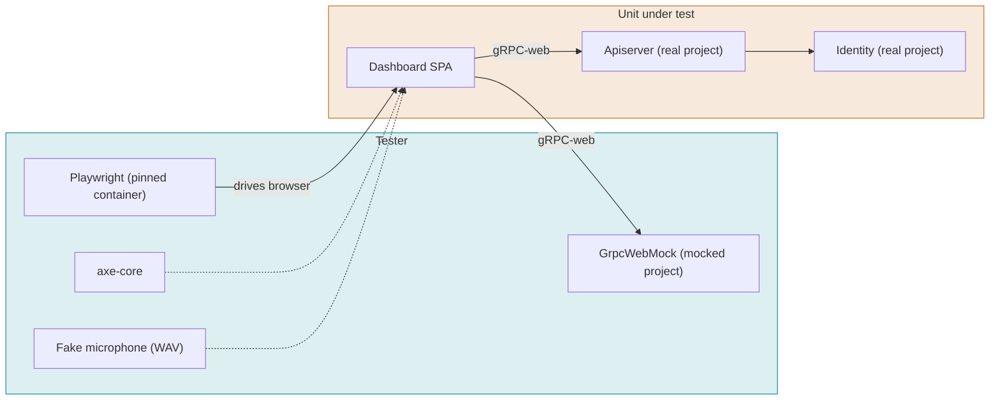

# Dashboard

What the user sees. Every screen and state in `designs/dashboard.pen`, in the community and cloud
editions. The mocked project proves the SPA's own behavior on every pull request in minutes; the
real project proves it against the platform nightly. Screenshot goldens are captured from the app
inside the pinned Playwright container, reviewed against the design once, and changed only through a
reviewed pull request. Few screenshots; structure checks carry the rest.

## Systems

## Cases

The first eight are the tests that exist today in `mods/dashboard/e2e`, mapped to the spec. The
rest are the scenarios the spec promises and nothing tests yet, in the order to take them.

### DSH-001 Sign in with email and password and land on the workspaces list

- **Spec:** dashboard / Sign-in options follow the advertised methods / Community defaults
- **Spec:** dashboard / Users land on the workspaces list after sign-in / Signed in with workspaces
- **Spec:** dashboard / Users land on the workspaces list after sign-in / Opening the root with a session
- **Priority:** P0
- **Proof:** Build the SPA with `landingTarget` returning the first workspace's path; the test must go red on the URL after sign-in and after reload.
- **Test:** mods/dashboard/e2e/community.spec.ts

A community install offers only the password method. A valid sign-in lands on the workspaces list, and so does a reload of `/`; nothing is remembered.

**Pass.** The sign-in form shows the password method only; after sign-in and again after a reload the URL is `/workspaces` with the Choose a workspace heading; choosing one opens its overview. **Fail.** Another method is offered, or the user lands anywhere but the list.

### DSH-002 An invitee sets a password before anything else

- **Spec:** dashboard / Invitees set a password before using the app / First sign-in from an invite
- **Spec:** dashboard / Invitees set a password before using the app / Password set
- **Priority:** P0
- **Proof:** Build the SPA with the set-password guard disabled (`guards.tsx`); the test must go red on the redirect to `/set-password`.
- **Test:** mods/dashboard/e2e/community.spec.ts

**Pass.** The first sign-in from an invite shows the set-password screen before any other screen, every other route redirects to it, and after setting the password the user lands on the workspaces list. **Fail.** Any other screen appears first, or the user lands anywhere but the list.

### DSH-003 Sign-out leaves a clean sign-in page

- **Spec:** dashboard / The session persists in the browser and ends cleanly / Sign-out
- **Priority:** P0
- **Proof:** Remove the `client.logout()` call from `signOut`; the test must go red on the logout poll. Remove `queryClient.clear()`; it must go red on the second user's list.
- **Test:** mods/dashboard/e2e/community.spec.ts

**Pass.** After sign-out the user is on sign-in, storage holds nothing token-like, the server logout was called, and a second user signing in sees only their own workspaces. **Fail.** A token remains, no logout call, or the first user's data shows for the second.

### DSH-004 List and open an agent with its saved configuration

- **Spec:** dashboard / The sidebar names Agents and Apps / Sidebar labels
- **Spec:** dashboard / Agent pickers offer the catalog / A saved item that is no longer offered
- **Spec:** dashboard / Agent pickers offer the catalog / A saved agent opens with its configuration
- **Priority:** P1
- **Proof:** Make `CatalogPicker` drop a provider the catalog no longer offers instead of marking it unavailable; the test must go red on the Provider select.
- **Test:** mods/dashboard/e2e/community.spec.ts

**Pass.** The sidebar links Agents to `/agents` and Apps to `/apps` with nothing labeled Streams or Autopilot; the list shows the seeded agent; opening it shows the saved prompt and first message decoded through the SDK; the voice row's Provider shows `deepgram (unavailable)` because the mocked catalog offers only `fake`. **Fail.** A wrong or missing sidebar label, a missing field, or the stale provider replaced or blank.

### DSH-005 Usage in a community install shows minutes and no money

- **Spec:** dashboard / The workspace has a Usage page / Community install
- **Spec:** dashboard / Usage shows minutes apart from test minutes / Calls and tests
- **Spec:** dashboard / Usage shows AI usage by vendor and key / Own key and platform key
- **Priority:** P1
- **Proof:** Make the summary fold browser-test seconds into Calls (`summary.ts`); the test must go red on both figures.
- **Test:** mods/dashboard/e2e/community.spec.ts

**Pass.** The Usage page shows Calls 1,284 min and Browser tests 96 min as separate figures, the AI table says Your key for the workspace-key row and Fonoster key for the platform-key row, and nothing on the page is a price, cost or balance. **Fail.** Tests folded into calls, a wrong key source, or any amount shown.

### DSH-006 Sign in with an emailed code

- **Spec:** dashboard / Sign-in options follow the advertised methods / Cloud
- **Priority:** P0
- **Proof:** Hide the "Email me a sign-in code instead" link when both methods are on (`sign-in.page.tsx`); the test must go red.
- **Test:** mods/dashboard/e2e/cloud.spec.ts

**Pass.** On Cloud the password form shows first; the link swaps it for the code form; the code is sent and accepted; the user lands on the workspaces list. **Fail.** No link, the password field stays, the code is not accepted, or the user lands anywhere but the list.

### DSH-007 Sign in with GitHub and check the state

- **Spec:** dashboard / Sign-in options follow the advertised methods / Cloud
- **Priority:** P0
- **Proof:** The mock's authorize URL omits the state; the test must go red.
- **Test:** mods/dashboard/e2e/cloud.spec.ts

**Pass.** The GitHub button sends the user to the advertised authorize URL with a state, the callback with that state signs the user in, and the user lands on the workspaces list. **Fail.** No state, sign-in without it, or a landing anywhere but the list.

### DSH-008 Refuse a GitHub callback the app did not start

- **Spec:** dashboard / Sign-in options follow the advertised methods / GitHub state mismatch
- **Priority:** P0
- **Proof:** Build the SPA with the state check disabled (a test-only flag); the test must go red.
- **Test:** mods/dashboard/e2e/cloud.spec.ts

**Pass.** A callback with an unknown state is refused and no token is stored. **Fail.** The callback signs the user in.

### DSH-009 A sign-in never reveals whether an email has an account

- **Spec:** dashboard / Sign-in options follow the advertised methods / Wrong credentials
- **Priority:** P0
- **Proof:** Make the code screen show the server's message for a refused exchange (`check-email.page.tsx`); the test must go red on the account text.
- **Test:** mods/dashboard/e2e/cloud.spec.ts

The wrong-password half is asserted by DSH-001 and DSH-016. This case covers the code path, where the risk is enumeration: asking for a code and entering a wrong one must look the same for an email with an account and one without.

**Pass.** Asking for a code for an unknown email shows Check your email; a refused exchange shows the wrong-code message and nothing about the account, even when the server's message says so. **Fail.** Any screen or message reveals that the email has no account.

### DSH-010 Reload keeps the session

- **Spec:** dashboard / The session persists in the browser and ends cleanly / Reload
- **Spec:** dashboard / The session persists in the browser and ends cleanly / No token in storage
- **Spec:** dashboard / Users land on the workspaces list after sign-in / Deep link with a session
- **Priority:** P0
- **Proof:** Make the restore-on-load navigate to the workspaces list (`auth.tsx`); the test must go red on the route after reload.
- **Test:** mods/dashboard/e2e/community.spec.ts

A token that expires in 30 s forces the timer-based renewal right after sign-in, so the renewal path is exercised without waiting.

**Pass.** The renewal runs from the timer and leaves nothing token-like in local or session storage; a reload on `/w/ws-1/agents` restores the user on that same route with storage still clean. **Fail.** No renewal, anything token-like in storage, or a reload that lands anywhere but the same route.

### DSH-011 Refresh token rejected

- **Spec:** dashboard / The session persists in the browser and ends cleanly / Refresh token rejected
- **Priority:** P0
- **Proof:** Drop `next` from both places that add it, the expiry redirect in `signOut` (`auth.tsx`) and the signed-out redirect in `RequireAuth` (`guards.tsx`); the test must go red on the sign-in URL. Either alone leaves the other, which is why both are named.
- **Test:** mods/dashboard/e2e/community.spec.ts

A 68-second token makes the renewal fire about 8 seconds after sign-in, once the test is on a deep route; the mock then refuses it. Writing this case found that the sign-in guard raced the form and dropped `next` (fixed in `guards.tsx`, with a unit test).

**Pass.** When the renewal is refused the user lands on `/sign-in?next=/w/ws-1/agents` with nothing token-like in storage, and signing in again returns to `/w/ws-1/agents`. **Fail.** A blank page, a spinner, no `next`, a token left behind, or a sign-in that lands anywhere else.

### DSH-012 No workspaces after sign-in

- **Spec:** dashboard / Users land on the workspaces list after sign-in / No workspaces
- **Priority:** P1
- **Proof:** Make the create page stay on the form after creating (`create-workspace.page.tsx`); the test must go red on the URL.
- **Test:** mods/dashboard/e2e/community.spec.ts

The deep-link scenario is cited by DSH-010, whose reload step opens `/w/ws-1/agents` directly.

**Pass.** With no workspaces, sign-in goes to Create workspace; creating one opens its overview at `/w/<ref>` showing the new name; the workspaces list then contains it. **Fail.** The list or any other screen first, no overview after creating, or a list that does not show the new workspace.

### DSH-013 A private region's fee follows billing

- **Spec:** dashboard / Cloud-only screens follow capabilities and ownership / Region fee follows billing
- **Priority:** P1
- **Proof:** Drop the `billing.enabled` guard around the fee in `region-drawer.tsx`; the community test must go red.
- **Test:** mods/dashboard/e2e/community.spec.ts and mods/dashboard/e2e/cloud.spec.ts (one case, both projects)

The same region, with a fee, served to both projects over the regions HTTP API. Writing this case found that the SDK called a detached `globalThis.fetch` ("Illegal invocation" in browsers), so the dashboard never listed private regions and silently showed the default; fixed in `@fonoster/sdk` `Regions` and `CallRecords`, with a unit test that calls the SDK with a `this`-checking fetch. The Billing tab scenarios of the open billing change get their own cases when that change lands; today there is no tab to test.

**Pass.** In the community project the region drawer shows no Monthly fee and no amount; in the cloud project it shows the fee. **Fail.** Any amount in community, or no fee on Cloud.

### DSH-014 Noise cancelling is one select fed by the catalog

- **Spec:** dashboard / Noise cancelling is one select fed by the catalog / No noise-cancelling provider is offered
- **Spec:** dashboard / Noise cancelling is one select fed by the catalog / Turning noise cancelling on
- **Spec:** dashboard / Noise cancelling is one select fed by the catalog / Turning it off
- **Spec:** dashboard / Noise cancelling is one select fed by the catalog / Agents set it on the Advanced tab
- **Priority:** P1
- **Proof:** Make `filtersFor` ignore the chosen value (`session/noise-cancelling.ts`); the test must go red on the saved filters.
- **Test:** mods/dashboard/e2e/community.spec.ts

Runs through the real SDK encoding of `filters` on `UpdateApplication`, which the unit tests do not reach.

**Pass.** On the agent's Advanced tab the select offers None and the catalog's nc provider by label; picking the provider sends nothing until Save, then saves `filters: [{ name: "aiCoustics" }]`; picking None saves an empty list; with no nc provider in the catalog the select offers None only. **Fail.** A missing or extra option, a request before Save, a wrong filter list, or a select with more than None when nothing is offered.

### DSH-015 Talk drawer: call, mute and hang up

- **Spec:** talk-in-browser / Talk drawer calls from the browser / Call, mute and hang up
- **Spec:** talk-in-browser / A browser call reaches the agent / Call the saved agent
- **Priority:** P0
- **Tier:** nightly
- **Proof:** Stop the Autopilot service (`docker stop rb-stack-autopilot-1`); with nothing to answer, the test must go red on Connected. Restart it after.
- **Test:** mods/dashboard/e2e/talk.real.spec.ts (the `real` project, `npm run test:e2e:real` against `ops/rebuild/stack up && seed`)

The first case of the real project: Chromium with a fake microphone against the running platform, the seeded owner and the seeded Autopilot agent on the fake providers. The fake STT is scripted, so this case checks the call's lifecycle and that a record is written, not what was said. Bringing it up found three breaks on `main` that the path-filtered nightly had not reported: `ops/rebuild/stack` still emitted the `registry` config key removed in #1011 (apiserver would not start); `seed.cjs` shadowed its `agent()` config builder with the SIP agent (#1012), so every seed failed and retried into the sign-in throttle; and the AppBridge image lacked the nested `ws` module (`Cannot find module 'ws'`), so no AppBridge ever claimed a call and the drawer reported 503.

**Pass.** Talk to agent, Call: the drawer shows Connected with a running timer; Mute reads Unmute; Hang up shows Call ended with Call again; the call then appears in the workspace's calls. **Fail.** No connection, a stuck state, a mute that does not toggle, or no call record.

### DSH-016 Sign in with email and password on Cloud

- **Spec:** dashboard / Sign-in options follow the advertised methods / Cloud
- **Spec:** dashboard / Sign-in options follow the advertised methods / Wrong credentials
- **Spec:** dashboard / Users land on the workspaces list after sign-in / Signed in with workspaces
- **Priority:** P0
- **Proof:** Never render the password form on Cloud (`sign-in.page.tsx`); the test must go red on the password field.
- **Test:** mods/dashboard/e2e/cloud.spec.ts

Every edition offers email and password. On Cloud it sits next to GitHub and the code link.

**Pass.** Cloud sign-in shows Continue with GitHub, the email and password form and the code link; a wrong password shows the documented message; the right one lands on the workspaces list. **Fail.** A method missing, a wrong message, or a landing anywhere but the list.
