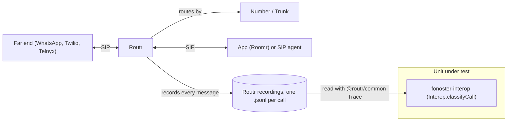

# Interop

Which interop case a call to a well-known far end proves, read from the recording Routr keeps of
every call. A far end is the provider on the other side of a Trunk: WhatsApp Business Calling,
Twilio, Telnyx. Two directions:

- **DID (inbound):** the far end calls one of our Numbers. Its INVITE arrives at the Trunk's
  inbound host and Routr marks it `X-Call-Direction: from-pstn`.
- **DOD (outbound):** Fonoster calls out through a Trunk, from an app (Roomr, `peer-to-pstn`) or a
  SIP agent (`agent-to-pstn`).

Each case is a signaling signature over the recorded messages. The classifier reports the far end
and at most one case per call; when several match (a re-INVITE inside an answered call), the
highest id wins. Evidence for each far end is its sanitized recordings and `manifest.yaml` in
fonoster/routr [`interop/<far-end>/`](https://github.com/fonoster/routr/tree/main/interop).

Not here: anything only media shows (DTMF, audio both ways, the codec used, hold actually silencing
the call, early media, SRTP or DTLS keying, AMD, recording), attended transfer (its Replaces spans
two calls), and Routr's own SEET compliance tests, which stay in fonoster/routr.

## Systems



## How evidence is found

The classifier reads one recording with `@routr/common`'s own schema, a line at a time (a line that
doesn't parse, like the last line of a file still being written, is skipped). It finds the initial
INVITE (the first one with no To tag that Routr forwarded, after any 401/407 challenge), takes the
direction from the `X-Call-Direction` Routr added, and the far end from fields a caller can't set:

- outbound, the Request-URI host Routr forwarded to, against the far end's `hosts`;
- inbound, the Request-URI host it arrived at (the Trunk's inbound host, for example
  `wa-<accessKeyId>-<digits>.<pstnRoot>` for WhatsApp) against `hosts`, or the address it came from
  against `addresses`.

The far ends come from the curated list `@fonoster/common` ships,
`mods/common/src/interop/far-ends.known.json`: one entry per well-known provider with its
signaling `hosts` and `addresses`, the provider's own pages they were read from (`sources`) and
the day they were last compared with them (`checked`). To add or fix a provider, edit its entry in a
pull request with a source and today's `checked` date. `--far-ends <file>` adds entries, or replaces a curated one with the same `name`.

Only responses Routr relayed count; retransmissions count once. A REGISTER-only recording, an
`agent-to-agent` call or a call to an unlisted far end shows no case.

The scan runs about every 5 minutes inside the API server when `features.ops` is on
(`mods/ops/README.md`). It reads only recordings modified since the last run (the first run reads
all retained traces), skips REGISTER-only files after their first line and calls that haven't ended
yet (they are read again once Routr writes their last message), and reports each far end x case
once ever, the first time it is seen. It also reports failures, calls to a listed far end whose
signaling points at the interconnect: `no response to INVITE` (an outbound INVITE cancelled with no
response at all from the far end), `<status> to INVITE` (400, 403, 415, 488, 5xx), `no final
response to INVITE` (408), `no ACK for 2xx`, `481 to <METHOD>`; 404, 480, 484, 486, 487 and 603 are
ordinary unanswered calls. One alert per far end and signature counts that UTC day's calls. Both are
in `<state>/state.json`; removing it starts over.

## Checking a case yourself

1. Place the call through the far end.
2. Find its recording, `<UTC time>-<Call-ID>.jsonl`, in the host's `routr_traces_dir`.
3. On your machine, run `npx -p @fonoster/common fonoster-interop classify <file>`; it prints the
   far end and the case, or `- -`.
4. Sanitize it with `rctl trace sanitize` (fonoster/routr `etc/corpus/README.md`) and add it to
   fonoster/routr `interop/<far-end>/manifest.yaml`, so Routr's replay guards it. This repository
   and Routr's are public. Commit only sanitized recordings. Never publish a production recording's
   file name, a Call-ID, a phone number or a host name. `rctl trace sanitize` applies only your
   rewrites and recomputes digests: it does not remove SDP lines or headers such as
   `X-Connect-Token`, so they need rewrites of their own.

## Running

```sh
npm run build -w @fonoster/common
LOGS_LEVEL=none npx mocha mods/common/test/interop/classify.test.ts
node mods/conformance/catalog/prove.cjs --area IOP     # the proofs, one run per case
```

## Cases

### IOP-001 Inbound call to a Number answered, caller hangs up

- **Spec:** interop / Each interop case has a signaling signature / Inbound call to a Number answered, caller hangs up
- **Priority:** P0
- **Proof:** Require the BYE to come from the callee (`byeFromCaller` → `byeFromCallee` in IOP-001's `matches`, `mods/common/src/interop/classifyCall.ts`); the test must go red on the fixture not classifying as IOP-001.
- **Fault:** faults/IOP-001.patch
- **Test:** mods/common/test/interop/classify.test.ts

Direction: inbound (DID). Fixture: `seet-provider_sc-1.3.2-did-invite_agent-1001_20261023.jsonl` (a real call from fonoster/routr's corpus).

1. The far end sends an INVITE to the Number, at the Trunk's inbound host; Routr challenges it (401) when the Trunk has credentials, and the far end sends it again.
2. Routr marks it `X-Call-Direction: from-pstn` and routes it to Roomr, which serves the Number's app.
3. The app answers: Roomr's 200 is relayed to the far end, which sends the ACK.
4. The caller hangs up: a BYE from the far end (its From tag is the INVITE's), and Fonoster's 200.

**Pass.** The recording classifies as IOP-001: a relayed 2xx to the INVITE, an ACK, a BYE whose From tag is the caller's, and a 2xx to the BYE. **Fail.** It classifies as another case or none, or its near miss still classifies as IOP-001.

### IOP-002 Inbound call answered, Fonoster hangs up

- **Spec:** interop / Each interop case has a signaling signature / Inbound call answered, Fonoster hangs up
- **Priority:** P1
- **Proof:** Require the BYE to come from the caller in IOP-002's `matches` (`classifyCall.ts`); the test must go red.
- **Fault:** faults/IOP-002.patch
- **Test:** mods/common/test/interop/classify.test.ts

Direction: inbound (DID). Fixture: `synthetic_did-invite-callee-bye_provider.jsonl` (a hand-written recording).

1. The far end's INVITE reaches the Number's app through Routr and Roomr, as in IOP-001.
2. The app answers; the far end sends the ACK.
3. The app ends the call: Roomr sends the BYE (its From tag is the dialog's To tag) and the far end answers 200.

**Pass.** The recording classifies as IOP-002: a relayed 2xx to the INVITE, an ACK, a BYE whose From tag is the callee's, and a 2xx to the BYE. **Fail.** It classifies as another case or none, or its near miss still classifies as IOP-002.

### IOP-003 Outbound call from an app answered

- **Spec:** interop / Each interop case has a signaling signature / Outbound call from an app answered
- **Priority:** P0
- **Proof:** Match IOP-003 on `agent-to-pstn` instead of `peer-to-pstn` (`classifyCall.ts`); the test must go red on the app's call not classifying as IOP-003.
- **Fault:** faults/IOP-003.patch
- **Test:** mods/common/test/interop/classify.test.ts

Direction: outbound (DOD). Fixture: `sipp-peer-asterisk_dod-invite-route-by-alias_provider_20261030.jsonl` (a real call from fonoster/routr's corpus).

1. An app places a call: Roomr, a peer of Routr, sends the INVITE; Routr challenges it, then marks it `peer-to-pstn` and forwards it to the Trunk's host.
2. The far end rings and answers; its 200 is relayed to Roomr, which sends the ACK.
3. Either side hangs up with a BYE, answered 200.

**Pass.** The recording classifies as IOP-003: a `peer-to-pstn` INVITE, a relayed 2xx to it, an ACK, a BYE and a 2xx to the BYE. **Fail.** It classifies as another case or none, or its near miss still classifies as IOP-003.

### IOP-004 SIP agent outbound call answered

- **Spec:** interop / Each interop case has a signaling signature / SIP agent outbound call answered
- **Priority:** P0
- **Proof:** Match IOP-004 on `peer-to-pstn` instead of `agent-to-pstn` (`classifyCall.ts`); the test must go red on the SIP agent's call not classifying as IOP-004.
- **Fault:** faults/IOP-004.patch
- **Test:** mods/common/test/interop/classify.test.ts

Direction: outbound (DOD). Fixture: `sipjs_wa-dod-invite_whatsapp_20261025.jsonl` (a real call from fonoster/routr's corpus).

1. A SIP agent (a softphone or the dashboard dialer) sends the INVITE; Routr challenges it, marks it `agent-to-pstn` and forwards it to the Trunk's host.
2. The far end answers; the 200 is relayed to the SIP agent, which sends the ACK.
3. Either side hangs up with a BYE, answered 200.

**Pass.** The recording classifies as IOP-004: an `agent-to-pstn` INVITE, a relayed 2xx to it, an ACK, a BYE and a 2xx to the BYE. **Fail.** It classifies as another case or none, or its near miss still classifies as IOP-004.

### IOP-005 Outbound call cancelled before answer

- **Spec:** interop / Each interop case has a signaling signature / Outbound call cancelled before answer
- **Priority:** P0
- **Proof:** Accept an answered call as cancelled (drop `!f.answered` from IOP-005, `classifyCall.ts`); the test must go red on the near miss.
- **Fault:** faults/IOP-005.patch
- **Test:** mods/common/test/interop/classify.test.ts

Direction: outbound (DOD). Fixture: `sipjs_wa-dod-invite-cancel_whatsapp_20261025.jsonl` (a real call from fonoster/routr's corpus).

1. An app or SIP agent sends the INVITE; Routr forwards it to the Trunk's host.
2. The caller gives up before the far end answers: a CANCEL follows the INVITE.
3. No 2xx answers the INVITE. A 487 and the CANCEL's 200 are not required: the far end's may arrive after the recording ends.

**Pass.** The recording classifies as IOP-005: an outbound INVITE, at least one response from the far end, a CANCEL, and no 2xx to the INVITE. **Fail.** It classifies as another case or none, or its near miss still classifies as IOP-005.

### IOP-006 Inbound call cancelled by the caller

- **Spec:** interop / Each interop case has a signaling signature / Inbound call cancelled by the caller
- **Priority:** P1
- **Proof:** Accept a CANCEL from any address (`cancelledBySender` → `cancelled` in IOP-006, `classifyCall.ts`); the test must go red on the near miss.
- **Fault:** faults/IOP-006.patch
- **Test:** mods/common/test/interop/classify.test.ts

Direction: inbound (DID). Fixture: `synthetic_did-invite-cancel_provider.jsonl` (a hand-written recording).

1. The far end sends an INVITE to the Number; Routr routes it to Roomr, which rings the app.
2. The far end cancels: a CANCEL from the address the INVITE came from.
3. No 2xx answers the INVITE.

**Pass.** The recording classifies as IOP-006: a `from-pstn` INVITE, a CANCEL from the INVITE's sender, and no 2xx to the INVITE. **Fail.** It classifies as another case or none, or its near miss still classifies as IOP-006.

### IOP-007 Outbound call busy

- **Spec:** interop / Each interop case has a signaling signature / Outbound call busy
- **Priority:** P1
- **Proof:** Match IOP-007 on 480 instead of 486 (`classifyCall.ts`); the test must go red.
- **Fault:** faults/IOP-007.patch
- **Test:** mods/common/test/interop/classify.test.ts

Direction: outbound (DOD). Fixture: `synthetic_dod-invite-busy_provider.jsonl` (a hand-written recording).

1. An app or SIP agent sends the INVITE; Routr forwards it to the Trunk's host.
2. The far end answers 486 Busy Here, relayed back to the caller.

**Pass.** The recording classifies as IOP-007: an outbound INVITE whose relayed final response is 486. **Fail.** It classifies as another case or none, or its near miss still classifies as IOP-007.

### IOP-008 Outbound call declined

- **Spec:** interop / Each interop case has a signaling signature / Outbound call declined
- **Priority:** P0
- **Proof:** Match IOP-008 on 604 instead of 603 (`classifyCall.ts`); the test must go red.
- **Fault:** faults/IOP-008.patch
- **Test:** mods/common/test/interop/classify.test.ts

Direction: outbound (DOD). Fixture: `seet-agent-1001_rr-1.2.1-dod-declined_provider_20261023.jsonl` (a real call from fonoster/routr's corpus).

1. An app or SIP agent sends the INVITE; Routr forwards it to the Trunk's host.
2. The far end answers 603 Decline, relayed back to the caller.

**Pass.** The recording classifies as IOP-008: an outbound INVITE whose relayed final response is 603. **Fail.** It classifies as another case or none, or its near miss still classifies as IOP-008.

### IOP-009 In-dialog re-INVITE with SDP answered

- **Spec:** interop / Each interop case has a signaling signature / In-dialog re-INVITE with SDP answered
- **Priority:** P0
- **Proof:** Require the re-INVITE to have no body (`hasBody(r)` → `!hasBody(r)` for the SDP re-INVITE, `classifyCall.ts`); the test must go red.
- **Fault:** faults/IOP-009.patch
- **Test:** mods/common/test/interop/classify.test.ts

Direction: either. Fixture: `seet-agent-1001_sc-12.2.1-dod-reinvite_provider_20261023.jsonl` (a real call from fonoster/routr's corpus).

1. A call is answered and acknowledged as in IOP-001 or IOP-004.
2. One side sends a new INVITE inside the dialog (it carries the To tag) with an SDP offer: a hold, a resume, a codec change or a session refresh.
3. The other side answers 2xx; the call goes on.

**Pass.** The recording classifies as IOP-009: after the ACK, an INVITE with a To tag and an SDP body, and a 2xx after it. **Fail.** It classifies as another case or none, or its near miss still classifies as IOP-009.

### IOP-010 In-dialog re-INVITE without SDP

- **Spec:** interop / Each interop case has a signaling signature / In-dialog re-INVITE without SDP
- **Priority:** P1
- **Proof:** Stop requiring the SDP in the ACK (`classifyCall.ts`); the test must go red on the near miss.
- **Fault:** faults/IOP-010.patch
- **Test:** mods/common/test/interop/classify.test.ts

Direction: either. Fixture: `synthetic_dod-reinvite-no-sdp_provider.jsonl` (a hand-written recording).

1. A call is answered and acknowledged.
2. One side sends an in-dialog INVITE with no body, asking the other for an offer.
3. The 2xx carries the offer and the ACK carries the answer (RFC 3261 §14.2).

**Pass.** The recording classifies as IOP-010: after the ACK, an INVITE with a To tag and no body, a 2xx with SDP, and an ACK with SDP. **Fail.** It classifies as another case or none, or its near miss still classifies as IOP-010.

### IOP-011 Blind transfer by REFER

- **Spec:** interop / Each interop case has a signaling signature / Blind transfer by REFER
- **Priority:** P2
- **Proof:** Accept any in-dialog request in place of the NOTIFY (`classifyCall.ts`); the test must go red on the near miss without a NOTIFY.
- **Fault:** faults/IOP-011.patch
- **Test:** mods/common/test/interop/classify.test.ts

Direction: either. Fixture: `synthetic_dod-refer_provider.jsonl` (a hand-written recording).

1. A call is answered and acknowledged.
2. One side sends an in-dialog REFER whose Refer-To names the new party; the other accepts it with 202.
3. The transferee reports progress with a NOTIFY (`Event: refer`, a sipfrag body), answered 200 (RFC 3515).

**Pass.** The recording classifies as IOP-011: an in-dialog REFER with Refer-To, a 202 to it, and a NOTIFY with `Event: refer`. **Fail.** It classifies as another case or none, or its near miss still classifies as IOP-011.
