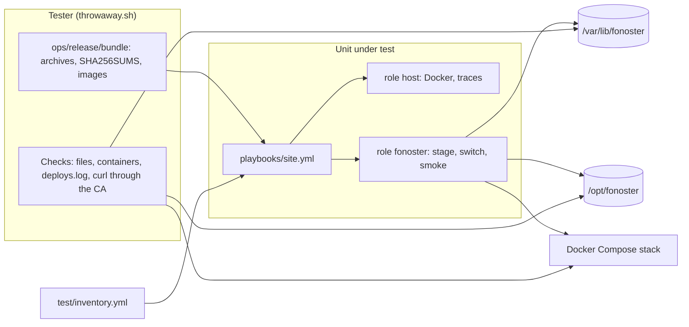

# Operations

How Fonoster's own hosts are run: the Ansible playbook that puts a host on a version, plans the
change before it is made, and rolls back by applying the previous version. A case runs the playbook
for real on a throwaway runner, from a fresh machine, with two local builds (`0.0.0-a` and
`0.0.0-b`) of the release archive and images: plan, apply, apply again, switch to the other
version and back. The failures it must refuse run there too: an archive that does not match its
`SHA256SUMS`, a release that adds a `.env` name the inventory lacks, an install whose keys are not
in the state folder.

Not here: production itself (the deploy workflow), the Compose bundle's own start (the compose job
of `stack-smoke.yaml`), the database (the playbook never touches it), the Helm chart (unsupported).
OPS-001 and OPS-002 are the install script's cases (#1206).

## Running

```sh
# On a throwaway Ubuntu 24.04 machine with root or sudo, Docker, Node.js and ansible on PATH:
npm install && npm run build
THROWAWAY=1 ops/ansible/test/throwaway.sh 0.0.0-a 0.0.0-b
node mods/conformance/catalog/prove.cjs --area OPS --timeout 3600   # the proofs, one run per case
```

## Systems



## Cases

### OPS-003 Plan then apply serves the dashboard and API

- **Spec:** deployment / A playbook puts a host on a Fonoster version / Plan then apply
- **Priority:** P1
- **Proof:** Empty `fonoster_live_excludes` in the fonoster role's defaults; the release's example files, README and schemas land in `/opt/fonoster` and the test goes red.
- **Fault:** faults/OPS-003.patch
- **Test:** ops/ansible/test/throwaway.sh

A plan (`--check --diff`) on the fresh runner, then an apply of `0.0.0-a`. The plan's output is
searched for every secret and `vault_` value of the inventory. After the apply the live folder is
checked for what must not be there, every service's state is read, and the dashboard and the API are
called through the CA the install generated. An archive whose `SHA256SUMS` does not match must fail
the play before anything in `/opt/fonoster` changes.

**Pass.** The plan exits 0, prints no secret and creates no `/opt/fonoster/compose.yaml`; the apply exits 0; `/opt/fonoster` has no `*.example.*`, `.env.example`, `README.md` or `config/schemas`; every service is `running`; the dashboard answers 200 and `ExchangeCredentials` answers `grpc-status: 3`; a checksum mismatch fails naming it, with `/opt/fonoster` byte-identical. **Fail.** Any of those differs.

### OPS-004 Applying the previous version rolls back

- **Spec:** deployment / A playbook puts a host on a Fonoster version / Another version
- **Priority:** P1
- **Proof:** Exclude `.env` from the switch's rsync once an install runs; applying `0.0.0-b` leaves `.env` and the containers on `0.0.0-a` and the test goes red.
- **Fault:** faults/OPS-004.patch
- **Test:** ops/ansible/test/throwaway.sh

After `0.0.0-a` runs, `0.0.0-b` is applied and then `0.0.0-a` again. Each time the running version
is read from `.env` and from the apiserver container's image. The `.env`, keys and TLS files are
compared across the three applies. Then two applies that must be refused without touching the live
install: a copy of the `0.0.0-a` archive whose `.env.example` adds a name, and the state folder's
keys moved away from under an existing install.

**Pass.** `0.0.0-b` runs after its apply and `0.0.0-a` after the next; `deploys.log` has `0.0.0-a -> 0.0.0-b` and `0.0.0-b -> 0.0.0-a`; `.env` is byte-identical to the first apply's and the keys and TLS files to every apply's; the added name fails the play naming it, and the empty `/var/lib/fonoster/keys` fails it naming that folder, each with `/opt/fonoster` byte-identical. **Fail.** Any of those differs.

### OPS-005 A second apply changes nothing

- **Spec:** deployment / A playbook puts a host on a Fonoster version / A second apply changes nothing
- **Priority:** P1
- **Proof:** Mark the switch's `docker compose up` as always changed; the second apply reports a change and the test goes red.
- **Fault:** faults/OPS-005.patch
- **Test:** ops/ansible/test/throwaway.sh

The same version and inventory applied again on the converged runner, then once more with only the
Routr log level changed in its override, which changes `config/routr-one.yaml` and nothing else.
The container of every service is compared before and after.

**Pass.** The second apply's recap says `changed=0`; with the override changed, only the `routr` container is new. **Fail.** The recap counts a change, or another service is recreated (or routr is not).
