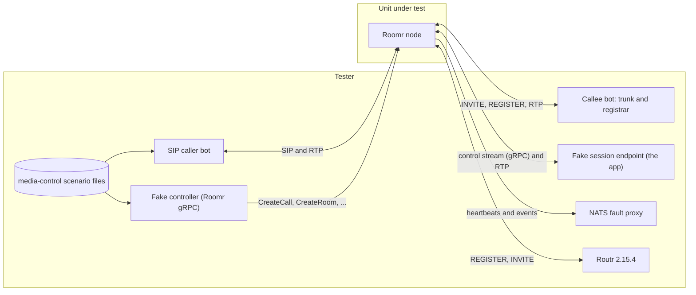

# Roomr, the SIP and media edge

What a SIP peer, a controller and an app see from a Roomr node (redesign-roomr). A call that
arrives as an INVITE becomes a room, rings, and opens one control stream to the session endpoint,
whose app answers, rejects, holds, transfers, sends keypresses or adds listeners on it; its audio is
RTP beside the stream. A controller places calls and manages rooms over gRPC. The node reports
liveness and capacity in heartbeats and every call's events on its own NATS subject, registers
where it is told to, and drains on SIGTERM.

Two kinds of tests prove it. The Go e2e tests run the node in the test process, so they reach
inside it (rooms held, open dialogs). The media-control scenario files run against the built binary
over real SIP and RTP, with NATS behind a fault proxy; each file belongs to the case that lists it
under **Runs**. The same files run against the fake node the AppBridge suites use (ROM-038), so the
fake cannot drift from the node.

Unit tests (go/roomr/internal) stay unit tests. Tests of the Roomr node that belong to other areas:

| Tests | Area |
| --- | --- |
| `mods/conformance/test/roomr-secrets.test.ts` (secret:// in the started node) | Deployment and operations (service-config) |
| `mods/conformance/test/deployment.test.ts` (the chart's Roomr settings, network isolation) | Deployment and operations |
| `mods/conformance/test/natsPermissions.test.ts` (the node's NATS user) | Deployment and operations |
| `mods/apiserver/test/outbound/*`, `webhooks/nodeCallEvents.test.ts` (placement, node events) | Call flows |

Cluster and scale scenarios (the capacity bar, calls across pods, rollouts with live calls,
NetworkPolicy reachability, the controller's choice of node) are listed in
`uncovered-scenarios.txt`.

## Systems



## Running it

```sh
nats-server -js -p 4222 &                                    # or: docker run -p 4222:4222 nats:2.11.8 -js
(cd go/roomr && docker compose -f e2e/testdata/routr/compose.yaml up -d --wait)
cd go/roomr && CONFORMANCE_NATS_URL=nats://127.0.0.1:4222 ROUTR_EDGEPORT=127.0.0.1:15360 \
  ROUTR_NODE_HOST=host.docker.internal go test -p 1 -count=1 ./e2e/
CONFORMANCE_NATS_URL=nats://127.0.0.1:4222 npx mocha --exit --timeout 120000 \
  mods/conformance/test/media-control-go.test.ts mods/conformance/test/media-control.test.ts
node mods/conformance/catalog/prove.cjs --area ROM --case ROM-012
```

## Cases

### ROM-001 Inbound calls reach the app on their own control stream

- **Spec:** roomr / Inbound calls become rooms / Inbound call reported with its headers
- **Spec:** roomr / The node knows no other component by name / Default configuration interprets nothing
- **Spec:** media-control / Each call opens one control stream to the session endpoint / One connection per call
- **Spec:** media-control / Each call opens one control stream to the session endpoint / Start is first
- **Spec:** media-control / Ringing before answer / Caller hears ringing while the app is slow
- **Priority:** P0
- **Proof:** Send Start without the INVITE's headers (`openStream` in `internal/node/call.go`); the tests must go red on the headers in Start.
- **Fault:** faults/ROM-001.patch
- **Test:** go/roomr/e2e/calls_test.go, mods/conformance/test/media-control-go.test.ts
- **Runs:** scenarios/media-control/inbound-start.yaml

An INVITE gets 180 Ringing at once and no 200 OK until the app's Answer. The node opens one control
stream for the call and sends Start first, with the call and room refs, the direction, the parties,
the node's RTP endpoint and every header of the INVITE untouched.

**Pass.** Start carries every header as received, 180 comes first and 200 only after Answer, and the call's events are numbered from 1. **Fail.** A header missing or changed in Start, or 200 OK before the app answered.

### ROM-002 Calls the app does not take are refused with the right status

- **Spec:** roomr / Inbound calls become rooms / Session endpoint unreachable
- **Spec:** roomr / Inbound calls become rooms / App never answers
- **Spec:** roomr / Inbound calls become rooms / App rejects
- **Spec:** media-control / Ringing before answer / Caller hears ringing while the app is unreachable
- **Priority:** P0
- **Proof:** Refuse a call the app never answered with 408 instead of 480 (`awaitAnswer` in `internal/node/call.go`); the tests must go red on app-never-answers.
- **Fault:** faults/ROM-002.patch
- **Test:** go/roomr/e2e/calls_test.go, go/roomr/e2e/hardening_test.go, mods/conformance/test/media-control-go.test.ts
- **Runs:** scenarios/media-control/session-endpoint-unreachable.yaml
- **Runs:** scenarios/media-control/app-never-answers.yaml
- **Runs:** scenarios/media-control/app-rejects.yaml

An unreachable session endpoint gets the caller 503, an app that keeps the stream open but never
answers gets 480 after the answer timeout, and Reject gives the app's status. No room and no SIP
dialog is left behind.

**Pass.** 503, 480 and the app's status reach the caller, call.ended carries the cause and status, and no room or dialog remains. **Fail.** Another status, a room or dialog left open, or a stream that stays up.

### ROM-003 A caller who cancels before the answer ends the call

- **Spec:** media-control / Each call opens one control stream to the session endpoint / Caller cancels before Answer
- **Priority:** P1
- **Proof:** End a call the caller canceled with cause removed (`watchLeg` in `internal/node/call.go`); the tests must go red on the Ended cause.
- **Fault:** faults/ROM-003.patch
- **Test:** go/roomr/e2e/calls_test.go, mods/conformance/test/media-control-go.test.ts
- **Runs:** scenarios/media-control/caller-cancels-before-answer.yaml

**Pass.** The caller gets 487, the app gets Ended caller_hangup and its stream closes, and call.ended says caller_hangup, not answered. **Fail.** Another cause, or a stream left open.

### ROM-004 A broken control stream, or a dead node, ends the call

- **Spec:** media-control / A broken control stream ends the call / Stream breaks mid-call
- **Spec:** media-control / A broken control stream ends the call / Ready never arrives
- **Spec:** media-control / A broken control stream ends the call / Session endpoint unreachable on answer
- **Spec:** media-control / A broken control stream ends the call / Node gone, appbridge notices
- **Spec:** media-control / Endings carry a reason / App pod dies
- **Spec:** roomr / Rooms without an owner end / AppBridge killed mid-call
- **Spec:** roomr / A crashed node's calls end cleanly / Node killed mid-call
- **Spec:** media-control / Nodes report capacity and liveness / Node killed
- **Spec:** media-control / Nodes report liveness / Node killed
- **Priority:** P0
- **Proof:** End a call whose stream broke with node_error instead of app_gone (`serve` in `internal/node/call.go`); the tests must go red on stream-breaks. A killed node has no code left to fault: its sockets close with the process, which node-killed checks on every run.
- **Fault:** faults/ROM-004.patch
- **Test:** go/roomr/e2e/calls_test.go, mods/conformance/test/media-control-go.test.ts
- **Runs:** scenarios/media-control/stream-breaks.yaml
- **Runs:** scenarios/media-control/ready-never-arrives.yaml
- **Runs:** scenarios/media-control/session-unreachable-on-answer.yaml
- **Runs:** scenarios/media-control/node-killed.yaml

The node never reconnects a call. A stream that breaks mid-call, an outbound call whose app never
sends Ready, and an answered callee whose session endpoint is down all end with BYE and app_gone;
a killed node's streams close and its heartbeats stop.

**Pass.** BYE to the caller or callee, call.ended app_gone, one stream per call, and no heartbeat after a kill. **Fail.** A call that outlives its stream, a second stream, or another cause.

### ROM-005 Endings carry the node's reason

- **Spec:** media-control / Endings carry a reason / Caller hangs up
- **Priority:** P0
- **Proof:** Report the caller's BYE as callee_hangup (`Incoming` in `internal/node/call.go`); the test must go red on caller-hangup-reason.
- **Fault:** faults/ROM-005.patch
- **Test:** mods/conformance/test/media-control-go.test.ts
- **Runs:** scenarios/media-control/caller-hangup-reason.yaml

**Pass.** The app's Ended, call.ended and room.ended all say caller_hangup, and the call ref from the header names the call end to end. **Fail.** Another cause anywhere.

### ROM-006 The app's audio is RTP beside its control stream

- **Spec:** media-control / App audio is RTP negotiated on the control stream / Endpoints exchanged on the stream
- **Spec:** media-control / App audio is RTP negotiated on the control stream / Audio never on the stream
- **Spec:** media-control / The app leg carries the app's audio / Agent audio reaches the caller
- **Spec:** media-control / The app leg carries the app's audio / AppBridge hears the caller
- **Spec:** media-control / The session participant carries AppBridge's audio / Agent audio reaches the caller
- **Spec:** media-control / The session participant carries AppBridge's audio / AppBridge hears the caller
- **Spec:** roomr / One RTP port range serves every leg / Port announced on the stream
- **Priority:** P0
- **Proof:** Send the app's leg nothing (`tick` in `internal/node/room.go`); the test must go red on audio-both-ways.
- **Fault:** faults/ROM-006.patch
- **Test:** go/roomr/e2e/calls_test.go, mods/conformance/test/media-control-go.test.ts
- **Runs:** scenarios/media-control/audio-both-ways.yaml

**Pass.** The app hears the caller and the caller hears the app over the endpoints exchanged in Start and Answer, and the stream carries only control. **Fail.** Silence either way, or audio on the stream.

### ROM-007 SIP TLS, SRTP and gRPC TLS are optional and off by default

- **Spec:** roomr / SIP TLS and SRTP are optional and off by default / Encrypted deployment
- **Spec:** roomr / SIP TLS and SRTP are optional and off by default / Plain by default
- **Priority:** P1
- **Proof:** Answer an SRTP offer with plain RTP (`prepareSRTP` in `internal/node/room.go`); the tests must go red on the encrypted call.
- **Fault:** faults/ROM-007.patch
- **Test:** go/roomr/e2e/media_test.go, go/roomr/e2e/tls_test.go, go/roomr/e2e/roomr_test.go, mods/conformance/test/media-control-go.test.ts
- **Runs:** scenarios/media-control/plain-by-default.yaml

A plain INVITE gets plain RTP. With a SIP TLS listener, an INVITE over TLS offering SDES-SRTP is
answered with SRTP; the edge's certificate is validated; with a client CA, Roomr's gRPC serves only
controllers that present a certificate it signed.

**Pass.** SRTP when offered over TLS, plain RTP otherwise, and mutual TLS enforced when configured. **Fail.** A plain answer to an SRTP offer, or a controller served without a valid certificate.

### ROM-008 The app leg can be encrypted

- **Spec:** media-control / App audio is RTP negotiated on the control stream / Encrypted app leg
- **Priority:** P1
- **Proof:** Ignore the app's SRTP key (`attachApp` in `internal/node/call.go`); the test must go red on the app leg's SRTP.
- **Fault:** faults/ROM-008.patch
- **Test:** go/roomr/e2e/media_test.go, mods/appbridge/test/srtp.test.ts

**Pass.** Start carries the node's key; an app that answers with its own gets SRTP both ways, plain RTP to the app port is dropped, and AppBridge's SRTP interoperates with the node's. **Fail.** Plain RTP on a leg that asked for SRTP.

### ROM-009 Opus first, G.711 for everyone, 488 when nothing matches

- **Spec:** roomr / Supported codecs / Each codec carries audio both ways
- **Spec:** roomr / Supported codecs / Opus preferred when the peer accepts it
- **Spec:** roomr / Supported codecs / Offer order on outbound legs
- **Spec:** roomr / Supported codecs / No common codec
- **Spec:** roomr / Rooms mix audio for their participants / Opus caller hears wideband, not full-band
- **Priority:** P0
- **Proof:** Answer with the caller's first codec instead of the node's (`Incoming` in `internal/node/call.go`); the tests must go red on Opus preferred.
- **Fault:** faults/ROM-009.patch
- **Test:** go/roomr/e2e/media_test.go, go/roomr/e2e/opus_test.go, mods/conformance/test/media-control-go.test.ts, mods/appbridge/test/gonode.test.ts
- **Runs:** scenarios/media-control/codec-preference.yaml

**Pass.** PCMU, PCMA, G.722 and Opus carry audio both ways (wideband for Opus), an offer with Opus is answered with Opus whatever its order, the node's own INVITEs offer its codecs in order and take the callee's pick, and an offer with no common codec gets 488. **Fail.** PCMU for an Opus-capable caller, or a call with no common codec answered.

### ROM-010 Keypresses are detected three ways and reported once

- **Spec:** roomr / DTMF is detected three ways / RFC 4733
- **Spec:** roomr / DTMF is detected three ways / SIP INFO
- **Spec:** roomr / DTMF is detected three ways / In-band fallback
- **Spec:** roomr / DTMF is detected three ways / No double report
- **Priority:** P0
- **Proof:** Label RFC 4733 keypresses as SIP INFO (`servePhone` in `internal/node/room.go`); the tests must go red on the source.
- **Fault:** faults/ROM-010.patch
- **Test:** go/roomr/e2e/media_test.go, go/roomr/e2e/hardening_test.go, mods/conformance/test/media-control-go.test.ts
- **Runs:** scenarios/media-control/dtmf-to-app.yaml

**Pass.** RFC 4733, SIP INFO and in-band keypresses reach the app as Dtmf with their source, once each; an INFO outside the dialog is refused and never reported. **Fail.** A wrong source, a lost or doubled keypress, or a node killed by a malformed INFO.

### ROM-011 The app sends DTMF on the caller's leg

- **Spec:** media-control / The app sends DTMF on the caller's leg / DTMF sent
- **Priority:** P1
- **Proof:** Drop the last digit of SendDtmf (`sendDTMFOn` in `internal/node/room.go`); the tests must go red on the digits.
- **Fault:** faults/ROM-011.patch
- **Test:** go/roomr/e2e/calls_test.go, mods/conformance/test/media-control-go.test.ts
- **Runs:** scenarios/media-control/send-dtmf.yaml

**Pass.** The caller receives 1, 2 and # as RFC 4733 events, in order. **Fail.** A missing or reordered digit.

### ROM-012 Hold plays hold audio, and commands apply in order

- **Spec:** media-control / Hold silences the app and plays hold audio / Hold with music
- **Spec:** media-control / Each call opens one control stream to the session endpoint / Commands are ordered
- **Priority:** P0
- **Proof:** Ignore Resume (`setHold` in `internal/node/room.go`); the tests must go red on the caller still held.
- **Fault:** faults/ROM-012.patch
- **Test:** go/roomr/e2e/calls_test.go, mods/conformance/test/media-control-go.test.ts
- **Runs:** scenarios/media-control/hold-with-music.yaml
- **Runs:** scenarios/media-control/commands-ordered.yaml

**Pass.** Hold cuts the caller off from the app and loops the hold audio to the caller alone; Resume restores both; Hold then Resume leaves the caller resumed. **Fail.** Hold audio after Resume, or a caller left on hold.

### ROM-013 Cold and REFER transfers

- **Spec:** media-control / Transfer modes / Cold transfer
- **Spec:** media-control / Transfer modes / Refer transfer
- **Priority:** P0
- **Proof:** Keep the app's leg in the room after a cold transfer (`transfer` in `internal/node/dial.go`); the tests must go red on the app leg leaving.
- **Fault:** faults/ROM-013.patch
- **Test:** go/roomr/e2e/calls_test.go, mods/conformance/test/media-control-go.test.ts
- **Runs:** scenarios/media-control/cold-transfer.yaml
- **Runs:** scenarios/media-control/refer-transfer.yaml

**Pass.** A cold transfer dials the target into the room, the app's leg leaves with removed, the caller and the new party hear each other and the call outlives the app's stream; a REFER transfer sends REFER on the caller's leg and leaves the call. **Fail.** The app left in the room, or a REFER not sent.

### ROM-014 A warm transfer holds the caller until it completes

- **Spec:** media-control / Warm transfer keeps the caller on hold / Warm transfer completed
- **Spec:** media-control / Warm transfer keeps the caller on hold / Warm transfer not answered
- **Priority:** P0
- **Proof:** Leave the caller on hold when the warm transfer's party never answers (`transfer` in `internal/node/dial.go`); the tests must go red on warm-transfer-not-answered.
- **Fault:** faults/ROM-014.patch
- **Test:** go/roomr/e2e/calls_test.go, mods/conformance/test/media-control-go.test.ts
- **Runs:** scenarios/media-control/warm-transfer-completed.yaml
- **Runs:** scenarios/media-control/warm-transfer-not-answered.yaml

**Pass.** The caller is held while the app briefs the new party, TransferComplete resumes the caller and removes the app, and an unanswered transfer reports no_answer and resumes the caller. **Fail.** A caller left on hold, or a transfer that never reports.

### ROM-015 Listeners fork audio by track

- **Spec:** media-control / Listeners fork audio by track / Recording listener gets both sides
- **Spec:** media-control / Listeners fork audio by track / Listener audio destination
- **Spec:** media-control / Roomr is a gRPC service with three nouns / An app records with a listener
- **Spec:** media-control / Participants and tracks are kind-neutral / Track list on join
- **Spec:** roomr / The node never records and captures no SIP / Recording is a listener
- **Spec:** roomr / The node does not capture SIP, record or run speech / Recording is a listener
- **Priority:** P0
- **Proof:** Send listeners the room's mix instead of their track (`tick` in `internal/node/room.go`); the tests must go red on the unmixed tracks.
- **Fault:** faults/ROM-015.patch
- **Test:** go/roomr/e2e/calls_test.go, mods/conformance/test/media-control-go.test.ts, mods/appbridge/test/gonode.test.ts
- **Runs:** scenarios/media-control/recording-listener.yaml
- **Runs:** scenarios/media-control/listener-destination.yaml

**Pass.** A listener added on the stream or with AddParticipant gets each selected track as its own RTP stream, unmixed, until it is removed, and AppBridge records both sides of a real call from it. **Fail.** A listener that hears another track, or keeps hearing after removal.

### ROM-016 The node writes no audio

- **Spec:** roomr / The node never records and captures no SIP / The node writes no audio
- **Priority:** P1
- **Proof:** Write a file for every listener (`addListener` in `internal/node/room.go`); the test must go red on no-audio-files.
- **Fault:** faults/ROM-016.patch
- **Test:** mods/conformance/test/media-control-go.test.ts
- **Runs:** scenarios/media-control/no-audio-files.yaml

**Pass.** A call with a recording listener leaves the node's working directory empty. **Fail.** Any file written.

### ROM-017 Rooms mix audio minus each participant's own

- **Spec:** roomr / Rooms mix audio for their participants / Mix-minus with three participants
- **Spec:** roomr / Rooms mix audio for their participants / Silence is not echoed
- **Priority:** P0
- **Proof:** Mix each participant's own audio back to it (`tick` in `internal/node/room.go`); the tests must go red on the mix.
- **Fault:** faults/ROM-017.patch
- **Test:** go/roomr/e2e/media_test.go, mods/conformance/test/media-control-go.test.ts
- **Runs:** scenarios/media-control/mix-minus-rtp.yaml

**Pass.** With A and B sending different tones and C silent, A hears B, B hears A and C hears both. **Fail.** Anyone hearing themselves.

### ROM-018 Per-room participant limits and track kinds

- **Spec:** roomr / Call and room limits / Room full
- **Spec:** roomr / Call and room limits / Per-room participant limit
- **Spec:** roomr / Rooms mix audio for their participants / Video track refused in v1
- **Priority:** P1
- **Proof:** Ignore CreateRoom's max_participants (`CreateRoom` in `internal/node/control.go`); the tests must go red on room-full.
- **Fault:** faults/ROM-018.patch
- **Test:** go/roomr/e2e/media_test.go, go/roomr/e2e/createroom_test.go, mods/conformance/test/media-control-go.test.ts
- **Runs:** scenarios/media-control/room-full.yaml

**Pass.** A room at its limit refuses the next participant with RESOURCE_EXHAUSTED room_full, CreateRoom's limit overrides the node's for that room, and a video track is refused. **Fail.** A participant past the limit.

### ROM-019 A call's maximum duration

- **Spec:** roomr / Call and room limits / Maximum duration
- **Spec:** media-control / Calls can carry a lower maximum duration / App limit applied
- **Priority:** P1
- **Proof:** End a call past its maximum duration with node_error (`checkLimits` in `internal/node/call.go`); the tests must go red on max_duration.
- **Fault:** faults/ROM-019.patch
- **Test:** go/roomr/e2e/media_test.go, mods/conformance/test/media-control-go.test.ts
- **Runs:** scenarios/media-control/max-duration.yaml

**Pass.** Answer's and CreateCall's max_duration_s lower the call's limit and the call ends with max_duration. **Fail.** A call that runs on, or another cause.

### ROM-020 The room limit is the only admission limit

- **Spec:** roomr / Call and room limits / Node full
- **Spec:** roomr / The room limit is the only admission limit / Loaded node still accepts
- **Spec:** media-control / CreateCall dials out on the node the controller chose / Node at its limit
- **Spec:** media-control / Nodes report capacity and liveness / Heartbeats report the room limit
- **Spec:** media-control / Nodes report liveness / Heartbeats report the room limit
- **Priority:** P0
- **Proof:** Count one room fewer than the node holds (`loadLocked` in `internal/node/node.go`); the tests must go red on the room limit.
- **Fault:** faults/ROM-020.patch
- **Test:** go/roomr/e2e/capacity_test.go, go/roomr/e2e/roomr_test.go, mods/conformance/test/media-control-go.test.ts
- **Runs:** scenarios/media-control/create-call-at-limit.yaml
- **Runs:** scenarios/media-control/capacity-retry.yaml

**Pass.** At maxRooms, CreateRoom and CreateCall into a new room fail with RESOURCE_EXHAUSTED before any INVITE, an INVITE gets 503, concurrent creates never pass the limit, a room that ends frees a place, the heartbeat reports rooms and max_rooms, and the controller moves on to the next node. **Fail.** A room past the limit, or an INVITE sent for a refused call.

### ROM-021 CreateCall dials out with the controller's target, headers and session

- **Spec:** media-control / CreateCall dials out on the node the controller chose / Dial into a new room
- **Spec:** media-control / CreateCall dials out on the node the controller chose / Dial into an existing room
- **Spec:** media-control / CreateCall dials out on the node the controller chose / Session opens at answer
- **Spec:** media-control / Outbound calls are placed on a node chosen by the control plane / Session opens at answer
- **Spec:** media-control / Roomr is a gRPC service with three nouns / CreateCall returns a Call in its room
- **Spec:** media-control / Rooms and participants are managed with CreateRoom, EndRoom, AddParticipant and RemoveParticipant / Participant removed
- **Spec:** roomr / The node knows no other component by name / Outbound headers pass through
- **Spec:** roomr / The node knows no other component by name / Proxy is a parameter
- **Spec:** roomr / The node knows no other component by name / Transport in the proxy URI
- **Priority:** P0
- **Proof:** Leave to.headers off the INVITE (`DialTarget` in `internal/sipua/sipua.go`); the tests must go red on the INVITE's headers.
- **Fault:** faults/ROM-021.patch
- **Test:** go/roomr/e2e/roomr_test.go, go/roomr/e2e/calls_test.go, go/roomr/e2e/createcall_test.go, mods/conformance/test/media-control-go.test.ts
- **Runs:** scenarios/media-control/create-call-new-room.yaml

**Pass.** CreateCall returns the call ringing in its room, the INVITE goes through to.proxy with to.headers byte for byte and no header of the node's own, the room is created on 200 OK (or the existing one joined), Start (OUTBOUND, the metadata) goes to the session endpoint the call names, and an RTP participant can be added and removed. **Fail.** A header changed or missing, another proxy, or a stream opened before the answer.

### ROM-022 Failed dials end with their cause and leave no room

- **Spec:** media-control / CreateCall dials out on the node the controller chose / Busy number
- **Spec:** media-control / Endings carry a reason / Dialed party busy
- **Priority:** P0
- **Proof:** Report a busy callee as rejected (`failCause` in `internal/node/dial.go`); the tests must go red on cause busy.
- **Fault:** faults/ROM-022.patch
- **Test:** go/roomr/e2e/createcall_test.go, go/roomr/e2e/calls_test.go, go/roomr/e2e/roomr_test.go, go/roomr/e2e/callevents_test.go, mods/conformance/test/media-control-go.test.ts
- **Runs:** scenarios/media-control/dialed-party-busy.yaml

**Pass.** Busy, no answer and a rejection end the call with busy (486), no_answer and rejected and their SIP status; no room was created and no stream opened. **Fail.** A wrong cause or status, or a room left behind.

### ROM-023 EndCall cancels a ringing call; unknown calls are NOT_FOUND

- **Spec:** media-control / CreateCall dials out on the node the controller chose / Cancel while ringing
- **Spec:** media-control / Roomr is a gRPC service with three nouns / Unknown call
- **Priority:** P1
- **Proof:** End a call canceled while ringing with the dial's own cause (`runOutbound` in `internal/node/control.go`); the tests must go red on cause removed.
- **Fault:** faults/ROM-023.patch
- **Test:** go/roomr/e2e/roomr_test.go, mods/conformance/test/media-control-go.test.ts
- **Runs:** scenarios/media-control/cancel-while-ringing.yaml

**Pass.** EndCall on a ringing call sends CANCEL and ends it with removed and no stream; on an unanswered inbound call it refuses the caller with 480; an unknown call_ref is NOT_FOUND. **Fail.** Another cause, or a stream opened for a canceled call.

### ROM-024 A repeated CreateCall is safe

- **Spec:** media-control / CreateCall dials out on the node the controller chose / Retry is safe
- **Spec:** media-control / CreateCall dials out on the node the controller chose / Repeat after the call ended
- **Spec:** media-control / CreateCall dials out on the node the controller chose / Same ref, different call
- **Priority:** P0
- **Proof:** Accept a repeated call_ref with other parameters (`CreateCall` in `internal/node/control.go`); the tests must go red on ALREADY_EXISTS.
- **Fault:** faults/ROM-024.patch
- **Test:** go/roomr/e2e/createcall_test.go, mods/conformance/test/media-control-go.test.ts
- **Runs:** scenarios/media-control/create-call-dedupe.yaml

**Pass.** A repeated call_ref returns the same call, also once it ended, with one INVITE; the same ref with other parameters, or the ref of an inbound call, is ALREADY_EXISTS. **Fail.** A second INVITE, or another call accepted under a taken ref.

### ROM-025 CreateCall answers a digest challenge

- **Spec:** media-control / CreateCall dials out on the node the controller chose / Digest challenge answered
- **Priority:** P1
- **Proof:** Drop to.auth's password on the way in (`internal/control/control.go`); the tests must go red on the challenged INVITE.
- **Fault:** faults/ROM-025.patch
- **Test:** go/roomr/e2e/createcall_test.go, mods/conformance/test/media-control-go.test.ts
- **Runs:** scenarios/media-control/create-call-digest.yaml

**Pass.** The proxy's 407 is answered with to.auth, the password appears in no reply, event or log, and wrong credentials end the call without a room. **Fail.** An unanswered challenge or a leaked password.

### ROM-026 One call ref end to end

- **Spec:** roomr / One call ref end to end / Inbound ref taken from the header
- **Spec:** roomr / One call ref end to end / Inbound ref generated
- **Spec:** roomr / One call ref end to end / Outbound ref from the headers
- **Spec:** roomr / One call ref end to end / Conflicting refs
- **Spec:** roomr / Inbound calls can join a room by header / Generated refs are random
- **Priority:** P0
- **Proof:** Let the call-ref header override a different call_ref (`CreateCall` in `internal/node/control.go`); the tests must go red on the conflicting refs.
- **Fault:** faults/ROM-026.patch
- **Test:** go/roomr/e2e/createcall_test.go, go/roomr/e2e/capacity_test.go, mods/conformance/test/media-control-go.test.ts
- **Runs:** scenarios/media-control/call-ref-header.yaml

**Pass.** The configured header names inbound and outbound calls, a malformed or missing one gets a random ref from the node, a call_ref that differs from the header or is not one subject token is INVALID_ARGUMENT. **Fail.** Two refs for one call, or a malformed ref accepted.

### ROM-027 Inbound calls join a room by header

- **Spec:** roomr / Inbound calls can join a room by header / Join an existing room
- **Spec:** roomr / Inbound calls can join a room by header / Create on missing room
- **Spec:** roomr / Inbound calls can join a room by header / Never redirect
- **Priority:** P1
- **Proof:** Refuse to join a room the header names (`Incoming` in `internal/node/call.go`); the tests must go red on the second caller.
- **Fault:** faults/ROM-027.patch
- **Test:** go/roomr/e2e/calls_test.go, mods/conformance/test/media-control-go.test.ts
- **Runs:** scenarios/media-control/room-header-join.yaml

**Pass.** The first INVITE naming a room creates it, the second joins it with no 3xx, both callers hear each other, and the room outlives the first caller. **Fail.** Two rooms, a redirect, or a refused second caller.

### ROM-028 Rooms and participants without a call

- **Spec:** media-control / Rooms and participants are managed with CreateRoom, EndRoom, AddParticipant and RemoveParticipant / Room without a call
- **Spec:** media-control / Rooms and participants are managed with CreateRoom, EndRoom, AddParticipant and RemoveParticipant / EndRoom ends everything
- **Spec:** media-control / Rooms and participants are managed with CreateRoom, EndRoom, AddParticipant and RemoveParticipant / Unknown room
- **Spec:** media-control / Rooms and participants are managed with CreateRoom, EndRoom, AddParticipant and RemoveParticipant / Taken room ref
- **Priority:** P1
- **Proof:** Remove a participant with cause node_error (`RemoveParticipant` in `internal/node/control.go`); the test must go red on room-without-call.
- **Fault:** faults/ROM-028.patch
- **Test:** mods/conformance/test/media-control-go.test.ts
- **Runs:** scenarios/media-control/room-without-call.yaml
- **Runs:** scenarios/media-control/end-room-ends-everything.yaml
- **Runs:** scenarios/media-control/room-refusals.yaml

**Pass.** An RTP participant joins and leaves a room with no call, EndRoom ends every call and participant with removed, and unknown or taken refs are refused with their codes. **Fail.** A wrong cause or code.

### ROM-029 Events are keyed by call, with contiguous sequence numbers and the metadata

- **Spec:** media-control / Events on NATS are keyed by call with sequence numbers and metadata / Another replica follows the call
- **Spec:** media-control / Events on NATS are keyed by call with sequence numbers and metadata / Sequence numbers are contiguous
- **Spec:** media-control / Events on NATS are keyed by call with sequence numbers and metadata / Room events have their own sequence
- **Priority:** P0
- **Proof:** Skip a sequence number on every call event (`event` in `internal/node/call.go`); the tests must go red on the contiguous seq.
- **Fault:** faults/ROM-029.patch
- **Test:** go/roomr/e2e/callevents_test.go, go/roomr/e2e/capacity_test.go, go/roomr/e2e/roomr_test.go, go/roomr/e2e/calls_test.go

**Pass.** A second replica follows a call it did not place on roomr.events.<call_ref>, seq is contiguous per call and per room, and CreateCall's metadata is on Start and every event. **Fail.** A gap, a repeat, or an event without the metadata.

### ROM-030 Events are best effort while NATS is down

- **Spec:** media-control / Events are best effort while NATS is down / NATS outage mid-call
- **Spec:** media-control / Events are best effort while NATS is down / Events lost, not replayed
- **Priority:** P1
- **Proof:** Buffer events while NATS is unreachable (`main.go`, the NATS connection); the test must go red on the replayed call.ended.
- **Fault:** faults/ROM-030.patch
- **Test:** mods/conformance/test/media-control-go.test.ts
- **Runs:** scenarios/media-control/nats-outage.yaml
- **Runs:** scenarios/media-control/nats-drop-messages.yaml

**Pass.** With NATS cut or its events dropped, the call keeps running with audio, heartbeats resume after, and an event lost meanwhile is never replayed. **Fail.** A call that ends with NATS, or a replayed event.

### ROM-031 Heartbeats report capacity and liveness

- **Spec:** media-control / Nodes report capacity and liveness / Heartbeats while alive
- **Spec:** media-control / Nodes report liveness / Heartbeats while alive
- **Priority:** P0
- **Proof:** Leave max_rooms out of the heartbeat (`heartbeat` in `internal/node/node.go`); the tests must go red on the heartbeat's fields.
- **Fault:** faults/ROM-031.patch
- **Test:** go/roomr/e2e/callevents_test.go, go/roomr/e2e/calls_test.go, mods/conformance/test/media-control-go.test.ts
- **Runs:** scenarios/media-control/heartbeat.yaml

**Pass.** Every heartbeatInterval the node publishes node.heartbeat with its rooms, participants, max_rooms, version, region, codecs, RTP ports and a dialable control_addr, and nothing retired. **Fail.** A missing or retired field.

### ROM-032 Draining is a health signal with a bounded wait

- **Spec:** roomr / Draining is a health signal with a bounded wait / Health fails on SIGTERM
- **Spec:** roomr / Draining is a health signal with a bounded wait / Exit after the last room
- **Spec:** roomr / Draining is a health signal with a bounded wait / Maximum wait reached
- **Spec:** media-control / Nodes report capacity and liveness / Clean shutdown
- **Spec:** media-control / Nodes report liveness / Clean shutdown
- **Priority:** P0
- **Proof:** Stop heartbeating on a drain without publishing node.down (`Down` in `internal/node/node.go`); the tests must go red on node.down.
- **Fault:** faults/ROM-032.patch
- **Test:** go/roomr/e2e/media_test.go, go/roomr/e2e/drain_process_test.go, mods/conformance/test/media-control-go.test.ts
- **Runs:** scenarios/media-control/drain-health.yaml
- **Runs:** scenarios/media-control/drain-exit.yaml
- **Runs:** scenarios/media-control/drain-max-wait.yaml

**Pass.** On SIGTERM the health service turns NOT_SERVING, the registration is removed (Expires 0), node.down is published and no heartbeat follows, live rooms keep their audio, and the process exits after the last room or ends what is left with node_error at drainWait. **Fail.** A heartbeat after node.down, a dropped live call, or a drain that never ends.

### ROM-033 Registration is optional and configured

- **Spec:** roomr / Registration is optional and configured / Count sent on registration
- **Spec:** roomr / Registration is optional and configured / Digest challenge answered
- **Spec:** roomr / Registration is optional and configured / No registrations
- **Spec:** roomr / Nodes register to Routr with their session count / Count sent on registration
- **Priority:** P0
- **Proof:** Answer a registrar's challenge with the wrong password (`send` in `internal/sipua/register.go`); the tests must go red on the digest.
- **Fault:** faults/ROM-033.patch
- **Test:** go/roomr/e2e/registrar_test.go, mods/conformance/test/media-control-go.test.ts
- **Runs:** scenarios/media-control/registration-templates.yaml
- **Runs:** scenarios/media-control/no-registrations.yaml

**Pass.** Each configured registration answers its digest challenge, renders {sessions} as the room count, re-registers on a load change and unregisters on exit; a challenge without credentials is a failed registration; with none configured the node sends no REGISTER and still takes calls. **Fail.** A REGISTER the node was not told to send, or a wrong count.

### ROM-034 Routr prefers the lighter node

- **Spec:** roomr / Registration is optional and configured / Routr prefers the lighter node
- **Spec:** roomr / Nodes register to Routr with their session count / Routr prefers the lighter node
- **Priority:** P1
- **Proof:** Report free places instead of rooms in use in {sessions} (`renderHeaders` in `internal/sipua/register.go`); the test must go red on the node Routr picks.
- **Fault:** faults/ROM-034.patch
- **Test:** go/roomr/e2e/routr_live_test.go

Two nodes register as one Routr peer with least-sessions and X-Session-Count; a caller's INVITE
through Routr's edgeport reaches the node with fewer rooms, in both directions (A loaded, then B
more loaded), so neither "first" nor "last registered" passes.

**Pass.** Routr sends each call to the lighter node and audio flows through it. **Fail.** The heavier node chosen.

### ROM-035 Rooms without an owner end

- **Spec:** roomr / Rooms without an owner end / Placer died before the dial
- **Spec:** roomr / Rooms without an owner end / Room emptied
- **Spec:** roomr / Rooms without an owner end / Per-room timeout
- **Priority:** P1
- **Proof:** End an empty room with cause removed (`checkLimits` in `internal/node/room.go`); the tests must go red on node_error.
- **Fault:** faults/ROM-035.patch
- **Test:** go/roomr/e2e/orphans_test.go, mods/conformance/test/media-control-go.test.ts
- **Runs:** scenarios/media-control/empty-room-timeout.yaml

**Pass.** A room nothing joins ends with node_error after the empty-room timeout (CreateRoom's, else the node's) and frees its place; a room waiting on a dial or holding a participant is not empty; a failed dial into an empty room ends it at once. **Fail.** An orphan room that stays, or one ended while in use.

### ROM-036 A silent leg ends the call

- **Spec:** roomr / A silent leg ends the call / App stops sending audio
- **Spec:** roomr / A silent leg ends the call / Caller stops sending audio
- **Spec:** media-control / Endings carry a reason / No RTP from the caller
- **Priority:** P1
- **Proof:** Never time out the app's leg (`checkLimits` in `internal/node/call.go`); the tests must go red on app-stops-rtp.
- **Fault:** faults/ROM-036.patch
- **Test:** go/roomr/e2e/calls_test.go, mods/conformance/test/media-control-go.test.ts
- **Runs:** scenarios/media-control/app-stops-rtp.yaml
- **Runs:** scenarios/media-control/caller-stops-rtp.yaml

**Pass.** After mediaTimeout without RTP, a silent app leg ends the call with app_gone and a silent caller with media_timeout, with BYE to the caller. **Fail.** A silent call that runs on.

### ROM-037 Bad input is refused before any INVITE

- **Spec:** roomr / Inbound calls become rooms / CR or LF in a header value
- **Priority:** P0
- **Proof:** Skip the header check on dial targets (`check` in `internal/node/control.go`); the tests must go red on the refused headers.
- **Fault:** faults/ROM-037.patch
- **Test:** go/roomr/e2e/roomr_test.go, mods/conformance/test/media-control-go.test.ts
- **Runs:** scenarios/media-control/header-crlf-refused.yaml

**Pass.** A to.headers value with CR or LF, or a header the node sets itself, is INVALID_ARGUMENT with no INVITE sent; a room at its limit, a WebRTC participant and an unsupported codec are refused with their codes. **Fail.** An INVITE sent for a refused request.

### ROM-038 The fake Roomr node keeps the node's contract

- **Spec:** media-control / Each call opens one control stream to the session endpoint / Start is first
- **Spec:** media-control / Ringing before answer / Caller hears ringing while the app is slow
- **Spec:** media-control / App audio is RTP negotiated on the control stream / Endpoints exchanged on the stream
- **Spec:** media-control / CreateCall dials out on the node the controller chose / Retry is safe
- **Priority:** P1
- **Proof:** The fake node never rings (`FakeRoomrNode.ts` in `@fonoster/conformance`); the tests must go red on 180 Ringing.
- **Fault:** faults/ROM-038.patch
- **Test:** mods/conformance/test/media-control.test.ts

The AppBridge, Voice SDK and Autopilot suites run against the fake Roomr node, so it must behave as
the Go node does. Every media-control scenario file that needs no real SIP stack runs against it,
each as a test of this case.

**Pass.** Every scenario file not tagged go-node passes against the fake node. **Fail.** Any file that the Go node passes and the fake fails.

### ROM-039 The controller fakes keep CreateCall's contract

- **Spec:** media-control / CreateCall dials out on the node the controller chose / Retry is safe
- **Spec:** media-control / CreateCall dials out on the node the controller chose / Same ref, different call
- **Spec:** media-control / CreateCall dials out on the node the controller chose / Node at its limit
- **Priority:** P2
- **Proof:** The controller fake accepts a repeated call_ref with other parameters (`FakeRoomr.ts` in `@fonoster/conformance`); the test must go red on ALREADY_EXISTS.
- **Fault:** faults/ROM-039.patch
- **Test:** mods/conformance/test/roomr-grpc.test.ts

The apiserver's placement suites run against `FakeRoomr`.

**Pass.** A repeated call_ref returns the same call, other parameters are ALREADY_EXISTS, and a full node is RESOURCE_EXHAUSTED. **Fail.** The fake accepts what the node refuses.

### ROM-040 AppBridge carries calls through the Go node

- **Spec:** media-control / The app leg carries the app's audio / Agent audio reaches the caller
- **Spec:** media-control / The app leg carries the app's audio / AppBridge hears the caller
- **Priority:** P1
- **Proof:** AppBridge drops the caller's audio from the node (`Call.ts` in `mods/appbridge`); the tests must go red on the voice-session files that hear the caller.
- **Fault:** faults/ROM-040.patch
- **Test:** mods/appbridge/test/gonode.test.ts

The voice-session scenario files that the real node can run go through AppBridge, the Go node and
a SIP caller bot: real SIP, RTP and the per-call control stream end to end. No NATS message carries
audio while a call has audio both ways.

**Pass.** Every runnable voice-session file passes through the Go node, and the bus carries only text, no subject at frame rate. **Fail.** A file that passes against the fake node and fails against the real one, or audio on the bus.
