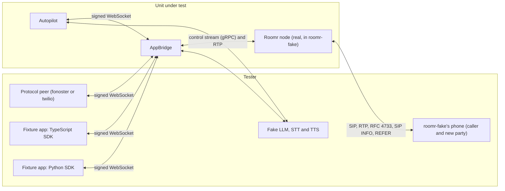

# Transfers and DTMF

What happens to the caller when an app moves, holds or keys a call. A cold transfer leaves the
caller with the new party and the call going on; a warm one holds the caller while the agent
briefs the new party, then connects them; a REFER hands the call off and the node lets it go; a
transfer that fails or is refused gives the caller back to the app. Hold silences the call both ways
until resume, and keys travel both ways at any time. Every case runs the real AppBridge and a real
Roomr node, and reads the result from the caller's phone, through each way an app reaches these
controls: the fonoster protocol, the Twilio flavor (which has keys and nothing else), the two SDKs
and Autopilot's tools.

The AppBridge area proves the same controls at the protocol level (APB-013: the messages, the
header rules, the node's commands); this area proves them end to end. What an SDK sends for each
method, against a scripted AppBridge, is in the Voice SDK area (VSD).

## Running

```sh
docker run -d --name xfr-nats -p 4222:4222 nats:2.11.8 -js
export CONFORMANCE_NATS_URL=nats://127.0.0.1:4222
python -m pip install -e python/fonoster-voice     # for XFR-013 and XFR-014 ($PYTHON)
LOGS_LEVEL=none npx mocha --exit --timeout 60000 \
  mods/appbridge/test/transfers.integration.test.ts \
  mods/autopilot/test/session/transfers.integration.test.ts
node mods/conformance/catalog/prove.cjs --area XFR     # the proofs, one run per case
```

## Systems



## What the fake can't show

roomr-fake's API addresses a call by its call_ref, and a transfer's dial carries none, so the new
party's leg can't be read or scripted on its own: the cases check the INVITE's headers on the
node's Transfer command (not on the INVITE the new party got), can't hear what the new party heard
or make it speak, and script its answer for every dial of the node at once (`FakeSessionNode`
`dialOutcome`, `answerAfterMs`, `callee`). The phone accepts a REFER, but the fake doesn't report
its Refer-To. The phone always negotiates telephone-event, so the node (rightly) never runs in-band
detection and in-band keys can't be proven here. Hold music must be a public URL, which the pr
tier doesn't reach, so hold is proven with silence.

## Cases

### XFR-001 A cold transfer leaves the caller with the new party

- **Spec:** voice-session / Call control / Cold transfer stays in the room
- **Spec:** voice-session / Call control / Transfer headers
- **Priority:** P0
- **Proof:** Hang the call up when a session ends by transfer (`endWith` in `mods/appbridge/src/session/Call.ts`); the test must go red on the caller's call still up.
- **Fault:** faults/XFR-001.patch
- **Test:** mods/appbridge/test/transfers.integration.test.ts

The new party answers after 1.2 s; the app's session stays open until then.

**Pass.** The node's Transfer is cold, to the target, with the app's header and the call's own number and workspace; the session ends with reason transfer once the new party answers; the caller's call goes on in the same room, off hold, with no hang-up sent; the call record keeps the call until the caller hangs up after the transfer. **Fail.** A dropped caller, a session that ends before the answer, or a record that stops at the transfer.

### XFR-002 A warm transfer holds the caller through the briefing, then connects them

- **Spec:** voice-session / Call control / Warm transfer
- **Priority:** P0
- **Proof:** Never send TransferComplete to the node on transfer.complete (`Call.ts`); the test must go red on the caller left on hold.
- **Fault:** faults/XFR-002.patch
- **Test:** mods/appbridge/test/transfers.integration.test.ts

**Pass.** The phone's call is held as soon as the warm transfer starts; the held caller hears none of the agent's briefing; the session stays open until transfer.complete, then ends with reason transfer; the caller comes off hold and the call goes on. **Fail.** A caller who hears the briefing, a caller left on hold, or a session that ends early.

### XFR-003 A warm transfer nobody answers fails after 30 seconds

- **Spec:** voice-session / Call control / Warm transfer not answered
- **Priority:** P1
- **Proof:** Ignore a failed warm transfer (`transferResult` in `Call.ts`); the test must go red on the missing transfer_failed.
- **Fault:** faults/XFR-003.patch
- **Test:** mods/appbridge/test/transfers.integration.test.ts

The new party rings and never answers (callee mode no_answer), so the case takes about 32 seconds.

**Pass.** After 29 to 36 seconds the app receives `error` `transfer_failed` relating to the transfer; the caller comes off hold, hears the app again, and the session goes on. **Fail.** No error, a caller left on hold, or a session that ends.

### XFR-004 A failed transfer gives the caller back to the app

- **Spec:** voice-session / Call control / Failed transfer
- **Priority:** P0
- **Proof:** End the session as transferred when a transfer fails (`transferResult` in `Call.ts`); the test must go red on session.end.
- **Fault:** faults/XFR-004.patch
- **Test:** mods/appbridge/test/transfers.integration.test.ts

Run with the new party busy (486) and declining (603).

**Pass.** The app receives `error` `transfer_failed` relating to the transfer; the session goes on; the caller's call is up, off hold, and hears the app. **Fail.** A dropped call, a session that ends, or a silent failure.

### XFR-005 A transfer by SIP REFER hands the call off

- **Spec:** voice-session / Call control / Transfer by SIP REFER
- **Priority:** P1
- **Proof:** Send a REFER transfer to the node as a cold one (`Call.ts`); the test must go red on the node's Transfer mode and a call the node keeps.
- **Fault:** faults/XFR-005.patch
- **Test:** mods/appbridge/test/transfers.integration.test.ts

**Pass.** The node's Transfer is a refer; the phone accepts the REFER; the session ends with reason transfer; the node no longer carries the call (ended, removed) and no hang-up was sent; the call record notes the transfer and ends the call as transferred. **Fail.** A call the node keeps, or an ending recorded as a hang-up.

### XFR-006 A refused transfer leaves the caller with the app

- **Spec:** voice-session / Call control / Transfer with a reserved header
- **Priority:** P0
- **Proof:** Skip the header rules for a transfer (`Call.ts`); the test must go red on a transfer the node receives.
- **Fault:** faults/XFR-006.patch
- **Test:** mods/appbridge/test/transfers.integration.test.ts

Run with a reserved header (`X-Dod-Number`) and with a target that has URI parameters.

**Pass.** The app receives `error` `bad_message` relating to the transfer; the node receives no Transfer; the caller's call is up, off hold, and hears the app. **Fail.** Anything reaches the node, or the caller loses the app.

### XFR-007 Hold silences the call both ways until resume

- **Spec:** voice-session / Call control / Hold and resume
- **Spec:** voice-session / Call control / Speaking while on hold
- **Priority:** P0
- **Proof:** Never send Resume to the node (`Call.ts`); the test must go red on the caller left on hold.
- **Fault:** faults/XFR-007.patch
- **Test:** mods/appbridge/test/transfers.integration.test.ts

**Pass.** The phone's call is held; while held the caller talks and the app gets no audio frame and no turn event, the caller's key still arrives, a speak is refused with `on_hold`, and the caller hears nothing; after resume the call is off hold, the caller hears the app and the app hears the caller. **Fail.** Audio either way while held, a lost key, or a caller left on hold.

### XFR-008 Keys travel both ways at any time

- **Spec:** voice-session / Call control / Keypress while the agent speaks
- **Priority:** P0
- **Proof:** Drop the last digit of dtmf.send (`Call.ts`); the test must go red on the phone receiving 12 instead of 12#.
- **Fault:** faults/XFR-008.patch
- **Test:** mods/appbridge/test/transfers.integration.test.ts

The phone presses keys as RFC 4733 events and as SIP INFO, one at a time. The app's keys (`dtmf.send`) have no scenario of their own in the spec; they are proven here.

**Pass.** A key pressed while the agent speaks reaches the app within a second, before the speech ends; every key arrives once, in order, whichever way it was sent; the app's `dtmf.send` `12#` reaches the phone as RFC 4733 events, in order. **Fail.** A lost, doubled or late key, or app keys the phone never got.

### XFR-009 The caller's keys reach a Twilio stream

- **Spec:** twilio-media-streams-flavor / Caller DTMF / Keypress
- **Priority:** P0
- **Proof:** Send keys on the outbound track (`mods/appbridge/src/protocols/twilio.ts`); the test must go red on the dtmf events.
- **Fault:** faults/XFR-009.patch
- **Test:** mods/appbridge/test/transfers.integration.test.ts

**Pass.** Keys the phone sends as RFC 4733 and SIP INFO arrive as `dtmf` events with `track: inbound_track`, the digit and the stream's `streamSid`, in order. **Fail.** A lost key or a wrong track.

### XFR-010 A Twilio stream can't transfer, hold or send keys

- **Spec:** twilio-media-streams-flavor / Twilio protocol scope / Unknown event from a Twilio-protocol stream
- **Priority:** P1
- **Proof:** Let a Twilio stream hold the caller (`twilio.ts` and `Call.ts`); the test must go red on the node's Hold.
- **Fault:** faults/XFR-010.patch
- **Test:** mods/appbridge/test/transfers.integration.test.ts

**Pass.** Transfer, hold and key messages from a Twilio stream, in Twilio's shape and in Fonoster's, are ignored: the node receives no Transfer, Hold or SendDtmf, the phone is not held and gets no keys, the stream is not stopped, and the caller's keys still arrive. **Fail.** Any call control from a Twilio stream reaches the node.

### XFR-011 TypeScript SDK: transfer() and completeTransfer() move the caller

- **Spec:** voice-sdk / Call control methods map one to one / Transfer
- **Spec:** voice-sdk / Call control methods map one to one / Warm transfer
- **Priority:** P0
- **Proof:** Complete the warm transfer with another id (`completeTransfer` in `mods/voice/src/Session.ts`; the prove script rebuilds the SDK); the test must go red on the caller left on hold.
- **Fault:** faults/XFR-011.patch
- **Test:** mods/appbridge/test/transfers.integration.test.ts

**Pass.** `transfer(to, { headers })` reaches the node as a cold Transfer with the header and resolves once the session ends with reason transfer, while the caller's call goes on; `transfer(to, { mode: "warm" })` holds the caller through a `say`, and `completeTransfer()` connects them and resolves the transfer. **Fail.** A promise that never resolves, or a caller left on hold.

### XFR-012 TypeScript SDK: keys, playDtmf, hold and resume reach the phone

- **Spec:** voice-sdk / Events are exposed as subscriptions / Listening for keypresses at any time
- **Spec:** voice-session / Call control / Hold and resume
- **Priority:** P1
- **Proof:** Drop the last digit of `playDtmf` (`mods/voice/src/Session.ts`); the test must go red on the phone receiving 12.
- **Fault:** faults/XFR-012.patch
- **Test:** mods/appbridge/test/transfers.integration.test.ts

**Pass.** The handler's `dtmf` listener gets the phone's keys in order; `playDtmf("12#")` reaches the phone; `hold()` holds the phone's call and `resume()` brings it back, after which the caller hears `say`. **Fail.** A lost key, keys the phone never got, or a call left on hold.

### XFR-013 Python SDK: transfer() and complete_transfer() move the caller

- **Spec:** voice-sdk / Call control methods map one to one / Transfer
- **Spec:** voice-sdk / Call control methods map one to one / Warm transfer
- **Priority:** P0
- **Proof:** Complete the warm transfer with another id (`complete_transfer` in `python/fonoster-voice/src/fonoster/voice/session.py`); the test must go red on the caller left on hold.
- **Fault:** faults/XFR-013.patch
- **Test:** mods/appbridge/test/transfers.integration.test.ts (the app is mods/appbridge/test/xfr/app.py)

**Pass.** As XFR-011, with the Python SDK. **Fail.** As XFR-011.

### XFR-014 Python SDK: keys, play_dtmf, hold and resume reach the phone

- **Spec:** voice-sdk / Events are exposed as subscriptions / Listening for keypresses at any time
- **Spec:** voice-session / Call control / Hold and resume
- **Priority:** P1
- **Proof:** Drop the last digit of `play_dtmf` (`session.py`); the test must go red on the phone receiving 12.
- **Fault:** faults/XFR-014.patch
- **Test:** mods/appbridge/test/transfers.integration.test.ts (the app is mods/appbridge/test/xfr/app.py)

**Pass.** As XFR-012, with the Python SDK. **Fail.** As XFR-012.

### XFR-015 Autopilot's transfer tool leaves the caller with the operator

- **Spec:** autopilot / Built-in hangup and transfer / Transfer tool
- **Spec:** voice-session / Call control / Cold transfer stays in the room
- **Priority:** P0
- **Proof:** Transfer without waiting for the transfer message to play (`transfer` in `mods/autopilot/src/session/Agent.ts`); the test must go red on what the caller heard.
- **Fault:** faults/XFR-015.patch
- **Test:** mods/autopilot/test/session/transfers.integration.test.ts

The fake LLM calls `transfer` after the caller's first turn.

**Pass.** The caller hears the whole transfer message before the node is sent the Transfer, to the agent's number with the call's own number and workspace; the operator answers, Autopilot's session ends with reason transfer, and the caller's call goes on with no hang-up sent. **Fail.** A message cut off, a transfer to another number, or a dropped caller.

### XFR-016 Autopilot's hangup tool says goodbye, then hangs up

- **Spec:** autopilot / Built-in hangup and transfer / Hangup tool
- **Priority:** P0
- **Proof:** Hang up without waiting for the goodbye to play (`goodbye` in `Agent.ts`); the test must go red on what the caller heard.
- **Fault:** faults/XFR-016.patch
- **Test:** mods/autopilot/test/session/transfers.integration.test.ts

**Pass.** The caller hears the whole goodbye; the node is sent the hang-up after it finished playing and removes the call; the phone's leg ends and the session ends with reason app_hangup. **Fail.** A goodbye cut off, or a call left up.
