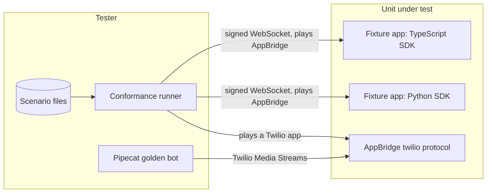

# Voice SDK and the Twilio flavor

What an app developer builds on. The voice-sdk scenario files describe what an app written with an
SDK does on the wire (say, gather, transfer, marks, keypresses); the runner plays AppBridge and checks
every message. The same files run against the TypeScript and the Python SDK, so a case passes only
when both do. The Twilio flavor files go the other way: the runner plays a Twilio Media Streams app
and checks AppBridge's twilio protocol, and the Pipecat case proves an unmodified Pipecat bot works.

Connection checks, mounting, the handler's shape and session end are proven by the SDK server
suites, which open real sockets against each SDK. AppBridge's own side of the session
(voice-session) belongs to the AppBridge area.

## Systems

## Cases

### VSD-001 Connections are verified before the handler runs

- **Spec:** voice-sdk / Connections are verified before the handler runs / Valid signature
- **Spec:** voice-sdk / Connections are verified before the handler runs / Invalid or stale signature
- **Spec:** voice-sdk / Connections are verified before the handler runs / Signature for another app
- **Spec:** voice-sdk / Connections are verified before the handler runs / Host header not trusted when a public URL is set
- **Spec:** voice-sdk / Connections are verified before the handler runs / Local development
- **Priority:** P0
- **Proof:** Skip signature verification (`VoiceServer` in `mods/voice/src/VoiceServer.ts`); the tests must go red on the refused connections reaching the handler.
- **Test:** mods/voice/test/VoiceServer.test.ts, mods/voice/test/appBinding.test.ts, python/fonoster-voice/tests/test_server.py

**Pass.** A signed connection runs the handler once; a wrong secret, no signature and a stale timestamp are refused with 401 before the handler runs; a signature for another app, changed app or workspace headers, and a URL built from the Host header are refused; unsigned connections are accepted only with verification off. Both SDKs. **Fail.** The handler runs for any connection that isn't signed for this app.

### VSD-002 VoiceServer runs standalone or mounted into an app

- **Spec:** voice-sdk / VoiceServer accepts AppBridge sessions over WebSocket / A call reaches a standalone server
- **Spec:** voice-sdk / VoiceServer accepts AppBridge sessions over WebSocket / Mounted into an existing application
- **Priority:** P1
- **Proof:** Leave the caller's number out of the session (`Session` in `mods/voice/src/Session.ts`); the test must go red on session-info.
- **Test:** mods/voice/test/VoiceServer.test.ts, python/fonoster-voice/tests/test_server.py, mods/voice/test/conformance.test.ts
- **Runs:** scenarios/voice-sdk/session-info.yaml

**Pass.** A standalone server takes a call and the handler sees the call's ref, parties, direction and app; a server mounted on a path of an existing HTTP (TypeScript) or ASGI (Python) app verifies and runs the handler. **Fail.** A session without its facts, or a mounted server that answers on the wrong path or skips verification.

### VSD-003 A session is one async handler, and old shapes are refused

- **Spec:** voice-sdk / Session handler signature / A session handler
- **Spec:** voice-sdk / Session handler signature / A gRPC-era handler in Python
- **Spec:** voice-sdk / The Python SDK is asyncio only / Async handler
- **Spec:** voice-sdk / The Python SDK is asyncio only / Sync handler rejected
- **Spec:** voice-sdk / Removed methods do not exist / An app looks for record
- **Spec:** voice-sdk / answer is a no-op / Old apps that answer first
- **Priority:** P1
- **Proof:** Let a synchronous handler through (`python/fonoster-voice/src/fonoster/voice/server.py`); the test must go red on the sync handler.
- **Test:** python/fonoster-voice/tests/test_server.py, mods/voice/test/VoiceServer.test.ts, mods/voice/test/conformance.test.ts
- **Runs:** scenarios/voice-sdk/answer-is-a-no-op.yaml

**Pass.** One handler takes the session; Python refuses a synchronous handler and a two-argument gRPC-era one; `record` and the other removed methods aren't on the session; `answer()` sends nothing; the answering machine result reaches the handler. **Fail.** An old shape accepted, a removed method present, or `answer()` on the wire.

### VSD-004 say speaks and reports what was heard

- **Spec:** voice-sdk / say speaks text and reports what was heard / Fully heard
- **Spec:** voice-sdk / say speaks text and reports what was heard / Interrupted
- **Spec:** voice-sdk / say speaks text and reports what was heard / Voice override
- **Priority:** P0
- **Proof:** Report an interrupted say as fully heard (`output.interrupted` in `mods/voice/src/Session.ts`); the test must go red on say-reports-interruption.
- **Test:** mods/voice/test/conformance.test.ts, python/fonoster-voice/tests/test_conformance.py
- **Runs:** scenarios/voice-sdk/say-hello.yaml
- **Runs:** scenarios/voice-sdk/say-reports-interruption.yaml
- **Runs:** scenarios/voice-sdk/say-voice-override.yaml

**Pass.** Each SDK sends one `speak`, resolves when it is done, reports an interruption with the text heard, and passes a voice override through. **Fail.** A missing or extra message, or a wrong heard text.

### VSD-005 Barge-in: the SDK clears what can be interrupted

- **Spec:** voice-sdk / say speaks text and reports what was heard / SDK clears on barge-in
- **Spec:** voice-sdk / say speaks text and reports what was heard / Non-interruptible say is kept
- **Priority:** P0
- **Proof:** Never send `clear` when the caller starts talking (`bargeIn` in `mods/voice/src/Session.ts`); the test must go red on sdk-clears-on-barge-in.
- **Test:** mods/voice/test/conformance.test.ts, python/fonoster-voice/tests/test_conformance.py
- **Runs:** scenarios/voice-sdk/sdk-clears-on-barge-in.yaml
- **Runs:** scenarios/voice-sdk/sdk-keeps-non-interruptible.yaml

**Pass.** When the caller starts talking over interruptible speech the SDK sends `clear`; speech marked non-interruptible is kept. **Fail.** No `clear`, or a `clear` over non-interruptible speech.

### VSD-006 say streams text as it is produced, and stopSay cuts it

- **Spec:** voice-sdk / say streams text as it is produced / Streaming LLM tokens
- **Spec:** voice-sdk / stopSay clears queued output / Cutting the agent off
- **Priority:** P1
- **Proof:** Drop the streamed chunks (`say` in `mods/voice/src/Session.ts`); the test must go red on say-stream.
- **Test:** mods/voice/test/conformance.test.ts, python/fonoster-voice/tests/test_conformance.py
- **Runs:** scenarios/voice-sdk/say-stream.yaml
- **Runs:** scenarios/voice-sdk/stop-say.yaml

**Pass.** Tokens go out as `speak` chunks as they arrive with `last` on the final one; `stopSay` sends `clear`. **Fail.** Speech waits for the whole stream, or queued speech survives `stopSay`.

### VSD-007 Failures end say and gather instead of hanging

- **Spec:** voice-sdk / Errors and session end never leave promises hanging / Provider failure during say
- **Spec:** voice-sdk / Errors and session end never leave promises hanging / Caller hangs up mid-gather
- **Spec:** voice-sdk / say streams text as it is produced / The stream fails midway
- **Priority:** P0
- **Proof:** Ignore `error` events (`mods/voice/src/Session.ts`); the test must go red on say-provider-error.
- **Test:** mods/voice/test/conformance.test.ts, python/fonoster-voice/tests/test_conformance.py, mods/voice/test/VoiceServer.test.ts, python/fonoster-voice/tests/test_server.py
- **Runs:** scenarios/voice-sdk/say-provider-error.yaml
- **Runs:** scenarios/voice-sdk/say-stream-fails.yaml

**Pass.** A provider error rejects the pending say with a session error; a token stream that throws ends the speech; a hang-up rejects a pending gather and fires end; a handler that throws hangs up. Both SDKs. **Fail.** A promise left pending, or a call left up.

### VSD-008 gather speech

- **Spec:** voice-sdk / gather is built from events / Speech
- **Spec:** voice-sdk / gather is built from events / Timeout
- **Spec:** voice-sdk / TypeScript and Python parity / A shared scenario
- **Priority:** P0
- **Proof:** Lose the caller's transcript when gather ends (`feedGather` in `mods/voice/src/Session.ts`); the test must go red on gather-speech.
- **Test:** mods/voice/test/conformance.test.ts, python/fonoster-voice/tests/test_conformance.py
- **Runs:** scenarios/voice-sdk/gather-speech.yaml
- **Runs:** scenarios/voice-sdk/gather-timeout.yaml
- **Runs:** scenarios/voice-sdk/say-then-gather.yaml

**Pass.** gather resolves with the caller's final transcript, resolves empty on timeout, and say then gather behaves the same in both SDKs. **Fail.** A partial taken as the answer, a gather that never ends, or the SDKs disagreeing.

### VSD-009 gather digits and keypresses at any time

- **Spec:** voice-sdk / gather is built from events / Digits with a finish key
- **Spec:** voice-sdk / gather is built from events / Digits up to the maximum
- **Spec:** voice-sdk / gather is built from events / First input wins
- **Spec:** voice-sdk / Events are exposed as subscriptions / Listening for keypresses at any time
- **Priority:** P0
- **Proof:** Ignore the finish key (`feedGather` in `mods/voice/src/Session.ts`); the tests must go red on gather-dtmf.
- **Test:** mods/voice/test/conformance.test.ts, python/fonoster-voice/tests/test_conformance.py
- **Runs:** scenarios/voice-sdk/gather-dtmf.yaml
- **Runs:** scenarios/voice-sdk/gather-max-digits.yaml
- **Runs:** scenarios/voice-sdk/gather-first-input-wins.yaml
- **Runs:** scenarios/voice-sdk/dtmf-any-time.yaml

**Pass.** Digits end on the finish key or at the maximum, the first of speech or digits wins, and a keypress listener hears digits pressed at any time. **Fail.** Digits lost, the finish key kept in the answer, or a listener that misses early digits.

### VSD-010 Partial transcripts on request

- **Spec:** voice-sdk / Events are exposed as subscriptions / Opting into partial transcripts
- **Priority:** P2
- **Proof:** Never send `subscribe` (`mods/voice/src/Session.ts`); the test must go red on partial-transcripts.
- **Test:** mods/voice/test/conformance.test.ts, python/fonoster-voice/tests/test_conformance.py
- **Runs:** scenarios/voice-sdk/partial-transcripts.yaml

**Pass.** An app that opts in sends `subscribe` for partials and receives them. **Fail.** No subscription, or partials delivered without opting in.

### VSD-011 Raw audio with marks

- **Spec:** voice-sdk / Raw audio access / Bring-your-own TTS
- **Spec:** voice-sdk / Raw audio access / Mark dropped by clear
- **Priority:** P1
- **Proof:** Resolve every mark as heard, even one a clear dropped (`mods/voice/src/Session.ts`); the test must go red on audio-mark-cleared.
- **Test:** mods/voice/test/conformance.test.ts, python/fonoster-voice/tests/test_conformance.py
- **Runs:** scenarios/voice-sdk/audio-mark-heard.yaml
- **Runs:** scenarios/voice-sdk/audio-mark-cleared.yaml

**Pass.** Audio sent with a mark resolves when the mark comes back, and reports it dropped when a clear removed it. **Fail.** A mark that never resolves or resolves as heard after a clear.

### VSD-012 Call control and notes map one to one

- **Spec:** voice-sdk / Call control methods map one to one / Transfer
- **Spec:** voice-sdk / Call control methods map one to one / Warm transfer
- **Spec:** voice-sdk / Call control methods map one to one / Handoff
- **Priority:** P1
- **Proof:** Send a warm transfer without its mode (`transfer` in `mods/voice/src/Session.ts`); the test must go red on transfer-warm.
- **Test:** mods/voice/test/conformance.test.ts, python/fonoster-voice/tests/test_conformance.py
- **Runs:** scenarios/voice-sdk/transfer-cold.yaml
- **Runs:** scenarios/voice-sdk/transfer-warm.yaml
- **Runs:** scenarios/voice-sdk/handoff.yaml
- **Runs:** scenarios/voice-sdk/record-note.yaml

**Pass.** Each method sends its one command with its fields (cold and warm transfer, handoff with its payload, a note for the call record) and resolves on the outcome. **Fail.** A wrong or extra command.

### VSD-013 Twilio streams open, carry audio both ways and end

- **Spec:** twilio-media-streams-flavor / Twilio Media Streams messages / Stream opening
- **Spec:** twilio-media-streams-flavor / Twilio Media Streams messages / Ids map to the session
- **Spec:** twilio-media-streams-flavor / Twilio Media Streams messages / Stream end
- **Spec:** twilio-media-streams-flavor / μ-law 8 kHz audio in base64 / Caller audio
- **Spec:** twilio-media-streams-flavor / μ-law 8 kHz audio in base64 / Agent audio
- **Priority:** P0
- **Proof:** Send the `start` event without its top-level `streamSid` (`mods/appbridge/src/protocols/twilio.ts`); the tests must go red on stream-opening.
- **Test:** mods/appbridge/test/conformance.test.ts
- **Runs:** scenarios/twilio-media-streams-flavor/stream-opening.yaml
- **Runs:** scenarios/twilio-media-streams-flavor/ids-map-to-session.yaml
- **Runs:** scenarios/twilio-media-streams-flavor/stream-end.yaml
- **Runs:** scenarios/twilio-media-streams-flavor/caller-audio.yaml
- **Runs:** scenarios/twilio-media-streams-flavor/agent-audio.yaml

**Pass.** AppBridge sends `connected` and `start` with Twilio's fields, maps the ids to the session, carries μ-law 8 kHz audio both ways in base64, and sends `stop` at the end. **Fail.** A field Twilio apps rely on is missing or audio is in the wrong format.

### VSD-014 Twilio marks, clear and keypresses

- **Spec:** twilio-media-streams-flavor / Clear and mark follow Twilio semantics / Barge-in
- **Spec:** twilio-media-streams-flavor / Clear and mark follow Twilio semantics / Mark reached
- **Spec:** twilio-media-streams-flavor / Caller DTMF / Keypress
- **Spec:** twilio-media-streams-flavor / Twilio protocol scope / Unknown event from a Twilio-protocol stream
- **Priority:** P1
- **Proof:** Drop mark events on the way to the app (`mods/appbridge/src/protocols/twilio.ts`); the tests must go red on mark-reached and barge-in-echoes-marks.
- **Test:** mods/appbridge/test/conformance.test.ts
- **Runs:** scenarios/twilio-media-streams-flavor/barge-in-echoes-marks.yaml
- **Runs:** scenarios/twilio-media-streams-flavor/mark-reached.yaml
- **Runs:** scenarios/twilio-media-streams-flavor/keypress.yaml
- **Runs:** scenarios/twilio-media-streams-flavor/unknown-event-ignored.yaml

**Pass.** A mark comes back when its audio has played; `clear` echoes the pending marks as Twilio does; a keypress arrives as a `dtmf` event; an unknown event is ignored without closing the stream. **Fail.** A mark lost or early, or the stream closed on an unknown event.

### VSD-015 Twilio streams hang up by socket or by the Calls endpoint

- **Spec:** twilio-media-streams-flavor / Hanging up from a Twilio-protocol stream / Socket closed
- **Spec:** twilio-media-streams-flavor / Hanging up from a Twilio-protocol stream / Call already ended
- **Priority:** P1
- **Proof:** Hang up calls that no replica owns (`createHangupHandler` in `mods/appbridge/src/http/hangupEndpoint.ts`); the tests must go red on 404 / 20404.
- **Test:** mods/appbridge/test/conformance.test.ts, mods/appbridge/test/hangupEndpoint.test.ts
- **Runs:** scenarios/twilio-media-streams-flavor/socket-closed.yaml

**Pass.** Closing the socket hangs the call up; the Calls endpoint hangs up a live call of the key's workspace with 200, answers 404 with code 20404 once it has ended, refuses another workspace's call, and checks Basic authentication. **Fail.** A call left up, or a call of another workspace hung up.

### VSD-016 An unmodified Pipecat bot works

- **Spec:** twilio-media-streams-flavor / Unmodified Pipecat compatibility / Pipecat golden call
- **Spec:** twilio-media-streams-flavor / Hanging up from a Twilio-protocol stream / Pipecat auto_hang_up with base_url
- **Priority:** P0
- **Tier:** nightly
- **Proof:** Send the hang-up to a subject no AppBridge serves (`createHangupHandler` in `mods/appbridge/src/http/hangupEndpoint.ts`); the test must go red on a call that ends as dropped instead of hung up through base_url.
- **Test:** mods/appbridge/test/pipecat.test.ts (needs NATS and a Python with pipecat-ai: CONFORMANCE_NATS_URL, PIPECAT_PYTHON)

The bot is `python/pipecat-golden/golden_bot.py`: TwilioFrameSerializer and FastAPIWebsocketTransport, nothing Fonoster-specific.

**Pass.** The bot hears the caller, is heard, barges in with clear, reads DTMF and hangs up through `base_url`; closing its socket hangs up too. **Fail.** Any step needs a change to the bot.
